# Database Schema — war-point

- **อัปเดตล่าสุด:** 2026-11-17 — ทัวนาเมนต์แพ้คัดออก + กติกาครูประกาศผลทีละรอบ (spec 08 หัวข้อ ซ./ฌ., AC-FE-31-3~19, AC-FE-43-1~2): เพิ่ม ENT-28 TOURNAMENT, ENT-29 TOURNAMENT_MATCH, ENT-30 TOURNAMENT_MATCH_RESULT (ผลลับ), ENT-31 TOURNAMENT_BATTLE_LOG + เส้นใน ER Diagram + enum + หัวข้อใหม่ 3.1 "การเก็บจริงบน Firestore (ทัวนาเมนต์)" (path, rules, ลำดับเขียนตอนประกาศ, doc เก่า) + Gap G-DB-13~19 — ไม่แตะ ENT-01~27 (รวม ENT-19~23 การแข่งรายสัปดาห์) · ENT-28~31 ใช้ hard delete ตาม spec 08 ซ. (ข้อยกเว้นจาก soft delete)
- **อัปเดตก่อนหน้า (2):** 2026-11-11 — กฎ B5 (คะแนนงานตรวจมือทศนิยม 1 ตำแหน่ง / ยอดสะสมมีเศษ / ยอดใช้ได้เป็นส่วนจำนวนเต็ม): แก้ชนิดข้อมูล ENT-08/09/10/11 และ CHECK ที่เกี่ยวข้อง ไม่เพิ่ม/ลบ ENT, ไม่แก้ ER Diagram — ปิด Gap B5 ฝั่ง database-schema แล้ว (ดู G-DB-12)
- **อัปเดตก่อนหน้า (3):** 2026-08-25 — เพิ่ม ENT-27 (PET_CARE_STATE) สำหรับ FE-82/FE-83 (CMP-21 Pet Care and Bonding Module) ไม่มี ENT เดิมถูกแก้ไข
- **ชนิดฐานข้อมูล:** Relational — สืบทอดจาก [[architecture#3-ตาราง-component|architecture.md CMP-16]] เหตุผลหลักคือต้องมี atomic transaction กันการหักแต้มซ้ำ/แต้มติดลบตอนซื้อไข่ ปลดล็อกขั้น และซื้อไอเทม ซึ่งเป็นจุดที่นักเรียนอาจกดพร้อมกันจากหลายอุปกรณ์ (ดู DF-01 ของ architecture.md)
- **ระดับความละเอียด:** Conceptual + Logical (ยังไม่ผูกกับเทคโนโลยี — ชนิดข้อมูลใช้ชื่อกลาง เช่น "ข้อความสั้น", "จำนวนเต็ม"; Physical จะระบุเมื่อผู้ใช้เลือก stack แล้ว)
- **นโยบายลบข้อมูล:** **soft delete เป็นค่าเริ่มต้นของทุกตาราง** — ทุกตารางมีคอลัมน์ `is_active` (บูลีน) และ `disabled_at` (วันที่-เวลา, null ได้) แทนการลบแถวจริง ยกเว้นระบุไว้เป็นอย่างอื่นชัดเจนในตารางนั้น (ไม่มีข้อยกเว้นในเอกสารนี้ — ทุก ENT ใช้ pattern เดียวกัน) **[หมายเหตุ 2026-11-17]** ข้อยกเว้นจริงมี 2 กลุ่ม: ENT-27 (ระบุเหตุผลที่ตัวมันเอง) และ ENT-28~31 ของทัวนาเมนต์ ที่ **ลบถาวร (hard delete)** เพราะ spec 08 ซ. กำหนดว่าครูลบทัวนาเมนต์แล้ว "ผลและรีเพลย์หายถาวร" — ไม่มี `is_active`/`disabled_at` ในกลุ่มนี้
- **ที่มา:** [[architecture|architecture]], [[../../01-requirements/feature-list|feature-list]], [[../../03-testing/01-test-plan/acceptance-criteria|acceptance-criteria]]
- **ส่งต่อไป:** [[api-spec|api-spec]], [[detailed-design|detailed-design]]

---

## 0. หลักการออกแบบที่ยึดตลอดเอกสาร

1. **Soft delete ทุกตาราง** — `is_active` (บูลีน, ค่าเริ่มต้น `true`) + `disabled_at` (วันที่-เวลา, null ได้) ทุกตาราง แถวที่ `is_active = false` ยังคงอยู่ในฐานข้อมูลเสมอ ไม่มีการ `DELETE` จริงในระบบนี้
2. **FE-56 (ปิดใช้งานนักเรียนที่ย้ายออก):** ใช้ pattern เดียวกับข้อ 1 บน `STUDENT` โดยตรง ไม่ต้องมี field พิเศษเพิ่ม
3. **FE-72/FE-73 (บันทึกเส้นทางการเติบโตต้องไม่ถูกลบเมื่อรีเซ็ต):** ใช้ pattern เดียวกับข้อ 1 บน `PET` — เมื่อนักเรียนรีเซ็ต/เปลี่ยนสายพันธุ์ (API-38) แถว `PET` ตัวเก่าจะถูกตั้ง `is_active = false, disabled_at = now()` (ไม่ลบ) เท่านั้น **การรีเซ็ตไม่ insert แถว `PET` ใหม่ในจังหวะเดียวกัน** — นักเรียนต้องเรียกซื้อไข่แยกต่างหากอีกครั้ง (API-36) เพื่อสร้างแถว `PET` ใหม่ เลือกสายพันธุ์ใหม่ และจ่าย 1 แต้ม "อัลบั้มบันทึกเส้นทางการเติบโต" ที่ FE-72 ต้องแสดง คือ query `PET` ทั้งหมด (ทั้ง active และ inactive) ของนักเรียนคนนั้น เรียงตาม `created_at` — **ไม่ต้องมี entity แยกสำหรับบันทึกเส้นทางการเติบโต** เพราะ soft-delete history ของ `PET` ทำหน้าที่นี้ได้ครบถ้วนอยู่แล้ว และตอบโจทย์ AC-FE-73-2 ("จำนวนรายการในอัลบั้มไม่ลดลงไม่ว่าจะรีเซ็ตกี่ครั้ง") โดยตรง
4. **FE-74 (สัตว์เลี้ยงที่ใช้งานอยู่ได้เพียงตัวเดียว):** บังคับด้วย unique index แบบ partial บน `PET(student_id)` โดยกรองเฉพาะแถวที่ `is_active = true`
5. **ไม่เก็บชื่อ-นามสกุลจริงของนักเรียนที่ใดในฐานข้อมูล** ตาม FE-07 — ไม่มี field `full_name` หรือเทียบเท่าอยู่ใน schema นี้เลยแม้แต่ตารางเดียว (ไม่ใช่แค่ไม่แสดง)
6. **ห้ามมีคอลัมน์แต้ม/ขั้นการเติบโต/ค่าสเตตัส/HP ปรากฏในตารางที่ query สำหรับหน้าจอฝั่งครูใช้โดยตรง** (`ARENA_MATCH`, `ARENA_MATCH_PARTICIPANT` ฯลฯ) — การซ่อนต้องเกิดที่ชั้น service/serializer ตอนสร้าง response ให้ CMP-02 (ดู [[api-spec|api-spec]] และ architecture.md ข้อ 7) ไม่ใช่ query คนละชุดแบบ ad-hoc
7. **ชนิดข้อมูลกลางที่ใช้ในเอกสารนี้:** `ข้อความสั้น` (≈ short text/label), `ข้อความยาว` (≈ long text/content), `จำนวนเต็ม`, `ทศนิยม`, `วันที่-เวลา`, `บูลีน`, `รหัสอ้างอิง` (Foreign Key ไปยัง ENT อื่น) — ไม่ใช้ VARCHAR(n)/BIGINT/ชื่อ storage engine ใดๆ

---

## 1. ER Diagram

```mermaid
erDiagram
    STUDENT ||--o| SESSION : "เปิด"
    TEACHER ||--o| SESSION : "เปิด"
    TEACHER ||--o{ LESSON : "สร้าง"
    TEACHER ||--o{ QUIZ_SET : "สร้าง"
    LESSON ||--o{ QUIZ_SET : "ผูกกับ (ไม่บังคับ)"
    QUIZ_SET ||--o{ QUIZ_QUESTION : "มี"
    QUIZ_QUESTION ||--o{ QUIZ_CHOICE : "มี"
    QUIZ_SET ||--o{ QUIZ_ATTEMPT : "ถูกทำใน"
    STUDENT ||--o{ QUIZ_ATTEMPT : "ทำ"
    QUIZ_SET ||--o{ STUDENT_QUIZ_RESULT : "สรุปผลดีที่สุดของ"
    STUDENT ||--o{ STUDENT_QUIZ_RESULT : "มีผลลัพธ์"
    STUDENT ||--|| POINTS_ACCOUNT : "มี"
    STUDENT ||--o{ POINTS_LEDGER_ENTRY : "มีประวัติแต้ม"
    STUDENT ||--o{ PET : "เคยเลี้ยง (ประวัติผ่าน soft delete)"
    SPECIES ||--o{ PET : "เป็นสายพันธุ์ของ"
    SPECIES ||--o{ SPECIES_STAT_SPLIT : "กำหนดสัดส่วนสเตตัสของ"
    SPECIES ||--o{ SPECIAL_POWER : "มีพลังพิเศษประจำสาย"
    PET ||--o{ PET_STAT : "มีค่าสเตตัสรายตัว"
    STUDENT ||--o{ STUDENT_ITEM_INVENTORY : "ถือครองไอเทม"
    SHOP_ITEM ||--o{ STUDENT_ITEM_INVENTORY : "ถูกซื้อเป็น"
    SHOP_ITEM ||--o{ MATCH_ITEM_USAGE : "ถูกใช้เป็น"
    ARENA_WEEK ||--o{ ARENA_MATCH : "มีคู่แข่งในสัปดาห์"
    ARENA_MATCH ||--o{ ARENA_MATCH_PARTICIPANT : "มีผู้เข้าแข่งขัน"
    STUDENT ||--o{ ARENA_MATCH_PARTICIPANT : "เข้าร่วมเป็น"
    ARENA_MATCH ||--o{ MATCH_ITEM_USAGE : "มีการใช้ไอเทมใน"
    STUDENT ||--o{ MATCH_ITEM_USAGE : "ใช้ไอเทมโดย"
    STUDENT ||--o| WINNER_STAT : "มีสถิติชนะสะสม"
    TEACHER ||--o{ SCORE_EXPORT_JOB : "สร้างงานส่งออก"
    SCORE_EXPORT_JOB ||--o{ SCORE_EXPORT_JOB_ITEM : "เลือกชุดข้อมูลส่งออก"
    SCORE_EXPORT_JOB ||--o{ SCORE_EXPORT_SKIPPED_ROW : "รายงานแถวที่ข้าม"
    QUIZ_SET ||--o{ SCORE_EXPORT_JOB_ITEM : "ถูกอ้างถึงใน"
    PET ||--|| PET_CARE_STATE : "มีสถานะการดูแลประจำวัน"
    TEACHER ||--o{ TOURNAMENT : "สร้างทัวนาเมนต์"
    TOURNAMENT ||--o{ TOURNAMENT_MATCH : "มีคู่แข่งในผัง"
    TOURNAMENT_MATCH ||--o| TOURNAMENT_MATCH_RESULT : "มีผลลับของคู่ (หลังต่อสู้)"
    TOURNAMENT_MATCH ||--o| TOURNAMENT_BATTLE_LOG : "มีบันทึกการต่อสู้ (หลังต่อสู้)"
    STUDENT ||--o{ TOURNAMENT_MATCH : "เป็นผู้เข้าแข่ง (สำเนา ณ ตอนสร้าง)"
```



> **หมายเหตุ:** ยืนยันด้วย mermaid.parse() จริงแล้ว (2026-08-25) — ER diagram ทั้งไฟล์รวมเส้น `PET ||--|| PET_CARE_STATE` ที่เพิ่งเพิ่ม parse ผ่านสำเร็จ (ผล PARSE_OK) ไม่ใช่แค่ตรวจด้วยสายตา
>
> **[2026-11-17] 5 เส้นท้ายสุด (TOURNAMENT*) ยืนยันด้วย mermaid.parse() จริงแล้ว** (mermaid 10.9.1 ในเบราว์เซอร์ — ER diagram ทั้งไฟล์ parse ผ่าน 1/1 บล็อก) · ~~ยังไม่ได้รัน mermaid.parse() — agent เขียนเอกสารไม่มีเครื่องมือรันโค้ด~~

---

## 2. สรุป Entity

| ID | Entity / ตาราง | เก็บอะไร | Feature ต้นทาง | ปริมาณข้อมูลที่คาด |
|---|---|---|---|---|
| ENT-01 | STUDENT | บัญชีนักเรียน (รหัส+PIN, ชื่อเล่น, สถานะใช้งาน) | FE-01, 06, 07, 47, 48, 52, 53, 54, 55, 56 | ~30 แถวต่อห้อง |
| ENT-02 | TEACHER | บัญชีครูที่ผูกกับ Google OAuth | FE-02, 03, 49 | 1–3 แถว (อาจมีครูร่วมสอน) |
| ENT-03 | SESSION | session token ของทั้งสองบทบาท (auth แบบ stateful) | FE-01, 03, 47, 48, 49 | ใช้งานพร้อมกันไม่เกินจำนวนผู้ใช้จริง (~30) |
| ENT-04 | LESSON | บทเรียนทุกช่องทาง (ลิงก์/ไฟล์/พิมพ์เอง/AI เสนอ) พร้อมสถานะอนุมัติ | FE-08, 09, 10, 11, 37, 39, 40 | หลักสิบแถวต่อเทอม |
| ENT-05 | QUIZ_SET | ชุดแบบทดสอบ/ใบงาน/งานแนบไฟล์ | FE-12, 13, 14, 15, 18, 19, 21, 38 | หลักสิบแถวต่อเทอม |
| ENT-06 | QUIZ_QUESTION | ข้อคำถามปรนัยของแต่ละชุด | FE-12, 15, 16 | ~5–10 แถวต่อชุดปรนัย |
| ENT-07 | QUIZ_CHOICE | ตัวเลือกคำตอบของแต่ละข้อ | FE-12, 15, 16 | ~4 แถวต่อข้อ |
| ENT-08 | QUIZ_ATTEMPT | การทำแบบทดสอบ/ส่งงานแต่ละรอบของนักเรียน | FE-16, 17, 18, 20, 41 | ~30 นักเรียน × หลายรอบ × หลักสิบชุด |
| ENT-09 | STUDENT_QUIZ_RESULT | คะแนนรอบที่ดีที่สุดต่อ (นักเรียน, ชุด) + แต้มที่จ่ายให้แล้ว | FE-21, 41 | ~30 นักเรียน × จำนวนชุด |
| ENT-10 | POINTS_ACCOUNT | ยอดแต้มสะสมรวม/แต้มที่ใช้ได้ปัจจุบันของนักเรียน (1:1) | FE-22, 23 | 1 แถวต่อนักเรียน |
| ENT-11 | POINTS_LEDGER_ENTRY | ประวัติการได้/หักแต้มทุกรายการ (audit log, immutable) | FE-21, 22, 23, 24, 26, 75, 78 | หลักร้อยแถวต่อเทอมต่อห้อง |
| ENT-12 | SPECIES | สายพันธุ์สัตว์เลี้ยง 3 สาย | FE-44, 75, 76, 77 | 3 แถว |
| ENT-13 | SPECIES_STAT_SPLIT | สัดส่วนแต้มสเตตัสต่อขั้นของแต่ละสายพันธุ์ | FE-77 | 3 สาย × จำนวนค่าสเตตัส (placeholder 3) = ~9 แถว |
| ENT-14 | SPECIAL_POWER | พลังพิเศษประจำสายพันธุ์ | FE-45 | หลักสิบแถว (ยังไม่ล็อกจำนวน) |
| ENT-15 | PET | สัตว์เลี้ยงของนักเรียน (แถว active = ตัวที่ใช้งานอยู่, แถว inactive = ประวัติ) | FE-24, 26, 44, 72, 73, 74, 75, 76 | ~30 นักเรียน × (1 active + N ประวัติจากการรีเซ็ต) |
| ENT-16 | PET_STAT | ค่าสเตตัสรายตัวของ PET แต่ละแถว | FE-77 | ~3 แถวต่อ PET (ตาม placeholder) |
| ENT-17 | SHOP_ITEM | รายการไอเทมช่วยในการต่อสู้ที่ขาย | FE-78, 80, 81 | หลักสิบแถว (ตัวอย่างล็อกแล้ว 2 รายการ) |
| ENT-18 | STUDENT_ITEM_INVENTORY | ไอเทมที่นักเรียนถือครองอยู่ | FE-78 | ~30 นักเรียน × จำนวนไอเทมที่ถือ |
| ENT-19 | ARENA_WEEK | รอบการแข่งขันรายสัปดาห์ + ค่าตั้งค่าจับคู่อัตโนมัติ | FE-27, 28, 29, 30 | ~14 แถวต่อเทอม (1 ต่อสัปดาห์) |
| ENT-20 | ARENA_MATCH | คู่แข่งขันแต่ละคู่ในแต่ละสัปดาห์ | FE-27, 28, 29, 30, 31, 42 | ~15 แถวต่อสัปดาห์ (30 คน/2) |
| ENT-21 | ARENA_MATCH_PARTICIPANT | ผลของแต่ละฝ่ายในแมตช์ (HP เริ่ม/จบ, แพ้-ชนะ) — ห้าม join เข้า query ฝั่งครู | FE-27, 32, 79 | 2 แถวต่อแมตช์ |
| ENT-22 | MATCH_ITEM_USAGE | การใช้ไอเทมช่วยในแต่ละแมตช์ (จำกัด 1 ครั้ง/ไอเทม/แมตช์) | FE-80, 81 | ≤2 แถวต่อแมตช์ต่อฝ่าย |
| ENT-23 | WINNER_STAT | สถิติจำนวนครั้งที่ชนะสะสมของนักเรียนแต่ละคน | FE-32, 46 | 1 แถวต่อนักเรียน |
| ENT-24 | SCORE_EXPORT_JOB | งานส่งออกคะแนน 1 ครั้ง (ตั้งแต่เลือกข้อมูลจนยืนยันส่ง) | FE-34, 63, 65, 66, 67, 69, 70, 71 | หลักสิบแถวต่อเทอม |
| ENT-25 | SCORE_EXPORT_JOB_ITEM | ชุดแบบทดสอบที่เลือกส่งออก + คอลัมน์ปลายทางที่จับคู่ | FE-63, 64, 68 | ~1–10 แถวต่องาน |
| ENT-26 | SCORE_EXPORT_SKIPPED_ROW | รายงานแถวที่ข้ามเพราะรหัสประจำตัวไม่ตรง | FE-70 | 0–หลักสิบแถวต่องาน |
| ENT-27 | PET_CARE_STATE | สถานะการดูแลสัตว์เลี้ยงรายวัน (ความหิว, โควตาหาแต้มต่อวัน) + ยอดสะสมรวมค่าความผูกพัน — 1:1 กับ PET, แยกขาดจากวงจรแต้ม-เติบโต-ต่อสู้เดิมโดยสิ้นเชิง (CMP-21) | FE-82, FE-83 | ~1 แถวต่อ PET หนึ่งตัว (ทั้ง active และประวัติ) |
| ENT-28 | TOURNAMENT | ทัวนาเมนต์แพ้คัดออก 1 รายการ (เอกสารสาธารณะ): จำนวนผู้เข้าแข่ง, จำนวนรอบ, **รอบที่ประกาศล่าสุด (`announced_round`)** — แยกจาก ARENA_WEEK (รายสัปดาห์) | FE-31, FE-43 (ผูกไปก่อน — spec 08 ยังไม่มี FE ของตัวเอง ดู G-DB-13) | หลักสิบแถวต่อเทอม (ครูจำลองทุกวัน แล้วลบ) |
| ENT-29 | TOURNAMENT_MATCH | คู่แข่งขันในผัง (สาธารณะ): slotA/slotB, บาย, **ต่อสู้แล้วหรือยัง**, ผู้ชนะ (คู่ปกติมีค่าเฉพาะหลังประกาศรอบนั้น · คู่บายมีค่าตั้งแต่สร้าง) | FE-31, FE-43 | ≤ ผู้เข้าแข่ง − 1 คู่ต่อทัวนาเมนต์ (เช่น 6 คน = 5 คู่) |
| ENT-30 | TOURNAMENT_MATCH_RESULT | **ผลลับ** ของคู่ที่ต่อสู้แล้ว (ผู้ชนะ, ครูชี้ขาดหรือไม่) — ครูอ่านได้คนเดียว | FE-31, FE-43 | 1 แถวต่อคู่ที่ต่อสู้ (ไม่รวมคู่บาย) |
| ENT-31 | TOURNAMENT_BATTLE_LOG | battle log เต็มก้อนของคู่ (seed + events + result) + เลขรอบ — อ่านได้ถ้าเป็นครู หรือรอบของคู่ประกาศแล้ว | FE-31, FE-43 | 1 แถวต่อคู่ที่ต่อสู้ (ก้อนใหญ่สุดของระบบ) |

---

## 3. รายละเอียดแต่ละ Entity

### ENT-01 — STUDENT
- **หน้าที่:** เก็บบัญชีนักเรียน ยืนยันตัวตนด้วยรหัสประจำตัว+PIN ไม่มีชื่อจริง
- **Feature ต้นทาง:** FE-01, FE-06, FE-07, FE-47, FE-48, FE-52, FE-53, FE-54, FE-55, FE-56

| Field | ชนิดข้อมูล | Key | Null ได้ | ค่าเริ่มต้น | คำอธิบาย / กฎ |
|---|---|---|---|---|---|
| id | รหัสอ้างอิง | PK | ไม่ | - | รหัสภายในระบบ |
| student_code | ข้อความสั้น | Unique | ไม่ | - | รหัสประจำตัวของโรงเรียน ครูเป็นผู้กรอก ระบบไม่สร้างขึ้นเอง (FE-51) |
| pin_hash | ข้อความสั้น | - | ไม่ | - | PIN ที่ผ่านการ hash แล้วเท่านั้น ห้ามเก็บ plaintext |
| must_change_pin | บูลีน | - | ไม่ | true | บังคับเปลี่ยน PIN ครั้งแรก (FE-47) ตั้ง false หลังเปลี่ยนสำเร็จ |
| nickname | ข้อความสั้น | - | ได้ | null | null = แสดงผลเป็น "ยังไม่ตั้งชื่อเล่น" (FE-53/55) |
| failed_pin_attempts | จำนวนเต็ม | - | ไม่ | 0 | นับจำนวนครั้งกรอก PIN ผิดติดต่อกัน (FE-48) รีเซ็ตเป็น 0 เมื่อล็อกอินสำเร็จ |
| locked_until | วันที่-เวลา | - | ได้ | null | null = ไม่ถูกล็อค; ค่าจริงเมื่อกรอกผิดครบเกณฑ์ (จำนวนครั้ง/ระยะเวลายังไม่ล็อก — ดู Gap) |
| last_active_at | วันที่-เวลา | - | ได้ | null | อัปเดตทุกครั้งที่ล็อกอินสำเร็จ เก็บค่าล่าสุดค่าเดียว ไม่เก็บประวัติ (FE-52) |
| is_active | บูลีน | - | ไม่ | true | false = ปิดใช้งาน (นักเรียนย้ายออก, FE-56) ข้อมูลไม่ถูกลบ |
| disabled_at | วันที่-เวลา | - | ได้ | null | เวลาที่ครูกดปิดใช้งาน |
| created_at | วันที่-เวลา | - | ไม่ | now() | เวลาเพิ่มเข้าระบบ |

- **ความสัมพันธ์:** 1 STUDENT มีได้ 1 SESSION ที่ยัง valid ในเวลาเดียว, 1 POINTS_ACCOUNT, หลาย QUIZ_ATTEMPT/PET(ประวัติ)/POINTS_LEDGER_ENTRY/STUDENT_ITEM_INVENTORY
- **Index ที่ควรมี:** unique บน `student_code` (ใช้ล็อกอินทุกครั้ง), บน `is_active` (รายการที่ครูใช้ประจำวันกรองเฉพาะ active), บน `last_active_at` (query "ไม่เข้าใช้งานนาน" ของ FE-59)
- **กฎความถูกต้องระดับข้อมูล:** `student_code` unique เฉพาะในกลุ่ม active หรือ unique ทั้งตารางแล้วแต่การตัดสินใจตอน implement (ต้องกันรหัสซ้ำตาม AC-FE-05-3); ไม่มี field ชื่อจริงในตารางนี้เลยตาม FE-07

### ENT-02 — TEACHER
- **หน้าที่:** เก็บบัญชีครูที่ผูกกับ Google OAuth ไม่เก็บรหัสผ่านเอง
- **Feature ต้นทาง:** FE-02, FE-03, FE-49

| Field | ชนิดข้อมูล | Key | Null ได้ | ค่าเริ่มต้น | คำอธิบาย / กฎ |
|---|---|---|---|---|---|
| id | รหัสอ้างอิง | PK | ไม่ | - | - |
| google_subject_id | ข้อความสั้น | Unique | ไม่ | - | ค่า `sub` จาก Google OAuth ใช้ยืนยันตัวตนแทนรหัสผ่าน รองรับทั้งบัญชีโรงเรียนและส่วนตัว (FE-49) |
| email | ข้อความสั้น | - | ได้ | null | อีเมลจาก Google เพื่อการติดต่อ ไม่ใช้ตรวจโดเมน (AC-FE-49-2) |
| display_label | ข้อความสั้น | - | ได้ | null | ชื่อแสดงผลของครู (ครูเป็นผู้ใหญ่ ไม่ติดกฎ "ไม่เก็บชื่อจริง" ที่ใช้กับนักเรียนเท่านั้น) |
| last_login_at | วันที่-เวลา | - | ได้ | null | - |
| is_active | บูลีน | - | ไม่ | true | - |
| disabled_at | วันที่-เวลา | - | ได้ | null | - |
| created_at | วันที่-เวลา | - | ไม่ | now() | - |

- **ความสัมพันธ์:** 1 TEACHER สร้างได้หลาย LESSON, QUIZ_SET, SCORE_EXPORT_JOB และเป็นผู้ทำ reset-pin/unlock ให้ STUDENT (บันทึกที่ log ระดับ audit นอกขอบเขต schema นี้)
- **Index ที่ควรมี:** unique บน `google_subject_id`
- **กฎความถูกต้องระดับข้อมูล:** ไม่มี field รหัสผ่าน

### ENT-03 — SESSION
- **หน้าที่:** เก็บ session token ของทั้งนักเรียนและครู (auth แบบ stateful ตาม architecture.md ข้อ 7)
- **Feature ต้นทาง:** FE-01, FE-03, FE-47, FE-48, FE-49

| Field | ชนิดข้อมูล | Key | Null ได้ | ค่าเริ่มต้น | คำอธิบาย / กฎ |
|---|---|---|---|---|---|
| id | รหัสอ้างอิง | PK | ไม่ | - | - |
| token_hash | ข้อความสั้น | Unique | ไม่ | - | ค่า hash ของ session token ที่ส่งเป็น cookie ห้ามเก็บ token ดิบ |
| role | ข้อความสั้น (enum) | - | ไม่ | - | ค่า: `student`, `teacher` |
| student_id | รหัสอ้างอิง | FK → STUDENT | ได้ | null | ใช้เมื่อ role = student |
| teacher_id | รหัสอ้างอิง | FK → TEACHER | ได้ | null | ใช้เมื่อ role = teacher |
| expires_at | วันที่-เวลา | - | ไม่ | - | หมดอายุตามนโยบายความปลอดภัย (ยังไม่ล็อกระยะเวลา) |
| created_at | วันที่-เวลา | - | ไม่ | now() | - |
| is_active | บูลีน | - | ไม่ | true | false = ถูก revoke (เช่น กด logout, ครูรีเซ็ต PIN บังคับ logout เซสชันเดิม) |
| disabled_at | วันที่-เวลา | - | ได้ | null | - |

- **ความสัมพันธ์:** exactly 1 ใน `student_id`/`teacher_id` ต้องมีค่า อีกฝั่ง null (exclusive)
- **Index ที่ควรมี:** unique บน `token_hash` (ตรวจทุก request), บน `(role, student_id)`/`(role, teacher_id)` (revoke ทุก session ของ user เดียว), บน `expires_at` (ลบ/เก็บกวาด session หมดอายุ — เป็น scheduled job ไม่ใช่ user-facing delete)
- **กฎความถูกต้องระดับข้อมูล:** CHECK ว่า `student_id` กับ `teacher_id` ไม่ตั้งค่าพร้อมกันทั้งคู่

### ENT-04 — LESSON
- **หน้าที่:** เก็บบทเรียนทุกช่องทาง และคุมสถานะอนุมัติของคลิปที่ AI เสนอ (คิวรออนุมัติต้องไม่ถึงนักเรียนจนกว่าครูอนุมัติ)
- **Feature ต้นทาง:** FE-08, FE-09, FE-10, FE-11, FE-37, FE-39, FE-40

| Field | ชนิดข้อมูล | Key | Null ได้ | ค่าเริ่มต้น | คำอธิบาย / กฎ |
|---|---|---|---|---|---|
| id | รหัสอ้างอิง | PK | ไม่ | - | - |
| teacher_id | รหัสอ้างอิง | FK → TEACHER | ไม่ | - | ผู้สร้าง/ผู้รับผิดชอบอนุมัติ |
| title | ข้อความสั้น | - | ไม่ | - | - |
| source_type | ข้อความสั้น (enum) | - | ไม่ | - | ค่า: `link`(FE-08), `file`(FE-09), `text`(FE-37), `ai_clip`(FE-11) |
| external_url | ข้อความยาว | - | ได้ | null | ใช้เมื่อ source_type = link หรือ ai_clip |
| file_storage_ref | ข้อความสั้น | - | ได้ | null | รหัสอ้างอิงไฟล์ใน Object Storage (CMP-17) ใช้เมื่อ source_type = file |
| text_content | ข้อความยาว | - | ได้ | null | ใช้เมื่อ source_type = text |
| ai_search_topic | ข้อความสั้น | - | ได้ | null | หัวข้อที่ครูระบุให้ AI ค้น (FE-11) เก็บเฉพาะ source_type = ai_clip |
| tts_supported | บูลีน | - | ได้ | null | null = ยังไม่ตรวจ; ระบุว่าดึงข้อความอ่านออกเสียงได้หรือไม่ (FE-40) |
| approval_status | ข้อความสั้น (enum) | - | ไม่ | `published` | ค่า: `published`, `pending_approval`, `rejected` — ค่าเริ่มต้นของ link/file/text คือ `published` ทันที; ai_clip เริ่มที่ `pending_approval` เสมอ (FE-39) |
| published_at | วันที่-เวลา | - | ได้ | null | เวลาที่เปลี่ยนเป็น published |
| is_active | บูลีน | - | ไม่ | true | ai_clip ที่ครูกด "ไม่อนุมัติ" ตั้ง false ทันที (เทียบเท่าลบถาวรจากมุมนักเรียนตาม AC-FE-39-3 แต่ยังคง record ไว้เพื่อ audit) |
| disabled_at | วันที่-เวลา | - | ได้ | null | - |
| created_at | วันที่-เวลา | - | ไม่ | now() | - |

- **ความสัมพันธ์:** 1 LESSON ผูกกับ QUIZ_SET ได้ไม่บังคับ (FE-38 อนุญาตให้ QUIZ_SET ไม่ผูกบทเรียน)
- **Index ที่ควรมี:** `(approval_status, is_active)` (query บทเรียนที่นักเรียนเห็นได้ ต้อง `approval_status='published' AND is_active=true`), `teacher_id`
- **กฎความถูกต้องระดับข้อมูล:** query ฝั่งนักเรียน (API ของ CMP-01) ต้อง filter `approval_status='published'` เสมอที่ชั้น service ไม่ใช่กรองที่ client (ตาม AC-FE-39-2)

### ENT-05 — QUIZ_SET
- **หน้าที่:** เก็บชุดแบบทดสอบ/ใบงาน/งานแนบไฟล์ พร้อมกติกาการทำซ้ำ/เดดไลน์/คะแนนเต็ม
- **Feature ต้นทาง:** FE-12, FE-13, FE-14, FE-15, FE-18, FE-19, FE-21, FE-38

| Field | ชนิดข้อมูล | Key | Null ได้ | ค่าเริ่มต้น | คำอธิบาย / กฎ |
|---|---|---|---|---|---|
| id | รหัสอ้างอิง | PK | ไม่ | - | - |
| teacher_id | รหัสอ้างอิง | FK → TEACHER | ไม่ | - | - |
| lesson_id | รหัสอ้างอิง | FK → LESSON | ได้ | null | null = ไม่ผูกกับบทเรียนใด (FE-38) |
| title | ข้อความสั้น | - | ไม่ | - | - |
| format | ข้อความสั้น (enum) | - | ไม่ | - | ค่า: `mcq`(ปรนัย), `worksheet`(ใบงาน), `attachment`(แนบชิ้นงาน) |
| creation_source | ข้อความสั้น (enum) | - | ไม่ | `teacher` | ค่า: `teacher`, `ai` — `ai` ต้องคู่กับ format=`mcq` เท่านั้น (FE-15 ต้องปรนัยล้วน) |
| grading_method | ข้อความสั้น (enum) | - | ไม่ | - | ค่า: `auto`(format=mcq), `manual`(format=worksheet/attachment) — derive จาก format ตอนสร้าง |
| full_score | จำนวนเต็ม | - | ไม่ | - | คะแนนเต็มที่ครูตั้ง (FE-21) ต้อง > 0 (AC-FE-13-2) |
| max_attempts | จำนวนเต็ม | - | ไม่ | 1 | จำนวนรอบที่ทำซ้ำได้ ต้อง ≥ 1 (AC-FE-18-2) |
| open_at | วันที่-เวลา | - | ไม่ | - | วันเปิด (FE-19) |
| close_at | วันที่-เวลา | - | ไม่ | - | วันปิด (FE-19) |
| is_active | บูลีน | - | ไม่ | true | - |
| disabled_at | วันที่-เวลา | - | ได้ | null | - |
| created_at | วันที่-เวลา | - | ไม่ | now() | - |

- **ความสัมพันธ์:** 1 QUIZ_SET มีหลาย QUIZ_QUESTION (เมื่อ format=mcq), หลาย QUIZ_ATTEMPT, หลาย STUDENT_QUIZ_RESULT (1 ต่อนักเรียนที่เคยทำ)
- **Index ที่ควรมี:** `(open_at, close_at)` (รายการชุดที่เปิดอยู่), `lesson_id`, `teacher_id`
- **กฎความถูกต้องระดับข้อมูล:** CHECK `full_score > 0`, CHECK `max_attempts >= 1`, CHECK `close_at > open_at`

### ENT-06 — QUIZ_QUESTION
- **หน้าที่:** เก็บข้อคำถามปรนัยของชุด (format=mcq เท่านั้น)
- **Feature ต้นทาง:** FE-12, FE-15, FE-16

| Field | ชนิดข้อมูล | Key | Null ได้ | ค่าเริ่มต้น | คำอธิบาย / กฎ |
|---|---|---|---|---|---|
| id | รหัสอ้างอิง | PK | ไม่ | - | - |
| quiz_set_id | รหัสอ้างอิง | FK → QUIZ_SET | ไม่ | - | - |
| question_text | ข้อความยาว | - | ไม่ | - | - |
| order_index | จำนวนเต็ม | - | ไม่ | - | ลำดับการแสดงข้อ |
| is_active | บูลีน | - | ไม่ | true | - |
| disabled_at | วันที่-เวลา | - | ได้ | null | - |
| created_at | วันที่-เวลา | - | ไม่ | now() | - |

- **ความสัมพันธ์:** 1 QUIZ_QUESTION มีหลาย QUIZ_CHOICE
- **Index ที่ควรมี:** `quiz_set_id`
- **กฎความถูกต้องระดับข้อมูล:** ต้องมี QUIZ_CHOICE ที่ `is_correct = true` อย่างน้อย 1 รายการต่อข้อ (บังคับระดับ application/transaction)

### ENT-07 — QUIZ_CHOICE
- **หน้าที่:** ตัวเลือกคำตอบของแต่ละข้อ
- **Feature ต้นทาง:** FE-12, FE-15, FE-16

| Field | ชนิดข้อมูล | Key | Null ได้ | ค่าเริ่มต้น | คำอธิบาย / กฎ |
|---|---|---|---|---|---|
| id | รหัสอ้างอิง | PK | ไม่ | - | - |
| question_id | รหัสอ้างอิง | FK → QUIZ_QUESTION | ไม่ | - | - |
| choice_text | ข้อความสั้น | - | ไม่ | - | - |
| is_correct | บูลีน | - | ไม่ | false | - |
| order_index | จำนวนเต็ม | - | ไม่ | - | - |

- **ความสัมพันธ์:** many-to-1 กับ QUIZ_QUESTION
- **Index ที่ควรมี:** `question_id`
- **กฎความถูกต้องระดับข้อมูล:** ไม่ soft-delete แยก (ผูกวงจรกับ QUIZ_QUESTION โดยตรง — ปิดใช้งานทั้งข้อไปพร้อมกัน)

### ENT-08 — QUIZ_ATTEMPT
- **หน้าที่:** บันทึกการทำ/ส่งงานแต่ละรอบของนักเรียนต่อชุด รวมคะแนนที่ได้และสถานะการตรวจ
- **Feature ต้นทาง:** FE-16, FE-17, FE-18, FE-20, FE-41

| Field | ชนิดข้อมูล | Key | Null ได้ | ค่าเริ่มต้น | คำอธิบาย / กฎ |
|---|---|---|---|---|---|
| id | รหัสอ้างอิง | PK | ไม่ | - | - |
| quiz_set_id | รหัสอ้างอิง | FK → QUIZ_SET | ไม่ | - | - |
| student_id | รหัสอ้างอิง | FK → STUDENT | ไม่ | - | - |
| attempt_number | จำนวนเต็ม | - | ไม่ | - | ลำดับรอบของนักเรียนคนนี้ต่อชุดนี้ ≤ `QUIZ_SET.max_attempts` |
| client_request_id | ข้อความสั้น | Unique ร่วมกับ (quiz_set_id, student_id) | ได้ | null | กัน retry ซ้ำจากเครือข่ายหลุด (idempotency ตาม DF-01 ของ architecture.md) |
| status | ข้อความสั้น (enum) | - | ไม่ | `submitted` | ค่า: `submitted`, `pending_review`(worksheet/attachment รอครูตรวจ), `graded` |
| score_awarded | ทศนิยม (ไม่เกิน 1 ตำแหน่ง) | - | ได้ | null | คะแนนของรอบนี้ (auto สำหรับ mcq ตรวจทันที ได้จำนวนเต็มเสมอ, manual รอครูกรอก — ทศนิยมได้ไม่เกิน 1 ตำแหน่ง เช่น 7.5, ช่องรับเฉพาะตัวเลขล้วน; AC-FE-17-3/4/5) |
| work_attachment_ref | ข้อความสั้น | - | ได้ | null | รหัสอ้างอิงไฟล์งานที่นักเรียนแนบ (format=attachment) ผ่าน Object Storage |
| graded_by_teacher_id | รหัสอ้างอิง | FK → TEACHER | ได้ | null | ใช้เมื่อ grading_method=manual |
| graded_at | วันที่-เวลา | - | ได้ | null | - |
| submitted_at | วันที่-เวลา | - | ไม่ | now() | - |
| is_active | บูลีน | - | ไม่ | true | - |
| disabled_at | วันที่-เวลา | - | ได้ | null | - |

- **ความสัมพันธ์:** many-to-1 กับ QUIZ_SET และ STUDENT
- **Index ที่ควรมี:** unique `(quiz_set_id, student_id, client_request_id)` (idempotency), `(quiz_set_id, student_id, attempt_number)` (นับจำนวนรอบ), `status` (รายการรอครูตรวจของ FE-17)
- **กฎความถูกต้องระดับข้อมูล:** CHECK `score_awarded BETWEEN 0 AND (QUIZ_SET.full_score)` (AC-FE-17-2), CHECK `score_awarded IS NULL OR (score_awarded * 10) = FLOOR(score_awarded * 10)` คือทศนิยมไม่เกิน 1 ตำแหน่ง (AC-FE-17-3/4 — 7.5 ผ่าน, 7.55 ไม่ผ่าน; การปฏิเสธค่าที่ไม่ใช่ตัวเลขล้วนเช่น `10abc` ตาม AC-FE-17-5 ทำที่ชั้น API ก่อนถึงฐานข้อมูล), CHECK `attempt_number <= QUIZ_SET.max_attempts` ที่ระดับ transaction ตอน insert

### ENT-09 — STUDENT_QUIZ_RESULT
- **หน้าที่:** cache คะแนนรอบที่ดีที่สุดต่อ (นักเรียน, ชุด) และแต้มที่เคยจ่ายให้แล้วจากชุดนี้ เพื่อคำนวณ delta แต้มถูกต้องเมื่อทำซ้ำได้คะแนนดีขึ้น
- **Feature ต้นทาง:** FE-21, FE-41 (ธุรกิจกฎ: "ยึดคะแนนรอบที่ดีที่สุด" ต้องแปลว่าแต้มที่ได้ต้องคำนวณจาก best score ไม่ใช่ผลรวมทุกรอบ — ดู AC-FE-41-1/2)

| Field | ชนิดข้อมูล | Key | Null ได้ | ค่าเริ่มต้น | คำอธิบาย / กฎ |
|---|---|---|---|---|---|
| id | รหัสอ้างอิง | PK | ไม่ | - | - |
| student_id | รหัสอ้างอิง | FK → STUDENT | ไม่ | - | - |
| quiz_set_id | รหัสอ้างอิง | FK → QUIZ_SET | ไม่ | - | - |
| best_attempt_id | รหัสอ้างอิง | FK → QUIZ_ATTEMPT | ไม่ | - | รอบที่มีคะแนนสูงสุด (เท่ากันให้ยึดรอบแรกที่ทำได้คะแนนนั้น) |
| best_score | ทศนิยม (ไม่เกิน 1 ตำแหน่ง) | - | ไม่ | 0 | คะแนนของ best_attempt_id (สืบจาก `QUIZ_ATTEMPT.score_awarded` จึงมีเศษได้) |
| points_awarded_total | ทศนิยม (1 ตำแหน่ง) | - | ไม่ | 0 | ผลรวมแต้ม (1 คะแนน = 1 แต้ม จึงมีเศษได้) ที่เคยส่งให้ POINTS_LEDGER_ENTRY จากชุดนี้แล้ว ใช้คำนวณ delta รอบถัดไป = `points_delta_total` สะสมของชุดนี้ |
| attempts_used | จำนวนเต็ม | - | ไม่ | 0 | จำนวนรอบที่ทำไปแล้ว |
| updated_at | วันที่-เวลา | - | ไม่ | now() | - |

- **ความสัมพันธ์:** unique ต่อ (student_id, quiz_set_id)
- **Index ที่ควรมี:** unique `(student_id, quiz_set_id)`
- **กฎความถูกต้องระดับข้อมูล:** เมื่อ attempt ใหม่มี `score_awarded` > `best_score` เดิม ให้อัปเดตแถวนี้และสร้าง `POINTS_LEDGER_ENTRY` เฉพาะส่วน delta เท่านั้น (AC-FE-41-1); ถ้าน้อยกว่าหรือเท่ากับเดิม **ห้ามแก้ `best_score`/`points_awarded_total`** (AC-FE-41-2) — ทั้งหมดต้องอยู่ใน database transaction เดียวกับการ insert QUIZ_ATTEMPT

### ENT-10 — POINTS_ACCOUNT
- **หน้าที่:** เก็บยอดแต้ม 2 ยอดของนักเรียนแต่ละคน เป็น single source of truth ตาม CMP-07
- **Feature ต้นทาง:** FE-22, FE-23

| Field | ชนิดข้อมูล | Key | Null ได้ | ค่าเริ่มต้น | คำอธิบาย / กฎ |
|---|---|---|---|---|---|
| id | รหัสอ้างอิง | PK | ไม่ | - | - |
| student_id | รหัสอ้างอิง | FK → STUDENT, Unique | ไม่ | - | 1:1 กับ STUDENT |
| total_earned_points | ทศนิยม (1 ตำแหน่ง) | - | ไม่ | 0 | ยอดสะสมรวม **ไม่ลดวันไหน** (FE-22) เพิ่มขึ้นอย่างเดียว มีเศษได้ เช่น 17.5 และแสดงตามจริง (AC-FE-22-3) |
| available_points | จำนวนเต็ม | - | ไม่ | 0 | ยอดใช้ได้ หักออกได้เมื่อซื้อไข่/ปลดล็อกขั้น/ซื้อไอเทม (FE-23) **คงเป็นจำนวนเต็ม** — นิยาม `available_points = floor(total_earned_points) − แต้มที่ใช้ไปทั้งหมด` (แต้มที่ใช้ไปเป็นจำนวนเต็มเสมอเพราะราคาทุกอย่างเป็นจำนวนเต็ม) เศษใช้ซื้ออะไรไม่ได้ (AC-FE-23-3/4/5) |
| updated_at | วันที่-เวลา | - | ไม่ | now() | - |

- **ความสัมพันธ์:** 1:1 กับ STUDENT, ทุกการเปลี่ยนแปลงต้องมี `POINTS_LEDGER_ENTRY` คู่กันเสมอ (audit trail)
- **เศษแต้มที่รอสะสม:** ไม่มีคอลัมน์เก็บ — คำนวณเป็น `total_earned_points − floor(total_earned_points)` (ตัดสินใจ 2026-11-11 ไม่เพิ่มคอลัมน์ `pending_fraction`); หน้าสัตว์เลี้ยง/หน้าหลักใช้ค่านี้แสดง "เศษ 0.5 แต้มรอสะสม" (AC-FE-23-3)
- **Index ที่ควรมี:** unique `student_id`
- **กฎความถูกต้องระดับข้อมูล:** CHECK `available_points >= 0`, CHECK `total_earned_points >= 0`, CHECK `total_earned_points >= available_points` (คงไว้ — ยังใช้ได้เพราะ `available_points` ≤ `floor(total_earned_points)` ≤ `total_earned_points`; หลังรีเซ็ต `available_points = floor(total_earned_points)` ไม่ใช่เท่ากับ `total_earned_points` เมื่อยอดสะสมมีเศษ — AC-FE-23-6, ตาม FE-26/AC ข้อ ข.3 + ข.5 ของ spec 02), CHECK `(total_earned_points * 10) = FLOOR(total_earned_points * 10)` (ทศนิยมไม่เกิน 1 ตำแหน่ง) — ทุก UPDATE ต้องอยู่ใน transaction เดียวกับ INSERT ของ `POINTS_LEDGER_ENTRY` ที่สอดคล้องกัน เพื่อกัน race condition ตาม DF-01

### ENT-11 — POINTS_LEDGER_ENTRY
- **หน้าที่:** ประวัติทุกรายการที่กระทบแต้ม (immutable, ไม่มีการแก้ไขย้อนหลัง) ใช้ตรวจสอบ/กันการหักซ้ำ
- **Feature ต้นทาง:** FE-21, FE-22, FE-23, FE-24, FE-26, FE-75, FE-78

| Field | ชนิดข้อมูล | Key | Null ได้ | ค่าเริ่มต้น | คำอธิบาย / กฎ |
|---|---|---|---|---|---|
| id | รหัสอ้างอิง | PK | ไม่ | - | - |
| student_id | รหัสอ้างอิง | FK → STUDENT | ไม่ | - | - |
| entry_type | ข้อความสั้น (enum) | - | ไม่ | - | ค่า: `quiz_score_conversion`(FE-21), `egg_purchase`(FE-75), `stage_unlock`(FE-24), `item_purchase`(FE-78), `pet_reset_refund`(FE-26) |
| points_delta_available | จำนวนเต็ม | - | ไม่ | - | ค่าบวก/ลบที่กระทบ `available_points` — สำหรับ `quiz_score_conversion` = `floor(ยอดสะสมใหม่) − floor(ยอดสะสมเดิม)` (เช่น สะสม 10 → 17.5 ได้ +7; สะสม 0.5 → 1 ได้ +1); สำหรับ `pet_reset_refund` คืนจนยอดใช้ได้ = `floor(total_earned_points)` (AC-FE-23-6) |
| points_delta_total | ทศนิยม (1 ตำแหน่ง) | - | ไม่ | 0 | ค่าที่กระทบ `total_earned_points` (มีค่า > 0 เฉพาะ `quiz_score_conversion` และมีเศษได้ เช่น 7.5, เป็น 0 เสมอสำหรับรายการอื่นตามกฎ "สะสมรวมไม่ลด") |
| related_entity_type | ข้อความสั้น (enum) | - | ได้ | null | ค่า: `quiz_set`, `pet`, `shop_item` — ใช้คู่กับ related_entity_id |
| related_entity_id | รหัสอ้างอิง | - | ได้ | null | อ้างอิงแบบยืดหยุ่นไปยัง entity ที่เกี่ยวข้อง |
| created_at | วันที่-เวลา | - | ไม่ | now() | - |

- **ความสัมพันธ์:** many-to-1 กับ STUDENT, เป็น log อ้างอิงประกอบการคำนวณ `POINTS_ACCOUNT`
- **Index ที่ควรมี:** `(student_id, created_at)` (ประวัติ/statement), `(related_entity_type, related_entity_id)` (ตรวจสอบว่าเคยหักแต้มให้ธุรกรรมนี้ไปแล้วหรือยัง — กัน double-spend ตาม DF-01)
- **กฎความถูกต้องระดับข้อมูล:** ตารางนี้ **append-only** ไม่มี UPDATE/DELETE จริงแม้จะมี `is_active` ตาม pattern มาตรฐาน — ในทางปฏิบัติแถวในตารางนี้จะไม่ถูกปิดใช้งานเลยตลอดอายุระบบ เพราะเป็นหลักฐานทางบัญชี ไม่ใช่ข้อมูลที่ต้อง disable

### ENT-12 — SPECIES
- **หน้าที่:** สายพันธุ์สัตว์เลี้ยง 3 สายที่ล็อกแล้ว
- **Feature ต้นทาง:** FE-44, FE-75, FE-76, FE-77

| Field | ชนิดข้อมูล | Key | Null ได้ | ค่าเริ่มต้น | คำอธิบาย / กฎ |
|---|---|---|---|---|---|
| id | รหัสอ้างอิง | PK | ไม่ | - | - |
| code | ข้อความสั้น (enum) | Unique | ไม่ | - | ค่า: `winged_egg`(ไข่มีปีก), `legged_egg`(ไข่มีขา), `tailed_egg`(ไข่มีหาง) — ชื่อทางการยังไม่ล็อก (ดู Gap) ใช้ลักษณะไข่แทนไปก่อน |
| display_label | ข้อความสั้น | - | ไม่ | - | ข้อความที่แสดงผลจริง เช่น "ไข่มีปีก" |
| is_active | บูลีน | - | ไม่ | true | - |
| disabled_at | วันที่-เวลา | - | ได้ | null | - |

- **ความสัมพันธ์:** 1 SPECIES มีหลาย SPECIES_STAT_SPLIT, หลาย SPECIAL_POWER, หลาย PET
- **Index ที่ควรมี:** unique `code`
- **กฎความถูกต้องระดับข้อมูล:** seed data คงที่ 3 แถวตามที่ spec ล็อก — การเพิ่มสายพันธุ์ใหม่ต้องมาจาก requirement ใหม่เท่านั้น (ห้ามแต่งเอง)

### ENT-13 — SPECIES_STAT_SPLIT
- **หน้าที่:** สัดส่วนแต้มสเตตัสที่แต่ละสายพันธุ์ได้รับต่อการปลดล็อก 1 ขั้น (ผลรวมต้องเท่ากับ 50 ต่อสายพันธุ์เสมอ)
- **Feature ต้นทาง:** FE-77

| Field | ชนิดข้อมูล | Key | Null ได้ | ค่าเริ่มต้น | คำอธิบาย / กฎ |
|---|---|---|---|---|---|
| id | รหัสอ้างอิง | PK | ไม่ | - | - |
| species_id | รหัสอ้างอิง | FK → SPECIES | ไม่ | - | - |
| stat_key | ข้อความสั้น (enum) | - | ไม่ | - | ค่า placeholder ปัจจุบัน: `speed`(ความเร็ว), `power`(พละกำลัง), `accuracy`(ความแม่นยำ) — **จำนวนค่าสเตตัสยังไม่ล็อก (Gap)** |
| points_per_stage | จำนวนเต็ม | - | ไม่ | - | จำนวนแต้มสเตตัสที่ได้ในค่านี้ทุกครั้งที่ปลดล็อก 1 ขั้น |

- **ความสัมพันธ์:** many-to-1 กับ SPECIES
- **Index ที่ควรมี:** unique `(species_id, stat_key)`
- **กฎความถูกต้องระดับข้อมูล:** CHECK เชิง business (ระดับ application, ไม่ใช่ DB constraint ตรงๆ): ผลรวม `points_per_stage` ของทุกแถวที่ `species_id` เดียวกันต้อง = 50 พอดี (AC-FE-77-2) — **ตัวเลขสัดส่วนจริงของแต่ละสายยังไม่ล็อก ดู Gap**

### ENT-14 — SPECIAL_POWER
- **หน้าที่:** พลังพิเศษประจำสายพันธุ์ (ตัวอย่างที่ล็อกแล้ว: ไฟไหม้/ติดพิษ/มึนงง)
- **Feature ต้นทาง:** FE-45

| Field | ชนิดข้อมูล | Key | Null ได้ | ค่าเริ่มต้น | คำอธิบาย / กฎ |
|---|---|---|---|---|---|
| id | รหัสอ้างอิง | PK | ไม่ | - | - |
| species_id | รหัสอ้างอิง | FK → SPECIES | ได้ | null | null ชั่วคราวจนกว่าจะล็อกว่าสายพันธุ์ไหนได้พลังอะไร (Gap) |
| name | ข้อความสั้น | - | ไม่ | - | เช่น "ไฟไหม้", "ติดพิษ", "มึนงง" |
| description | ข้อความยาว | - | ได้ | null | - |
| is_active | บูลีน | - | ไม่ | true | - |
| disabled_at | วันที่-เวลา | - | ได้ | null | - |

- **ความสัมพันธ์:** many-to-1 กับ SPECIES (ไม่บังคับจนกว่าจะล็อก mapping)
- **Index ที่ควรมี:** `species_id`
- **กฎความถูกต้องระดับข้อมูล:** ห้ามแต่งชื่อพลังพิเศษเพิ่มเองโดยไม่มีต้นทางจากผู้ใช้ (ตาม spec 02 ข้อ ช.) — seed data เริ่มต้นมีเพียง 3 รายการที่ล็อกแล้ว โดยยังไม่ผูก `species_id`

### ENT-15 — PET
- **หน้าที่:** สัตว์เลี้ยงของนักเรียน แถว active หนึ่งแถวคือตัวที่ใช้งาน/ต่อสู้ได้จริง แถว inactive คือประวัติที่เกิดจากการรีเซ็ต (ทำหน้าที่เป็น "อัลบั้มบันทึกเส้นทางการเติบโต" ของ FE-72/73 ในตัว)
- **Feature ต้นทาง:** FE-24, FE-26, FE-44, FE-72, FE-73, FE-74, FE-75, FE-76

| Field | ชนิดข้อมูล | Key | Null ได้ | ค่าเริ่มต้น | คำอธิบาย / กฎ |
|---|---|---|---|---|---|
| id | รหัสอ้างอิง | PK | ไม่ | - | - |
| student_id | รหัสอ้างอิง | FK → STUDENT | ไม่ | - | - |
| species_id | รหัสอ้างอิง | FK → SPECIES | ไม่ | - | เลือกตอนซื้อไข่ (FE-44) เปลี่ยนไม่ได้หลังจากนั้นตราบใดที่แถวนี้ยัง active — การเปลี่ยนสายพันธุ์ทำโดยรีเซ็ตปิดใช้งานแถวนี้ก่อน (API-38) แล้วนักเรียนต้องเรียกซื้อไข่ใหม่แยกต่างหากอีกครั้ง (API-36) เพื่อสร้างแถว `PET` ใหม่และเลือกสายพันธุ์ใหม่ — **ไม่ได้ insert แถวใหม่ในจังหวะเดียวกับการรีเซ็ต** |
| stage | ข้อความสั้น (enum) | - | ไม่ | `egg` | ค่า: `egg`, `stage1`, `stage2`, `stage3`, `stage4` (FE-75/24) |
| stat_total | จำนวนเต็ม | - | ไม่ | 50 | แต้มสเตตัสรวม เพิ่มทีละ 50 ทุกขั้น (สูงสุด 250 ที่ stage4, AC-FE-77-5) |
| is_active | บูลีน | - | ไม่ | true | false = ถูกปิดใช้งานจากการรีเซ็ต (FE-26, API-38) — คือรายการในอัลบั้มประวัติ ณ จังหวะรีเซ็ตยังไม่มีแถว `PET` ใหม่เกิดขึ้นทันที นักเรียนต้องเรียกซื้อไข่ใหม่แยกต่างหาก (API-36) จึงจะมีแถว active ตัวถัดไป |
| disabled_at | วันที่-เวลา | - | ได้ | null | เวลาที่ถูกรีเซ็ตทิ้ง |
| created_at | วันที่-เวลา | - | ไม่ | now() | เวลาที่ซื้อไข่ตัวนี้ |
| updated_at | วันที่-เวลา | - | ไม่ | now() | เวลาปลดล็อกขั้นล่าสุด |

- **ความสัมพันธ์:** many-to-1 กับ STUDENT และ SPECIES, 1 PET มีหลาย PET_STAT
- **Index ที่ควรมี:** **unique partial index** บน `student_id` โดยกรองเฉพาะ `is_active = true` (บังคับ FE-74 — มีสัตว์เลี้ยงที่ใช้งานอยู่ได้เพียงตัวเดียว), `(student_id, created_at)` (query อัลบั้มบันทึกเส้นทางการเติบโตเรียงตามเวลา — FE-72)
- **กฎความถูกต้องระดับข้อมูล:** CHECK `stat_total IN (50,100,150,200,250)`; การรีเซ็ต (FE-26, API-38) เป็น transaction เดียวที่ทำแค่: (1) UPDATE แถว `PET` ปัจจุบัน `is_active=false, disabled_at=now()`, (2) INSERT `POINTS_LEDGER_ENTRY` ชนิด `pet_reset_refund` ให้ `available_points` กลับมาเท่ากับ `floor(total_earned_points)` (ส่วนจำนวนเต็มของยอดสะสม ตามกฎเศษแต้ม B5 / AC-FE-23-6 — ถ้ายอดสะสมไม่มีเศษก็เท่ากับ `total_earned_points` พอดี) — คืนแต้มเต็มจำนวน **รวมแต้มที่เคยใช้ซื้อไอเทมด้วย** (ปิด Open Question ข้อ 6 ของ spec 06 แล้วเมื่อ 2026-08-23 ตาม spec 02 ข้อ ซ.6), และ (3) เคลียร์ `STUDENT_ITEM_INVENTORY` ของนักเรียนคนนั้นทั้งหมด — ตั้ง `quantity=0` ทุกแถว (ไม่ลบแถวจริง ดู ENT-18 และหัวข้อ 5) เพื่อปิดช่องโหว่ไม่ให้ได้ทั้งไอเทมและแต้มคืนพร้อมกัน — **transaction นี้ไม่ insert แถว `PET` ใหม่** นักเรียนต้องเรียก API-36 (ซื้อไข่) แยกต่างหากอีกครั้งเพื่อสร้าง `PET` ใหม่ เลือกสายพันธุ์ใหม่ และจ่าย 1 แต้ม

### ENT-16 — PET_STAT
- **หน้าที่:** ค่าสเตตัสรายตัวของ PET แต่ละแถว (เช่น ความเร็ว/พละกำลัง/ความแม่นยำ) สะสมตามสัดส่วนสายพันธุ์ทุกครั้งที่ปลดล็อกขั้น
- **Feature ต้นทาง:** FE-77

| Field | ชนิดข้อมูล | Key | Null ได้ | ค่าเริ่มต้น | คำอธิบาย / กฎ |
|---|---|---|---|---|---|
| id | รหัสอ้างอิง | PK | ไม่ | - | - |
| pet_id | รหัสอ้างอิง | FK → PET | ไม่ | - | - |
| stat_key | ข้อความสั้น (enum) | - | ไม่ | - | ค่าเดียวกับ `SPECIES_STAT_SPLIT.stat_key` |
| value | จำนวนเต็ม | - | ไม่ | 0 | ค่าปัจจุบันของสเตตัสนี้ |

- **ความสัมพันธ์:** many-to-1 กับ PET
- **Index ที่ควรมี:** unique `(pet_id, stat_key)`
- **กฎความถูกต้องระดับข้อมูล:** ผลรวม `value` ของทุกแถวที่ `pet_id` เดียวกันต้องเท่ากับ `PET.stat_total` เสมอ (ตรวจระดับ application ทุกครั้งที่ปลดล็อกขั้น)

### ENT-17 — SHOP_ITEM
- **หน้าที่:** รายการไอเทมช่วยในการต่อสู้ที่ขายในร้าน (แทนของแต่งตัวเดิมทั้งหมด)
- **Feature ต้นทาง:** FE-78, FE-80, FE-81

| Field | ชนิดข้อมูล | Key | Null ได้ | ค่าเริ่มต้น | คำอธิบาย / กฎ |
|---|---|---|---|---|---|
| id | รหัสอ้างอิง | PK | ไม่ | - | - |
| code | ข้อความสั้น (enum) | Unique | ไม่ | - | ค่าที่ล็อกแล้ว: `cleanse_status`(ล้างสถานะ, FE-80), `prevent_death`(ป้องกันการโจมตีถึงตาย, FE-81) |
| name | ข้อความสั้น | - | ไม่ | - | - |
| description | ข้อความยาว | - | ได้ | null | - |
| price_points | จำนวนเต็ม | - | ไม่ | - | **ราคายังไม่ล็อก (Gap) — ห้ามใช้ตัวเลขจาก prototype เป็นค่าจริง** |
| is_active | บูลีน | - | ไม่ | true | - |
| disabled_at | วันที่-เวลา | - | ได้ | null | - |

- **ความสัมพันธ์:** 1 SHOP_ITEM ถูกซื้อเป็นหลาย STUDENT_ITEM_INVENTORY และถูกใช้เป็นหลาย MATCH_ITEM_USAGE
- **Index ที่ควรมี:** unique `code`
- **กฎความถูกต้องระดับข้อมูล:** ห้ามเพิ่มรายการไอเทมใหม่โดยไม่มีต้นทางจากผู้ใช้ (spec 06 ข้อ ก.) — seed data เริ่มต้นมีเพียง 2 รายการที่ล็อกแล้ว, ไอเทมไม่มีคอลัมน์ใดที่กระทบ `PET_STAT`/`PET.stat_total` เพื่อยืนยันกฎ "ไม่เพิ่มค่าสเตตัส"

### ENT-18 — STUDENT_ITEM_INVENTORY
- **หน้าที่:** ไอเทมที่นักเรียนถือครองอยู่ (จำนวนคงเหลือ)
- **Feature ต้นทาง:** FE-78

| Field | ชนิดข้อมูล | Key | Null ได้ | ค่าเริ่มต้น | คำอธิบาย / กฎ |
|---|---|---|---|---|---|
| id | รหัสอ้างอิง | PK | ไม่ | - | - |
| student_id | รหัสอ้างอิง | FK → STUDENT | ไม่ | - | - |
| shop_item_id | รหัสอ้างอิง | FK → SHOP_ITEM | ไม่ | - | - |
| quantity | จำนวนเต็ม | - | ไม่ | 0 | จำนวนที่ถือครอง — **กฎว่าการใช้ในแมตช์หักจำนวนนี้หรือไม่ยังไม่ล็อก (Gap: กฎการถือครองไอเทม)** |
| updated_at | วันที่-เวลา | - | ไม่ | now() | - |

- **ความสัมพันธ์:** many-to-1 กับ STUDENT และ SHOP_ITEM
- **Index ที่ควรมี:** unique `(student_id, shop_item_id)`
- **กฎความถูกต้องระดับข้อมูล:** CHECK `quantity >= 0`; การซื้อต้องอยู่ใน transaction เดียวกับการหัก `POINTS_ACCOUNT.available_points` และ insert `POINTS_LEDGER_ENTRY(entry_type='item_purchase')`; **การรีเซ็ต `PET` (FE-26, API-38) ต้องเคลียร์ทุกแถวของนักเรียนคนนั้นในทรานแซกชันเดียวกัน** โดยตั้ง `quantity=0` (ไม่ลบแถวจริง — ใช้ pattern soft delete เดียวกับทั้งเอกสาร) เพื่อปิดช่องโหว่ "รีเซ็ตแล้วได้ทั้งไอเทมและแต้มคืนพร้อมกัน" (ปิด Open Question ข้อ 6 ของ spec 06 แล้วเมื่อ 2026-08-23)

### ENT-19 — ARENA_WEEK
- **หน้าที่:** รอบการแข่งขันของแต่ละสัปดาห์ + การตั้งค่าจับคู่อัตโนมัติที่คงอยู่ข้ามสัปดาห์
- **Feature ต้นทาง:** FE-27, FE-28, FE-29, FE-30

| Field | ชนิดข้อมูล | Key | Null ได้ | ค่าเริ่มต้น | คำอธิบาย / กฎ |
|---|---|---|---|---|---|
| id | รหัสอ้างอิง | PK | ไม่ | - | - |
| start_date | วันที่-เวลา | - | ไม่ | - | จุดเริ่มของสัปดาห์นั้น |
| end_date | วันที่-เวลา | - | ไม่ | - | - |
| status | ข้อความสั้น (enum) | - | ไม่ | `open` | ค่า: `open`(รอจับคู่/รอผล), `computed`(คำนวณผลแล้วรอประกาศ), `announced`(ประกาศแล้ว) |
| auto_pairing_enabled | บูลีน | - | ไม่ | false | ค่าที่ครูตั้งไว้ครั้งเดียวแล้วมีผลต่อเนื่องทุกสัปดาห์ (FE-30) — เก็บไว้ที่แถวล่าสุดหรือ config ระดับห้อง (ระบบเดียว 1 ห้อง) |
| is_active | บูลีน | - | ไม่ | true | - |
| disabled_at | วันที่-เวลา | - | ได้ | null | - |
| created_at | วันที่-เวลา | - | ไม่ | now() | - |

- **ความสัมพันธ์:** 1 ARENA_WEEK มีหลาย ARENA_MATCH
- **Index ที่ควรมี:** `start_date`, `status`
- **กฎความถูกต้องระดับข้อมูล:** มีได้เพียง 1 แถวที่ `status IN ('open','computed')` ในเวลาเดียว (สัปดาห์ปัจจุบัน)

### ENT-20 — ARENA_MATCH
- **หน้าที่:** คู่แข่งขันแต่ละคู่ในแต่ละสัปดาห์ — **ต้องไม่ join field ค่าสเตตัส/ขั้น/แต้มเข้ามาใน query ที่ใช้ตอบ CMP-02 (ฝั่งครู)**
- **Feature ต้นทาง:** FE-27, FE-28, FE-29, FE-30, FE-31, FE-42

| Field | ชนิดข้อมูล | Key | Null ได้ | ค่าเริ่มต้น | คำอธิบาย / กฎ |
|---|---|---|---|---|---|
| id | รหัสอ้างอิง | PK | ไม่ | - | - |
| arena_week_id | รหัสอ้างอิง | FK → ARENA_WEEK | ไม่ | - | - |
| pairing_method | ข้อความสั้น (enum) | - | ไม่ | - | ค่า: `student_choice`(FE-42), `teacher_random`(FE-28), `teacher_manual`(FE-29), `system_auto`(FE-30) |
| status | ข้อความสั้น (enum) | - | ไม่ | `pending` | ค่า: `pending`, `computed`, `announced` |
| winner_student_id | รหัสอ้างอิง | FK → STUDENT | ได้ | null | null จนกว่าจะคำนวณผล — ไม่ส่ง field นี้ให้ CMP-02 |
| computed_at | วันที่-เวลา | - | ได้ | null | - |
| announced_at | วันที่-เวลา | - | ได้ | null | - |
| is_active | บูลีน | - | ไม่ | true | false เมื่อครูสุ่มจับคู่ใหม่ทับคู่เดิมก่อนประกาศผล (AC-FE-28-2) |
| disabled_at | วันที่-เวลา | - | ได้ | null | - |
| created_at | วันที่-เวลา | - | ไม่ | now() | - |

- **ความสัมพันธ์:** many-to-1 กับ ARENA_WEEK, 1 ARENA_MATCH มี 2 ARENA_MATCH_PARTICIPANT (ฝั่ง A และ B)
- **Index ที่ควรมี:** `arena_week_id`, `status`
- **กฎความถูกต้องระดับข้อมูล:** ห้ามมี field ค่าสเตตัส/ขั้น/แต้มในตารางนี้เด็ดขาด (ตาม architecture.md ข้อ 7 และ AC-FE-27-3) — ข้อมูลเหล่านั้นอยู่ที่ `PET`/`PET_STAT` เท่านั้นซึ่งไม่ถูก join เข้า query ฝั่งครู

### ENT-21 — ARENA_MATCH_PARTICIPANT
- **หน้าที่:** ผลของแต่ละฝ่ายในหนึ่งแมตช์ (HP เริ่ม/จบ, ตายหรือไม่, แพ้-ชนะ) — ข้อมูลนี้คำนวณที่ server เท่านั้น (CMP-10) และห้ามรั่วไปหน้าจอครู
- **Feature ต้นทาง:** FE-27, FE-32, FE-79

| Field | ชนิดข้อมูล | Key | Null ได้ | ค่าเริ่มต้น | คำอธิบาย / กฎ |
|---|---|---|---|---|---|
| id | รหัสอ้างอิง | PK | ไม่ | - | - |
| arena_match_id | รหัสอ้างอิง | FK → ARENA_MATCH | ไม่ | - | - |
| student_id | รหัสอ้างอิง | FK → STUDENT | ไม่ | - | - |
| hp_start | จำนวนเต็ม | - | ได้ | null | ค่าตั้งต้นของ HP ในแมตช์นี้ (สูตรยังไม่ล็อก — ดู Gap) |
| hp_end | จำนวนเต็ม | - | ได้ | null | ค่า HP ตอนจบแมตช์ (0 = ตาย) |
| died | บูลีน | - | ไม่ | false | true เมื่อ `hp_end = 0` ก่อนแมตช์จบตามปกติ (FE-79) |
| is_winner | บูลีน | - | ได้ | null | null จนกว่าจะคำนวณผล |

- **ความสัมพันธ์:** many-to-1 กับ ARENA_MATCH และ STUDENT
- **Index ที่ควรมี:** unique `(arena_match_id, student_id)`
- **กฎความถูกต้องระดับข้อมูล:** ตารางนี้**ห้ามถูก join เข้า query ใดๆ ที่ตอบสนอง CMP-02**; หลังแมตช์จบ สถานะ "ตาย"/HP ในตารางนี้ไม่ถูกนำไปกระทบ `PET`/`POINTS_ACCOUNT` ของนักเรียนเลย (การแพ้ไม่มีผลเสียใดๆ ตาม AC-FE-27-2 และ spec 06 ข้อ ข.) — เป็นสภาพภายในแมตช์เท่านั้น

### ENT-22 — MATCH_ITEM_USAGE
- **หน้าที่:** บันทึกการใช้ไอเทมช่วยในแต่ละแมตช์ จำกัด 1 ครั้งต่อไอเทมต่อแมตช์ต่อฝ่าย
- **Feature ต้นทาง:** FE-80, FE-81

| Field | ชนิดข้อมูล | Key | Null ได้ | ค่าเริ่มต้น | คำอธิบาย / กฎ |
|---|---|---|---|---|---|
| id | รหัสอ้างอิง | PK | ไม่ | - | - |
| arena_match_id | รหัสอ้างอิง | FK → ARENA_MATCH | ไม่ | - | - |
| student_id | รหัสอ้างอิง | FK → STUDENT | ไม่ | - | ฝ่ายที่ใช้ไอเทม |
| shop_item_id | รหัสอ้างอิง | FK → SHOP_ITEM | ไม่ | - | - |
| used_at | วันที่-เวลา | - | ไม่ | now() | - |

- **ความสัมพันธ์:** many-to-1 กับ ARENA_MATCH, STUDENT, SHOP_ITEM
- **Index ที่ควรมี:** **unique** `(arena_match_id, student_id, shop_item_id)` — บังคับกฎ "ใช้ได้ 1 ครั้งต่อแมตช์" ที่ระดับฐานข้อมูลโดยตรง (ไม่ใช่แค่ disable ปุ่มที่ client ตาม DF-03)
- **กฎความถูกต้องระดับข้อมูล:** การ insert แถวนี้ต้องอยู่ใน transaction เดียวกับการตรวจสิทธิ์ว่าแมตช์ยังไม่จบและนักเรียนยังไม่เคยใช้ไอเทมนี้ในแมตช์นี้

### ENT-23 — WINNER_STAT
- **หน้าที่:** สถิติจำนวนครั้งที่ชนะสะสมของนักเรียนแต่ละคน ให้ครูดูได้ ไม่ผูกกับของรางวัลจริง
- **Feature ต้นทาง:** FE-32, FE-46

| Field | ชนิดข้อมูล | Key | Null ได้ | ค่าเริ่มต้น | คำอธิบาย / กฎ |
|---|---|---|---|---|---|
| id | รหัสอ้างอิง | PK | ไม่ | - | - |
| student_id | รหัสอ้างอิง | FK → STUDENT, Unique | ไม่ | - | - |
| win_count | จำนวนเต็ม | - | ไม่ | 0 | เพิ่มขึ้นทุกครั้งที่ครูประกาศผลแล้วนักเรียนคนนี้ชนะ |
| updated_at | วันที่-เวลา | - | ไม่ | now() | - |

- **ความสัมพันธ์:** 1:1 กับ STUDENT
- **Index ที่ควรมี:** unique `student_id`
- **กฎความถูกต้องระดับข้อมูล:** ไม่มี field ใดเกี่ยวข้องกับของรางวัลจริง/การจ่ายเงิน (AC-FE-46-2) — อัปเดตพร้อมกับการตั้ง `ARENA_MATCH.status='announced'` ในทรานแซกชันเดียวกัน

### ENT-24 — SCORE_EXPORT_JOB
- **หน้าที่:** เก็บงานส่งออกคะแนนหนึ่งครั้ง ตั้งแต่เลือกข้อมูลจนยืนยันส่ง ครูต้องกดยืนยันเองเท่านั้นระบบจึงเขียนจริง
- **Feature ต้นทาง:** FE-34, FE-63, FE-65, FE-66, FE-67, FE-69, FE-70, FE-71

| Field | ชนิดข้อมูล | Key | Null ได้ | ค่าเริ่มต้น | คำอธิบาย / กฎ |
|---|---|---|---|---|---|
| id | รหัสอ้างอิง | PK | ไม่ | - | - |
| teacher_id | รหัสอ้างอิง | FK → TEACHER | ไม่ | - | - |
| data_scope | ข้อความสั้น (enum) | - | ไม่ | - | ค่า: `per_quiz`(FE-64), `aggregate`(FE-65) — เลือกได้ทีละแบบต่องาน (AC-FE-65-2) |
| channel | ข้อความสั้น (enum) | - | ได้ | null | ค่า: `google_sheets`(FE-66), `file_download`(FE-67) — null ก่อนเลือกช่องทาง |
| destination_sheet_link | ข้อความยาว | - | ได้ | null | ใช้เมื่อ channel = google_sheets |
| file_format | ข้อความสั้น (enum) | - | ได้ | null | ใช้เมื่อ channel = file_download — **รูปแบบไฟล์ยังไม่ล็อก (Gap)** |
| status | ข้อความสั้น (enum) | - | ไม่ | `draft` | ค่า: `draft`, `validated`, `confirmed`, `completed`, `failed` |
| matched_student_count | จำนวนเต็ม | - | ได้ | null | ผลจากขั้นตรวจสอบก่อนส่ง (FE-69) |
| created_at | วันที่-เวลา | - | ไม่ | now() | - |
| validated_at | วันที่-เวลา | - | ได้ | null | - |
| confirmed_at | วันที่-เวลา | - | ได้ | null | เวลาที่ครูกด "ยืนยันส่ง" (FE-71) — ก่อนหน้านี้ห้ามมีการเขียนจริงเกิดขึ้น |
| completed_at | วันที่-เวลา | - | ได้ | null | - |
| is_active | บูลีน | - | ไม่ | true | - |
| disabled_at | วันที่-เวลา | - | ได้ | null | - |

- **ความสัมพันธ์:** 1 SCORE_EXPORT_JOB มีหลาย SCORE_EXPORT_JOB_ITEM และหลาย SCORE_EXPORT_SKIPPED_ROW
- **Index ที่ควรมี:** `teacher_id`, `(status, created_at)`
- **กฎความถูกต้องระดับข้อมูล:** ต้องไม่มีการเขียนไปยัง Google Sheets/สร้างไฟล์จริงจนกว่า `status='confirmed'` (AC-FE-71-2); ไม่มี field ใดที่ดึงแต้ม/ขั้นการเติบโต/ชื่อจริงมาเก็บในงานส่งออก

### ENT-25 — SCORE_EXPORT_JOB_ITEM
- **หน้าที่:** ชุดแบบทดสอบที่ครูเลือกส่งออก และคอลัมน์ปลายทางที่จับคู่ไว้ (เมื่อ channel=google_sheets)
- **Feature ต้นทาง:** FE-63, FE-64, FE-68

| Field | ชนิดข้อมูล | Key | Null ได้ | ค่าเริ่มต้น | คำอธิบาย / กฎ |
|---|---|---|---|---|---|
| id | รหัสอ้างอิง | PK | ไม่ | - | - |
| score_export_job_id | รหัสอ้างอิง | FK → SCORE_EXPORT_JOB | ไม่ | - | - |
| quiz_set_id | รหัสอ้างอิง | FK → QUIZ_SET | ได้ | null | null เมื่อ `data_scope='aggregate'` (ไม่แยกรายชุด) |
| destination_column | ข้อความสั้น | - | ได้ | null | คอลัมน์ปลายทางที่ครูเลือก (FE-68) — ห้ามซ้ำกันภายในงานเดียวกัน (AC-FE-68-2) |

- **ความสัมพันธ์:** many-to-1 กับ SCORE_EXPORT_JOB และ QUIZ_SET
- **Index ที่ควรมี:** `score_export_job_id`
- **กฎความถูกต้องระดับข้อมูล:** unique `(score_export_job_id, destination_column)` เมื่อ `destination_column` ไม่ null

### ENT-26 — SCORE_EXPORT_SKIPPED_ROW
- **หน้าที่:** รายงานแถวที่ข้ามเพราะรหัสประจำตัวไม่ตรง (ให้ครูเห็นก่อนยืนยันส่ง)
- **Feature ต้นทาง:** FE-70

| Field | ชนิดข้อมูล | Key | Null ได้ | ค่าเริ่มต้น | คำอธิบาย / กฎ |
|---|---|---|---|---|---|
| id | รหัสอ้างอิง | PK | ไม่ | - | - |
| score_export_job_id | รหัสอ้างอิง | FK → SCORE_EXPORT_JOB | ไม่ | - | - |
| source_row_reference | ข้อความสั้น | - | ไม่ | - | ค่ารหัสประจำตัวที่พบในชีทต้นทางแต่ไม่ตรงกับระบบ |
| reason | ข้อความสั้น | - | ไม่ | `ไม่พบรหัสนี้ในระบบ` | - |

- **ความสัมพันธ์:** many-to-1 กับ SCORE_EXPORT_JOB
- **Index ที่ควรมี:** `score_export_job_id`
- **กฎความถูกต้องระดับข้อมูล:** แถวที่ปรากฏในตารางนี้ต้องไม่ถูกเขียนทับข้อมูลใดๆ ในปลายทางจริง (AC-FE-70-2)

### ENT-27 — PET_CARE_STATE
- **หน้าที่:** เก็บสถานะการดูแลสัตว์เลี้ยงรายวัน ("ความหิว" ค่าซ่อนของ action "ให้อาหาร", "โควตาหาแต้มต่อวัน" ของค่าความผูกพัน) และ "ยอดสะสมรวม" ของค่าความผูกพันของ `PET` แต่ละแถว — เป็นชั้นความผูกพัน (bonding layer) ของ CMP-21 (Pet Care and Bonding Module) ที่**แยกขาดโดยสิ้นเชิง**จากวงจรแต้ม-เติบโต-ต่อสู้เดิม (ENT-10/ENT-11/ENT-16)
- **Feature ต้นทาง:** FE-82, FE-83

| Field | ชนิดข้อมูล | Key | Null ได้ | ค่าเริ่มต้น | คำอธิบาย / กฎ |
|---|---|---|---|---|---|
| id | รหัสอ้างอิง | PK | ไม่ | - | - |
| pet_id | รหัสอ้างอิง | FK → PET, Unique | ไม่ | - | 1:1 กับ `PET` หนึ่งแถวต่อสัตว์เลี้ยงหนึ่งตัว (ทั้งแถว `PET` ที่ active และ inactive/ประวัติ) |
| hunger_today | จำนวนเต็ม | - | ไม่ | 0 | ค่าซ่อน "ความหิว" วันนี้ — จำนวนครั้งที่กด "ให้อาหาร" สำเร็จวันนี้ ห้ามส่งค่าดิบนี้ให้ client เห็น (ดู [[api-spec|api-spec]] API-62/63) |
| daily_bonding_quota_used | จำนวนเต็ม | - | ไม่ | 0 | "โควตาหาแต้มต่อวัน" ของค่าความผูกพัน — จำนวนหน่วยที่หาได้แล้วในวันนี้ เทียบกับเพดาน 10 หน่วย/วัน รีเซ็ตทุกเที่ยงคืน |
| total_bonding_score | จำนวนเต็ม | - | ไม่ | 0 | "ยอดสะสมรวม" ของค่าความผูกพัน ไม่มีเพดานบน **ไม่รีเซ็ตรายวัน** สะสมต่อเนื่องจนกว่า `PET` ตัวนี้จะถูกรีเซ็ต (FE-26) |
| last_recorded_date | วันที่ | - | ไม่ | วันที่สร้างแถว | วันที่บันทึกล่าสุด ใช้เทียบกับวันปัจจุบันเพื่อทำ lazy reset (ไม่ใช่วันที่-เวลา เพราะสนใจแค่ "วันเดียวกันหรือไม่") |
| updated_at | วันที่-เวลา | - | ไม่ | now() | - |

- **ความสัมพันธ์:** 1:1 กับ `PET` ผ่าน `pet_id` (unique) — เมื่อนักเรียนรีเซ็ตตัวละคร (FE-26, API-38) แถว `PET` ปัจจุบันถูกตั้ง `is_active=false` เท่านั้น (ไม่ insert แถวใหม่ในจังหวะเดียวกัน ตามหลักการเดิมของ ENT-15) ดังนั้นแถว `PET_CARE_STATE` ที่ผูกกับ `pet_id` เดิมจะไม่ถูกแตะต้องเลย ยังคงอยู่เป็นประวัติ เมื่อนักเรียนเรียกซื้อไข่ใหม่แยกต่างหาก (API-36) ระบบต้อง insert แถว `PET_CARE_STATE` ใหม่คู่กับแถว `PET` ใหม่เสมอ (1 ต่อ 1) — **ค่าทั้งหมดของแถวใหม่เริ่มที่ 0 โดยอัตโนมัติจากค่า default ของแต่ละ field เพียงเพราะเป็นแถวใหม่ที่เพิ่ง insert เท่านั้น ไม่ต้องมี event/สัญญาณข้ามโมดูลระดับ DB ใดๆ เพื่อ "รีเซ็ต" ค่าเก่า** (แถวเก่าของ `PET_CARE_STATE` ที่ผูกกับ `pet_id` ที่ถูกปิดใช้งานไปแล้วยังอยู่เป็นประวัติ ไม่ถูกลบ ไม่ถูกแก้ไข)
- **ห้ามมีความสัมพันธ์ทาง data model ใดๆ กับ `POINTS_ACCOUNT` (ENT-10), `POINTS_LEDGER_ENTRY` (ENT-11) หรือ `PET_STAT` (ENT-16)** — ไม่มี FK และไม่มี trigger ใดๆ เชื่อมจากตารางนี้ไปยัง 3 entity ดังกล่าว (หรือย้อนกลับ) เพราะ action ดูแลสัตว์เลี้ยงทั้ง 4 แบบต้องไม่มีผลใดๆ ต่อแต้มที่ใช้ได้และค่าสเตตัสต่อสู้ตาม AC-FE-82-4/AC-FE-82-5
- **Index ที่ควรมี:** unique บน `pet_id` (บังคับ 1:1 และเป็น index หลักที่ query ทุกครั้งที่มี action ดูแลสัตว์เลี้ยงหรือเปิดหน้าสัตว์เลี้ยง)
- **กฎความถูกต้องระดับข้อมูล:**
  - CHECK `hunger_today BETWEEN 0 AND 3` (เพดานล็อกที่ 3 ครั้ง/วัน ตาม AC-FE-82-1/2)
  - CHECK `daily_bonding_quota_used BETWEEN 0 AND 10` (เพดานล็อกที่ 10 หน่วย/วัน ตาม AC-FE-83-2/3)
  - CHECK `total_bonding_score >= 0` (ไม่มีเพดานบน)
  - **Lazy reset ระดับ application layer (ไม่มี background job/cron):** ทุกครั้งที่มี request เข้า endpoint ที่อ่านหรือแก้ไขสถานะนี้ (API-62, API-63) ให้เทียบ `last_recorded_date` กับวันที่ปัจจุบันก่อนเสมอ ถ้าไม่ใช่วันเดียวกัน ให้ตั้ง `hunger_today=0` และ `daily_bonding_quota_used=0` ก่อน (**ไม่แตะ `total_bonding_score`**) แล้วอัปเดต `last_recorded_date` เป็นวันนี้ จากนั้นจึงประมวลผล request นั้นต่อตามปกติ (AC-FE-83-4)
  - **ข้อยกเว้นจาก pattern soft-delete มาตรฐานของเอกสารนี้ (หัวข้อ 0 ข้อ 1):** ตารางนี้**ไม่มี** `is_active`/`disabled_at` ของตัวเอง เพราะเมื่อ `PET` ที่ผูกอยู่ถูกปิดใช้งาน (รีเซ็ต) แถว `PET_CARE_STATE` ของมันจะไม่ถูก query ถึงอีกอยู่แล้ว (ระบบ query ผ่าน `pet_id` ของ `PET` ที่ `is_active=true` เท่านั้น) สถานะ active/inactive ของ `PET` ที่มันอ้างอิงอยู่ทำหน้าที่นี้แทนได้ครบถ้วนโดยไม่ต้องมีคอลัมน์ซ้ำอีกชั้น

### ทัวนาเมนต์แพ้คัดออก (ENT-28 ถึง ENT-31) — เพิ่ม 2026-11-17

> **ขอบเขตและที่มา:** ต้นทางคือ [[../../01-requirements/01-spec/20261103-08-tournament-bracket-demo|spec 08]] หัวข้อ ซ. (กี่คนก็ได้ + บาย + ลบได้) และ ฌ. (ครูประกาศผลทีละรอบ) + AC-FE-31-3~19, AC-FE-43-1~2 — **แยกขาดจาก ARENA_WEEK/ARENA_MATCH (ENT-19~23) ของการแข่งรายสัปดาห์โดยสิ้นเชิง** ไม่มี FK ข้ามกลุ่ม · spec 08 ยังไม่มี FE ของตัวเอง จึงผูก FE-31 (ครูกดประกาศผล) และ FE-43 (ฉายผลในห้อง) ไปก่อน (G-DB-13)
>
> **หลักการปิดผล (สรุป):** ผลของคู่ที่ต่อสู้แล้วแต่ยังไม่ประกาศอยู่ใน ENT-30 (ครูอ่านได้คนเดียว) และ ENT-31 (ครูอ่านได้เสมอ นักเรียนอ่านได้เมื่อรอบของคู่นั้นถูกประกาศแล้ว) · ENT-28/29 (สาธารณะ) มี `winner_slot` และการเลื่อนผู้ชนะเข้ารอบถัดไป **เฉพาะหลังครูประกาศรอบนั้น** — รายละเอียดการเก็บจริงที่หัวข้อ 3.1

### ENT-28 — TOURNAMENT
- **หน้าที่:** ทัวนาเมนต์ 1 รายการ เก็บข้อมูลระดับรายการและตัวนับ "ประกาศถึงรอบไหนแล้ว" — เป็นข้อมูลที่ทุกคนที่ล็อกอินอ่านได้
- **Feature ต้นทาง:** FE-31, FE-43

| Field | ชนิดข้อมูล | Key | Null ได้ | ค่าเริ่มต้น | คำอธิบาย / กฎ |
|---|---|---|---|---|---|
| id | รหัสอ้างอิง | PK | ไม่ | - | ใช้เป็น seed สุ่มจับคู่/สุ่มคนได้บาย (spec 08 ซ.) และเป็นส่วนหน้าของ `match_id` |
| format | จำนวนเต็ม | - | ไม่ | 2 | 2 = ผังแบบ `matches` (กี่คนก็ได้) · เอกสารรุ่นเก่า 4 คนตายตัว (semifinal1/semifinal2/final) ไม่มีผังแบบนี้ — เปิดผังในระบบใหม่ไม่ได้ (spec 08 ซ.) |
| created_by_teacher_id | รหัสอ้างอิง | FK → TEACHER | ได้ | null | ครูผู้สร้าง |
| created_by_teacher_name | ข้อความสั้น | - | ได้ | null | ชื่อที่แสดง |
| created_at | วันที่-เวลา | - | ไม่ | now() | ใช้เรียงใหม่สุดก่อน |
| participant_count | จำนวนเต็ม | - | ไม่ | - | ≥ 2 |
| round_count | จำนวนเต็ม | - | ไม่ | - | = ceil(log2(participant_count)) เช่น 2 คน = 1 รอบ, 4 คน = 2, 6 คน = 3 |
| final_key | ข้อความสั้น | - | ไม่ | - | `r{round_count}m1` |
| **announced_round** | จำนวนเต็ม | - | **ได้** | **0 (ทัวนาเมนต์ใหม่)** | รอบที่ครูประกาศล่าสุด (0 = ยังไม่ประกาศรอบใด) · **ไม่มี field นี้ (null/absent) = ทัวนาเมนต์ที่สร้างก่อนกติกานี้ → ถือว่าประกาศครบทุกรอบแล้ว** (การตัดสินใจ 2026-11-17 ข้อ 3) |

- **ความสัมพันธ์:** many-to-1 กับ TEACHER (ครูผู้สร้าง) · 1 TOURNAMENT มีหลาย TOURNAMENT_MATCH (ทุกคู่ของผัง เก็บเป็น map ในเอกสารเดียวกัน — ดู 3.1)
- **Index ที่ควรมี:** `created_at` (เรียงรายการใหม่สุดก่อน — query "รายการทัวนาเมนต์" ของหน้าหลัก/กระดานเกียรติยศ)
- **กฎความถูกต้องระดับข้อมูล:**
  - CHECK `announced_round BETWEEN 0 AND round_count` เมื่อมีค่า (`announced_round ≤ round_count`)
  - `announced_round` **เพิ่มได้ครั้งละ 1 เท่านั้น และไม่มีทางลดลง** — ประกาศแล้วยกเลิก/ซ่อนกลับไม่ได้ (การตัดสินใจ 2026-11-17 ข้อ 4) ไม่มี endpoint ยกเลิก
  - **ประกาศรอบ N ได้เมื่อ** `announced_round = N − 1` **และ** ทุกคู่ของรอบ N "ผ่านการต่อสู้" — คู่บาย (`bye = true`) นับว่าผ่านโดยอัตโนมัติ, คู่ปกติต้อง `fought = true` และมีผู้ชนะที่แน่ชัดแล้ว (ถ้าเสมอจริงครูต้องเลือกผู้ชนะก่อน — G-DB-16)
  - **ต่อสู้คู่ของรอบ N ได้เมื่อ** `announced_round ≥ N − 1` (รอบ 1 ต่อสู้ได้เสมอ เพราะ `announced_round ≥ 0`) — ไม่ล็อกตามเวลา/วัน (spec 08 ฌ.3 และ AC-FE-31-14)
  - ไม่มีกลไกอัตโนมัติ/ตามเวลาที่เพิ่ม `announced_round` — เพิ่มได้จากการที่ครูกดประกาศเท่านั้น (AC-FE-31-19)
  - แชมป์ = ผู้ชนะของ `final_key` และ **เห็นได้เมื่อ `announced_round = round_count` เท่านั้น** (หรือเอกสารเก่าที่ไม่มี field) — เพราะ `winner_slot` ของรอบชิงถูกเขียนลงเอกสารสาธารณะตอนประกาศรอบชิงเท่านั้น
  - ลบถาวรได้ (ครูเท่านั้น): ต้องลบ ENT-29/30/31 ทั้งหมดของทัวนาเมนต์นั้นด้วย (ผลและรีเพลย์หาย แชมป์หายจากกระดานเกียรติยศ/หน้าหลัก)

### ENT-29 — TOURNAMENT_MATCH
- **หน้าที่:** คู่แข่งขัน 1 คู่ในผัง — ส่วนสาธารณะของคู่ (ใครเจอใคร, ต่อสู้แล้วหรือยัง, ผู้ชนะหลังประกาศ) **ไม่มีผลดิบของคู่ที่ยังไม่ประกาศ**
- **Feature ต้นทาง:** FE-31, FE-43

| Field | ชนิดข้อมูล | Key | Null ได้ | ค่าเริ่มต้น | คำอธิบาย / กฎ |
|---|---|---|---|---|---|
| tournament_id | รหัสอ้างอิง | FK → TOURNAMENT | ไม่ | - | - |
| match_key | ข้อความสั้น | PK ร่วม (กับ tournament_id) | ไม่ | - | รูปแบบ `r{รอบ}m{ลำดับ}` เช่น `r1m1`, `r2m1` |
| round | จำนวนเต็ม | - | ไม่ | - | 1…`round_count` · รอบ r มี 2^(round_count − r) คู่ |
| match_index | จำนวนเต็ม | - | ไม่ | - | ลำดับคู่ในรอบ เริ่ม 1 |
| slot_a | สำเนาผู้เข้าแข่ง (object) | - | ได้ | null | `{ studentUid, studentName, speciesKey, stage, stats(SPD/ATK/ACC/EVA/DEF/HP) }` snapshot ณ ตอนสร้าง · null = รอผู้เข้ารอบ (รอบ ≥ 2 ที่ยังไม่ประกาศรอบก่อนหน้า) |
| slot_b | สำเนาผู้เข้าแข่ง (object) | - | ได้ | null | เหมือน slot_a · คู่บายมี slot_b = null ตลอด |
| bye | บูลีน | - | ไม่ | false | true = คู่รอบแรกที่มีคนเดียว (ผ่านเข้ารอบถัดไปโดยไม่ต้องสู้) — คู่บายไม่มี ENT-30/31 |
| **fought** | บูลีน | - | ไม่ | false | **ต่อสู้แล้วหรือยัง** — นักเรียนเห็นค่านี้ได้ (ใช้แสดงสถานะ "รอครูประกาศผล") |
| match_id | ข้อความสั้น | - | ได้ | null | = `tournament_id + "-" + match_key` (deterministic) ตั้งพร้อม `fought = true` · ชี้ไป ENT-31 |
| winner_slot | ข้อความสั้น (enum) | - | ได้ | null | `slotA` / `slotB` — **คู่ปกติ: เขียนตอนครูกดประกาศรอบของคู่นั้นเท่านั้น** (null จนกว่าจะประกาศ) · **คู่บาย: ตั้งเป็น `slotA` ตั้งแต่ตอนสร้าง** (บายไม่ใช่ผลการต่อสู้ ทุกคนรู้ตั้งแต่จับคู่ — ผู้ใช้ตัดสิน 2026-11-17, G-DB-15) |
| decided_by_teacher | บูลีน | - | ได้ | null | true = ผู้ชนะมาจากครูชี้ขาดกรณีเสมอ — เขียนตอนประกาศพร้อม `winner_slot` |

- **ความสัมพันธ์:** many-to-1 กับ TOURNAMENT · 0..1 ENT-30 และ 0..1 ENT-31 (มีเมื่อ `fought = true` และ `bye = false`) · ผู้ชนะของ `r{R}m{M}` เลื่อนไป `r{R+1}m{ceil(M/2)}` ฝั่ง `slot_a` ถ้า M คี่ / `slot_b` ถ้า M คู่ (ตรรกะเดิมของ `js/tournament-data.js`)
- **Index ที่ควรมี:** ไม่มี index ของตัวเอง (เก็บเป็น map `matches` ภายในเอกสาร ENT-28 — อ่านพร้อมเอกสารทัวนาเมนต์ในคำขอเดียว)
- **กฎความถูกต้องระดับข้อมูล:**
  - **Invariant ปิดผล:** `winner_slot` ไม่ null ⇒ `round ≤ TOURNAMENT.announced_round` (หรือเอกสารเก่าไม่มี announced_round) **ยกเว้นคู่บาย (`bye = true`) ที่มี `winner_slot = slotA` ตั้งแต่ตอนสร้าง** · `slot_a`/`slot_b` ของรอบ ≥ 2 ไม่ null ⇒ รอบก่อนหน้าที่ป้อนช่องนั้นถูกประกาศแล้ว **ยกเว้นช่องที่มาจากคู่บาย ซึ่งเติมชื่อคนได้บายตั้งแต่ตอนสร้าง (ก่อนประกาศได้)** — ข้อยกเว้นนี้ไม่ทำให้ผลลับรั่ว เพราะบายไม่มีการต่อสู้
  - `fought = true` ⇒ `bye = false` และ `slot_a`, `slot_b` ไม่ null (ต้องรอผลรอบก่อนครบทั้งสองฝั่งก่อน)
  - `fought` เปลี่ยน false → true ได้ครั้งเดียว (ต่อสู้คู่เดิมซ้ำไม่ได้) และไม่กลับเป็น false

### ENT-30 — TOURNAMENT_MATCH_RESULT
- **หน้าที่:** เก็บ**ผลลับ**ของคู่ที่ต่อสู้แล้วแต่ยังไม่ประกาศ — เป็นที่เดียวที่ผู้ชนะของคู่ที่ยังไม่ประกาศถูกบันทึกไว้ในรูปที่อ่านง่าย · **ครูอ่านได้คนเดียว** (spec 08 ฌ.7, AC-FE-31-6)
- **Feature ต้นทาง:** FE-31, FE-43

| Field | ชนิดข้อมูล | Key | Null ได้ | ค่าเริ่มต้น | คำอธิบาย / กฎ |
|---|---|---|---|---|---|
| tournament_id | รหัสอ้างอิง | FK → TOURNAMENT | ไม่ | - | - |
| match_key | ข้อความสั้น | PK ร่วม (กับ tournament_id), FK → ENT-29 | ไม่ | - | 1:1 กับคู่ที่ต่อสู้แล้ว |
| match_id | ข้อความสั้น | - | ไม่ | - | ชี้ ENT-31 |
| winner_slot | ข้อความสั้น (enum) | - | ได้ | null | `slotA` / `slotB` · **null = เสมอจริง รอครูชี้ขาด** (engine คืน winner = null เมื่อครบ 30 เทิร์นแล้วเลือด % เท่ากันเป๊ะ ตามสูตร ง.๓) |
| decided_by_teacher | บูลีน | - | ไม่ | false | true เมื่อครูชี้ขาดกรณีเสมอ — ตั้งได้ครั้งเดียว แก้ซ้ำไม่ได้ |
| fought_at | วันที่-เวลา | - | ไม่ | now() | - |

- **ความสัมพันธ์:** 1:1 กับ ENT-29 (เฉพาะคู่ที่ `fought = true`)
- **Index ที่ควรมี:** ไม่ต้อง (อ่านด้วย doc id = `match_key` หรืออ่านทั้ง subcollection ตอนประกาศ)
- **กฎความถูกต้องระดับข้อมูล:** **ห้ามส่งเนื้อหาตารางนี้ให้ client ฝั่งนักเรียนไม่ว่าทางใด** (rules ปฏิเสธ read ของนักเรียน) · ตอนประกาศรอบ N ค่า `winner_slot`/`decided_by_teacher` ของทุกคู่ในรอบ N ถูก **คัดลอก** ไป ENT-29 (ต้นฉบับใน ENT-30 ไม่ถูกลบ — ใช้เป็นหลักฐานตรวจย้อน) · ลบถาวรพร้อม TOURNAMENT

### ENT-31 — TOURNAMENT_BATTLE_LOG
- **หน้าที่:** battle log เต็มก้อนของคู่ (seed, events, result) ที่ engine คำนวณ ใช้เปิดรีเพลย์โดยไม่คำนวณใหม่ — **มีผู้ชนะอยู่ใน `result` และ event `match_end`** จึงต้องปิดการอ่านของนักเรียนจนกว่ารอบของคู่นั้นถูกประกาศ
- **Feature ต้นทาง:** FE-31, FE-43

| Field | ชนิดข้อมูล | Key | Null ได้ | ค่าเริ่มต้น | คำอธิบาย / กฎ |
|---|---|---|---|---|---|
| tournament_id | รหัสอ้างอิง | FK → TOURNAMENT | ไม่ | - | - |
| match_id | ข้อความสั้น | PK ร่วม (กับ tournament_id) | ไม่ | - | = `tournament_id + "-" + match_key` |
| **round** | จำนวนเต็ม | - | ไม่ (ทัวนาเมนต์ใหม่) | - | **เลขรอบของคู่ — field ใหม่ที่ rules ใช้ตัดสินสิทธิ์อ่าน** (`round ≤ TOURNAMENT.announced_round`) · log ของทัวนาเมนต์เก่าไม่มี field นี้ (ไม่ต้องมี เพราะเอกสารเก่าไม่มี announced_round → อ่านได้เสมอ) |
| engine_version | ข้อความสั้น | - | ไม่ | - | จาก engine (`combat-engine.js`) |
| seed | จำนวนเต็ม | - | ไม่ | - | แฮชจาก `match_id` — seed เดิม ได้ผลเดิม (ง.๓ ข้อ 9) |
| computed_at | วันที่-เวลา | - | ไม่ | - | - |
| side_a / side_b | object | - | ไม่ | - | ผู้เข้าแข่งสองฝ่ายตามที่ engine บันทึก |
| result | object | - | ไม่ | - | `{ winner: "A" \| "B" \| null, reason: "ko" \| "turn_limit" \| "teacher_decides", turns }` |
| events | รายการ object | - | ไม่ | - | `[{ seq, turn, type, payload }]` ชุด type ตามสูตร ง.๓ ที่ engine กำหนด (ชุด event ที่ใช้จริงเป็น Open Question ของ spec 08 ไม่กำหนดซ้ำในเอกสารนี้) |

- **ความสัมพันธ์:** 1:1 กับ ENT-29 (เฉพาะคู่ที่ `fought = true`, `bye = false`)
- **Index ที่ควรมี:** ไม่ต้อง (อ่านด้วย doc id)
- **กฎความถูกต้องระดับข้อมูล:** เขียนครั้งเดียวตอนต่อสู้ ไม่แก้ภายหลัง (กรณีเสมอ ผู้ชนะที่ครูเลือกอยู่ที่ ENT-30/29 — log ยังเป็น `winner: null` ตามจริงของ engine) · อ่านได้โดย: ครู **เสมอ** (AC-FE-43-1); นักเรียนเมื่อ `round ≤ announced_round` หรือเอกสารทัวนาเมนต์ไม่มี `announced_round` (AC-FE-31-5, 31-6, 31-11)

### 3.1 การเก็บจริงบน Firestore (ทัวนาเมนต์) — เพิ่ม 2026-11-17

> เฉพาะ ENT-28~31 — ส่วนอื่นของเอกสารนี้ยังเป็น Relational conceptual ตามเดิม · โค้ดจริงของทัวนาเมนต์เก็บบน Firestore อยู่แล้ว (`js/tournament-data.js`, `firestore.rules`) หัวข้อนี้บอกโครงที่ต้อง**เปลี่ยน**เพื่อรองรับกติกาประกาศทีละรอบ — **ไม่ได้แก้โค้ด/rules ในรอบนี้** (ผู้ใช้ห้าม) rules ด้านล่างเป็นข้อเสนอ ยังไม่ได้ทดสอบกับ emulator

**(ก) Path และการแมป ENT**

| Path | ENT | อ่านได้ | เขียนได้ | เนื้อหา |
|---|---|---|---|---|
| `tournaments/{tournamentId}` | ENT-28 + ENT-29 | ทุกคนที่ล็อกอิน | ครู | ฟิลด์ระดับรายการ + map `matches` (คีย์ = `match_key`) |
| `tournaments/{tournamentId}/results/{matchKey}` **(subcollection ใหม่)** | ENT-30 | **ครูเท่านั้น** | ครู | ผลลับของคู่ |
| `tournaments/{tournamentId}/matches/{matchId}` | ENT-31 | ครู เสมอ · นักเรียนเมื่อรอบประกาศแล้ว (หรือ doc เก่า) | ครู | battle log + `round` |

**(ข) ชื่อฟิลด์จริง (camelCase เดิมของโค้ด) ↔ ชื่อ logical**

| Logical | Firestore | หมายเหตุ |
|---|---|---|
| round_count / final_key | `roundCount` / `finalKey` | มีอยู่แล้ว |
| **announced_round** | **`announcedRound`** | **ใหม่** — ตั้ง `0` ตอนสร้าง · ไม่มี field = doc เก่า |
| match_key, round, match_index | คีย์ใน `matches`, `matches.{key}.round`, `.index` | มีอยู่แล้ว |
| slot_a / slot_b / bye / match_id | `slotA` / `slotB` / `bye` / `matchId` | มีอยู่แล้ว |
| **fought** | **`matches.{key}.fought`** | **ใหม่** (boolean) |
| winner_slot / decided_by_teacher | `matches.{key}.winnerSlot` / `.decidedByTeacher` | มีอยู่แล้ว แต่เปลี่ยนจังหวะเขียน → คู่ปกติเขียนตอนประกาศเท่านั้น (คู่บายเขียนตอนสร้างเหมือนเดิม) |
| battle log `round` | `round` บนเอกสาร `matches/{matchId}` | **ใหม่** |

**(ค) กฎอ่านแบบมีเงื่อนไข (ภาษาอธิบาย)**
1. เอกสารทัวนาเมนต์: ทุกคนที่ล็อกอินอ่านได้ — **ปลอดภัยโดยโครงสร้าง** เพราะ `winnerSlot` ของคู่ปกติในรอบที่ยังไม่ประกาศไม่เคยถูกเขียนลงเอกสารนี้ และช่อง `slotA/slotB` ของรอบถัดไปที่มาจากคู่ปกติยังเป็น null (ข้อยกเว้นเดียว: คู่บายและช่องรอบถัดไปของคนได้บายถูกเติมตั้งแต่ตอนสร้าง)
2. `results/{matchKey}`: ครูเท่านั้น (อ่านและเขียน)
3. `matches/{matchId}` (battle log): ครูอ่านได้เสมอ · นักเรียนอ่านได้เมื่อ (ก) เอกสารทัวนาเมนต์แม่ **ไม่มี** `announcedRound` (doc เก่า = ประกาศแล้ว) หรือ (ข) `round` ของ log ≤ `announcedRound` ของแม่ · log ที่ไม่มี `round` ในทัวนาเมนต์ที่มี `announcedRound` = ปฏิเสธ (ค่าเริ่มต้นปลอดภัย)
4. เขียน/สร้าง/ลบทุก path: ครูเท่านั้น (เหมือนเดิม)

**(ง) ตัวอย่าง rules (ร่าง — ยังไม่ทดสอบ)**

```
match /tournaments/{tid} {
  allow read: if request.auth != null;
  allow create, update, delete: if isTeacher();

  match /results/{matchKey} {
    allow read, write: if isTeacher();
  }

  match /matches/{matchId} {
    allow write: if isTeacher();
    allow read: if isTeacher() || (request.auth != null && logReadable(tid));
  }
}

function logReadable(tid) {
  let t = get(/databases/$(database)/documents/tournaments/$(tid)).data;
  return !('announcedRound' in t) || resource.data.round <= t.announcedRound;
}
```

เสริมได้ (ไม่บังคับ): เงื่อนไข update ของครู `request.resource.data.announcedRound in [resource.data.announcedRound, resource.data.announcedRound + 1]` กันตัวนับลด/กระโดด (ไม่มี server ตรวจลำดับเอง — ดู G-DB-19)

**(จ) ลำดับการเขียนแต่ละเหตุการณ์ (ครูเป็นผู้เขียนทั้งหมด)**

| เหตุการณ์ | ลำดับ | atomic |
|---|---|---|
| **สร้าง** | สุ่มจับคู่/บายด้วย seed = `tournamentId` → เขียนเอกสาร `tournaments/{id}` ด้วย `announcedRound: 0`, ทุกคู่ `fought: false`, **คู่ปกติ `winnerSlot: null`** · **คู่บาย: `bye: true`, `winnerSlot: "slotA"` และเติมสำเนาคนได้บายลงช่องรอบถัดไปทันที (เหมือนโค้ดเดิม)** · ช่องรอบ ≥ 2 ที่ไม่ได้มาจากคู่บายเป็น null | เขียนเอกสารเดียว |
| **ต่อสู้คู่** | (1) อ่านเอกสารทัวนาเมนต์ ตรวจ: ไม่ใช่บาย, `fought=false`, ทั้ง `slotA/slotB` ไม่ null, `announcedRound ≥ round − 1` (2) engine คำนวณ (deterministic จาก `matchId`) (3) เขียน `matches/{matchId}` (battle log + `round`) + `results/{matchKey}` + อัปเดต `matches.{key}.fought=true, matchId` — **ไม่เขียน `winnerSlot` และไม่เลื่อนผู้ชนะ** | `runTransaction`/batch เดียว |
| **ครูชี้ขาดกรณีเสมอ** | อ่าน `results/{matchKey}` ตรวจ `winner_slot = null` และยังไม่ชี้ขาด → เขียน `results/{matchKey}.winnerSlot` + `decidedByTeacher=true` (**ที่ผลลับเท่านั้น ยังไม่แตะเอกสารสาธารณะ**) | เขียนเอกสารเดียว |
| **ประกาศรอบ N** | (1) อ่านเอกสารทัวนาเมนต์ ตรวจ `announcedRound = N−1` (2) อ่าน `results/*` ของทุกคู่ปกติในรอบ N ตรวจครบและทุกคู่มี `winnerSlot` (3) เขียนใน **transaction/batch เดียว**: `matches.{key}.winnerSlot` + `decidedByTeacher` ของทุกคู่ปกติในรอบ N (คู่บายมีค่าอยู่แล้วตั้งแต่ตอนสร้าง ไม่ต้องเขียนซ้ำ) **+** `matches.{next}.{side} = สำเนาผู้ชนะ` ของรอบ N+1 (ถ้ามี) **+** `announcedRound = N` | **ต้อง atomic** — ถ้าแยกเขียน นักเรียนอาจเห็นผู้ชนะก่อนตัวนับ (หรือกลับกัน) และกดซ้ำ 2 ครั้งอาจประกาศซ้ำ (ครั้งที่ 2 ต้องเห็น `announcedRound = N` แล้วปฏิเสธ) |
| **ลบ** | ลบทุกเอกสารใน `matches/` และ `results/` ก่อน แล้วลบ `tournaments/{id}` (Firestore ไม่ลบ subcollection ให้อัตโนมัติ) — โค้ดปัจจุบันลบเฉพาะ `matches/` ต้องเพิ่ม `results/` | ไม่ atomic (ลบ log ก่อนแม่เสมอ) |

**(ฉ) ทัวนาเมนต์ที่สร้างก่อนกติกานี้ (doc เก่า)** — เอกสารที่ไม่มี `announcedRound` ถือว่าประกาศครบทุกรอบ: ผังแสดงผู้ชนะ/แชมป์ตามที่เก็บไว้เหมือนเดิม, rules อนุญาตนักเรียนอ่าน battle log (ข้อ (ค).3 กรณี ก), ไม่มี `results/` (ไม่ต้องย้อนสร้าง) · ปุ่มประกาศผลไม่ปรากฏสำหรับ doc เก่า · ไม่ต้อง migrate ข้อมูลเก่า

---

## 4. ตารางค่าคงที่และ Enum

| Enum | ค่าที่เป็นไปได้ | ใช้ที่ | ล็อกแล้วหรือยัง |
|---|---|---|---|
| `SESSION.role` | `student`, `teacher` | ENT-03 | ล็อก |
| `LESSON.source_type` | `link`, `file`, `text`, `ai_clip` | ENT-04 | ล็อก |
| `LESSON.approval_status` | `published`, `pending_approval`, `rejected` | ENT-04 | ล็อก |
| `QUIZ_SET.format` | `mcq`, `worksheet`, `attachment` | ENT-05 | ล็อก |
| `QUIZ_SET.creation_source` | `teacher`, `ai` | ENT-05 | ล็อก |
| `QUIZ_SET.grading_method` | `auto`, `manual` | ENT-05 | ล็อก (derive จาก format) |
| `QUIZ_ATTEMPT.status` | `submitted`, `pending_review`, `graded` | ENT-08 | ล็อก |
| `POINTS_LEDGER_ENTRY.entry_type` | `quiz_score_conversion`, `egg_purchase`, `stage_unlock`, `item_purchase`, `pet_reset_refund` | ENT-11 | ล็อก |
| `SPECIES.code` | `winged_egg`, `legged_egg`, `tailed_egg` | ENT-12 | ล็อกจำนวน (3 สาย) — ชื่อทางการยังไม่ล็อก |
| `PET.stage` | `egg`, `stage1`, `stage2`, `stage3`, `stage4` | ENT-15 | ล็อก (ตารางต้นทุน 1/5/10/15/20 สะสม 51 แต้ม, สเตตัสรวม 50/100/150/200/250) |
| `SPECIES_STAT_SPLIT.stat_key` | `speed`, `power`, `accuracy` | ENT-13, ENT-16 | **placeholder ยังไม่ล็อก** (จำนวนค่าสเตตัสอาจเปลี่ยน) |
| `SHOP_ITEM.code` | `cleanse_status`, `prevent_death` | ENT-17 | ล็อกเฉพาะ 2 ตัวอย่างนี้ — ราคายังไม่ล็อก |
| `ARENA_WEEK.status` | `open`, `computed`, `announced` | ENT-19 | ล็อก |
| `ARENA_MATCH.pairing_method` | `student_choice`, `teacher_random`, `teacher_manual`, `system_auto` | ENT-20 | ล็อก |
| `ARENA_MATCH.status` | `pending`, `computed`, `announced` | ENT-20 | ล็อก |
| `SCORE_EXPORT_JOB.data_scope` | `per_quiz`, `aggregate` | ENT-24 | ล็อก |
| `SCORE_EXPORT_JOB.channel` | `google_sheets`, `file_download` | ENT-24 | ล็อก |
| `SCORE_EXPORT_JOB.status` | `draft`, `validated`, `confirmed`, `completed`, `failed` | ENT-24 | ล็อก |
| `SCORE_EXPORT_JOB.file_format` | ยังไม่กำหนดค่า | ENT-24 | **ยังไม่ล็อก (Gap)** |
| `TOURNAMENT_MATCH.winner_slot` / `TOURNAMENT_MATCH_RESULT.winner_slot` | `slotA`, `slotB` (null = ยังไม่ประกาศ / เสมอรอครูชี้ขาด) | ENT-29, ENT-30 | ล็อก (ตรงกับโค้ดเดิม) |
| `TOURNAMENT_MATCH.status` (**derived — ไม่เก็บเป็น field**) | `waiting_fight` (`fought=false`, ไม่ใช่บาย), `waiting_announce` (`fought=true` และ `round > announced_round`) → ข้อความ "รอครูประกาศผล", `announced` (`round ≤ announced_round` หรือ doc เก่า), `bye` | ENT-29 | ล็อกค่า (ข้อความภาษาไทยที่แสดงจริงยังไม่ล็อก — ดู G-18 ใน acceptance-criteria) |
| `TOURNAMENT.announced_round` | จำนวนเต็ม 0…`round_count` · absent = doc เก่า (ประกาศแล้วทั้งหมด) | ENT-28 | ล็อก (การตัดสินใจ 2026-11-17) |

**ค่าตัวเลขที่ล็อกแล้วและต้องตรงกันทุกที่ (อ้างอิง AC-FE-24-4~10, AC-FE-75-*, AC-FE-77-*):**

| ขั้น | แต้มที่จ่ายเพิ่ม | จ่ายสะสม | แต้มสเตตัสที่ได้ | แต้มสเตตัสรวม |
|---|---|---|---|---|
| ซื้อไข่ (`egg`) | 1 | 1 | +50 | 50 |
| ร่างที่ 1 (`stage1`) | 5 | 6 | +50 | 100 |
| ร่างที่ 2 (`stage2`) | 10 | 16 | +50 | 150 |
| ร่างที่ 3 (`stage3`) | 15 | 31 | +50 | 200 |
| ร่างที่ 4 (`stage4`) | 20 | 51 | +50 | 250 |

---

## 5. การเก็บข้อมูลส่วนบุคคลและการลบ

- **ไม่เก็บชื่อ-นามสกุลจริงของนักเรียนเลย** ตั้งแต่ชั้นนำเข้าข้อมูล — `STUDENT` มีเพียง `student_code` (รหัสของโรงเรียน) และ `nickname` (ตั้งเอง/ครูล้างได้) ไม่มี field ชื่อจริงในทุกตาราง (FE-07)
- **PIN เก็บเป็น hash เท่านั้น** (`STUDENT.pin_hash`) ไม่เก็บ plaintext ไม่ว่าจะเป็น log หรือ backup
- **ครูไม่เก็บรหัสผ่านของตัวเอง** — ยืนยันตัวตนผ่าน `google_subject_id` เท่านั้น (`TEACHER`)
- **Soft delete เป็นค่าเริ่มต้นทุกตาราง** (ดูข้อ 0) — การ "ลบ" ในระบบนี้ทั้งหมดคือการตั้ง `is_active=false` เท่านั้น ไม่มีคำสั่งลบถาวรที่ผู้ใช้เข้าถึงได้
  - `STUDENT`: ปิดใช้งานเมื่อย้ายออก (FE-56) — ไม่ปรากฏในรายการที่ครูใช้ประจำวัน แต่ query ประวัติ/ตรวจสอบยังเห็นได้
  - `PET`: ปิดใช้งานเมื่อรีเซ็ต/เปลี่ยนสายพันธุ์ (FE-26, API-38) — แถวเก่ากลายเป็นรายการในอัลบั้มบันทึกเส้นทางการเติบโตโดยอัตโนมัติ (FE-72/FE-73) **ไม่มีทางลบแถว PET ได้เลยในระบบนี้** — การรีเซ็ตเองไม่ insert แถว `PET` ใหม่ในจังหวะเดียวกัน นักเรียนต้องเรียกซื้อไข่แยกต่างหากอีกครั้ง (API-36) เพื่อสร้าง `PET` ใหม่ เลือกสายพันธุ์ใหม่ และจ่าย 1 แต้ม
  - `STUDENT_ITEM_INVENTORY` (ENT-18): เคลียร์ทั้งหมดในจังหวะเดียวกับที่รีเซ็ต `PET` (API-38) — ตั้ง `quantity=0` ทุกแถวของนักเรียนคนนั้น (ไม่ลบแถวจริง ใช้ pattern soft delete เดียวกับทั้งเอกสาร) **กฎใหม่ (ปิด Open Question ข้อ 6 ของ spec 06 แล้วเมื่อ 2026-08-23):** การรีเซ็ตคืนแต้มทั้งหมดที่เคยใช้ไปกับสัตว์เลี้ยงตัวนั้นเต็มจำนวน รวมแต้มค่าไอเทมด้วย (`available_points` กลับมาเท่ากับ `floor(total_earned_points)` — ส่วนจำนวนเต็มของยอดสะสม ตามกฎเศษแต้ม B5 2026-11-11; เดิมเขียนว่าเท่ากับ `total_earned_points` ซึ่งใช้ได้เมื่อยอดสะสมไม่มีเศษ) แต่ต้องเคลียร์ไอเทมในคลังพร้อมกันเสมอ เพื่อปิดช่องโหว่ไม่ให้ได้ทั้งไอเทมและแต้มคืนพร้อมกัน
  - `LESSON` (ai_clip ที่ไม่อนุมัติ): ปิดใช้งานทันที เทียบเท่า "ไม่มีทางเห็นได้อีก" จากมุมนักเรียน (AC-FE-39-3) แต่ยังอยู่ในฐานข้อมูลเพื่อ audit
  - `POINTS_LEDGER_ENTRY`: เป็นข้อยกเว้นในทางปฏิบัติ — เป็น append-only log ที่ไม่ถูกปิดใช้งานเลยตลอดอายุระบบ เพราะเป็นหลักฐานทางบัญชี ไม่ใช่ข้อมูลที่มีสถานะ "ใช้งาน/ไม่ใช้งาน"
- **ข้อมูลที่ครูห้ามเข้าถึงไม่ว่ากรณีใด** (ต้องกรองที่ query/service layer ก่อนส่ง response ให้ CMP-02 ไม่ใช่กรองที่ client): `POINTS_ACCOUNT`, `POINTS_LEDGER_ENTRY`, `PET`, `PET_STAT`, `PET_CARE_STATE`, `STUDENT_ITEM_INVENTORY`, `ARENA_MATCH_PARTICIPANT`, `MATCH_ITEM_USAGE` ของนักเรียนทุกคน — รายละเอียดการบังคับใช้อยู่ที่ [[api-spec|api-spec]]

---

## 6. ช่องว่างที่พบ (Gap)

- **G-DB-01 (สืบทอดจาก AC G-01):** จำนวนครั้งกรอก PIN ผิดก่อนล็อค และระยะเวลาล็อค ยังไม่ล็อก — `STUDENT.locked_until` และ `failed_pin_attempts` มี field รองรับแล้วแต่ตัวเลขเกณฑ์ต้องรอ requirement ใหม่
- **G-DB-02 (สืบทอดจาก spec 02 ช./ซ.5):** จำนวนค่าสเตตัส (ปัจจุบัน placeholder 3: ความเร็ว/พละกำลัง/ความแม่นยำ) และสัดส่วนการกระจายแต้มสเตตัสต่อสายพันธุ์จริง ยังไม่ล็อก — กระทบ seed data ของ `SPECIES_STAT_SPLIT` โดยตรง ถ้าจำนวนค่าสเตตัสเปลี่ยน ต้องแก้ enum `stat_key` ทั้งใน `SPECIES_STAT_SPLIT` และ `PET_STAT`
- **G-DB-03 (สืบทอดจาก spec 02 ช.):** ยังไม่กำหนดว่าสายพันธุ์ไหนได้พลังพิเศษอะไร และได้กี่อย่าง — `SPECIAL_POWER.species_id` จึงเป็น null ได้ชั่วคราว รอ mapping จริง
- **G-DB-04 (สืบทอดจาก spec 02/06):** ยังไม่มีสูตรตัดสินแพ้-ชนะและสูตรคำนวณ HP — `ARENA_MATCH_PARTICIPANT.hp_start`/`hp_end` มี field รองรับแล้วแต่ค่าที่คำนวณจริงต้องรอสูตรจาก requirement ใหม่ (การคำนวณต้องเกิดที่ server/CMP-10 เท่านั้นตามที่ architecture.md ระบุ)
- **G-DB-05 (สืบทอดจาก spec 06 Open Question ข้อ 1):** ราคาไอเทมช่วย (`SHOP_ITEM.price_points`) และรายการไอเทมครบชุดยังไม่ล็อก — ปัจจุบันมีเพียง 2 ตัวอย่างที่ล็อกชื่อ/กติกา (`cleanse_status`, `prevent_death`) แต่ยังไม่มีราคาให้ seed จริง
- **G-DB-06 (สืบทอดจาก spec 06 Open Question ข้อ 5):** กฎการถือครองไอเทม (ใช้ได้กี่ชิ้นต่อแมตช์, ซื้อซ้ำได้ไหม, เก็บข้ามสัปดาห์ได้ไหม, การใช้ในแมตช์หัก `quantity` ใน `STUDENT_ITEM_INVENTORY` หรือไม่) ยังไม่ล็อก — schema ปัจจุบันรองรับทั้งสองแบบ (แบบใช้แล้วหมดไปและแบบใช้ได้ทุกแมตช์) แต่ business logic ต้องรอการตัดสินใจก่อน implement จริง
- **G-DB-07 — ปิดแล้ว (2026-08-23, สืบทอดจาก spec 06 Open Question ข้อ 6 / architecture.md ข้อ 9):** ช่องโหว่ "รีเซ็ตแล้วได้แต้มค่าไอเทมคืนวนซ้ำ" ปิดแล้ว — ผู้ใช้ยืนยันว่าการรีเซ็ต (API-38) คืนแต้มเต็มจำนวน รวมแต้มค่าไอเทมด้วย (`available_points = total_earned_points` พอดี) **และ** ต้องเคลียร์ `STUDENT_ITEM_INVENTORY` ของนักเรียนคนนั้นทั้งหมด (ตั้ง `quantity=0`) ในทรานแซกชันเดียวกัน เพื่อปิดช่องโหว่ไม่ให้ได้ทั้งไอเทมและแต้มคืนพร้อมกัน — ดูรายละเอียดที่ ENT-15, ENT-18 และหัวข้อ 5
- **G-DB-08 (สืบทอดจาก AC G-04):** เกณฑ์ "ไม่เข้าใช้งานนาน" (จำนวนวัน) ของ FE-59 ยังไม่ล็อก — ไม่กระทบ schema (ใช้ `STUDENT.last_active_at` เทียบกับค่าคงที่ที่ config ไว้ระดับ application) แต่ตัวเลขเกณฑ์ต้องรอ requirement ใหม่
- **G-DB-09 (สืบทอดจาก AC G-05 ข้อ 1):** นโยบายส่งคะแนนซ้ำรอบสองเข้า Google Sheets (เขียนทับ/เพิ่มคอลัมน์ใหม่/ถามครูก่อน) ยังไม่ล็อก — `SCORE_EXPORT_JOB` ปัจจุบันออกแบบเป็น "งานใหม่ทุกครั้ง" (ไม่มี versioning/ผูกกับงานก่อนหน้า) ต้องทบทวน schema เพิ่มถ้าตัดสินใจว่าต้องอ้างอิงงานเดิม
- **G-DB-10 (สืบทอดจาก AC G-05 ข้อ 3):** รูปแบบไฟล์ดาวน์โหลดคะแนน (`SCORE_EXPORT_JOB.file_format`) ยังไม่ล็อกค่า enum ที่แน่นอน (prototype ใช้ CSV/XLSX เป็นตัวอย่าง ไม่ใช่ข้อกำหนด)
- **G-DB-11 (พบใหม่ในรอบนี้):** ยังไม่มี requirement ที่นิยามว่าคะแนนที่ส่งออก (`SCORE_EXPORT_JOB_ITEM` อ้างถึง `QUIZ_SET`) ใช้คะแนนดิบ (`score_awarded`) หรือคะแนนที่ปรับสัดส่วนแล้ว และยังไม่ตัดสินว่าจะรวมคะแนนจากงานที่ครูตรวจเอง (worksheet/attachment) เข้าไปด้วยหรือไม่ — ตรงกับ Gap ที่บันทึกไว้แล้วใน feature-list.md (กระทบ FE-64/FE-65)
- **G-DB-12 — ปิดแล้ว (2026-11-11, Gap B5 ฝั่ง database-schema):** กฎคะแนนทศนิยม 1 ตำแหน่ง + "ยอดสะสมมีเศษ / ยอดใช้ได้ = ส่วนจำนวนเต็ม" ตาม spec 01 หัวข้อ ง. และ spec 02 ข.4–6 บันทึกลง ENT-08 (`score_awarded` + CHECK), ENT-09 (`best_score`, `points_awarded_total`), ENT-10 (`total_earned_points` เป็นทศนิยม, `available_points` คงจำนวนเต็ม), ENT-11 (`points_delta_total` ทศนิยม) แล้ว — ผู้ใช้เลือกทาง "ยอดสะสมเป็นทศนิยม ยอดใช้ได้เป็นจำนวนเต็ม" ไม่เพิ่มคอลัมน์ `pending_fraction` ข้อความ "available_points = total_earned_points" ใน G-DB-07 ด้านบนเป็นบันทึกประวัติของ 2026-08-23 ใช้ได้เฉพาะกรณียอดสะสมไม่มีเศษ ปัจจุบันยึด `floor(total_earned_points)`
- **G-DB-13 (พบใหม่ 2026-11-17):** spec 08 (ทัวนาเมนต์) และ spec 09 (leaderboard) ยังไม่มี FE-XX ของตัวเองใน feature-list — ENT-28~31 ผูก FE-31 (ครูประกาศผล) และ FE-43 (โหมดฉายผล) ไปก่อนตามที่ AC-FE-31-3~19 / AC-FE-43-1~2 ทำไว้ (ตรงกับ G-18 ของ acceptance-criteria) · ต้องเปิด requirement/ไล่ `/sync-feature-journey` เพื่อออก FE ใหม่ แล้วค่อยแก้ "Feature ต้นทาง" ของ ENT-28~31
- **G-DB-14 (พบใหม่ 2026-11-17):** การตัดสินใจ 2026-11-17 ข้อ 3 (ทัวนาเมนต์เก่า = ประกาศแล้ว) และข้อ 4 (ประกาศแล้วยกเลิกไม่ได้) บันทึกในเอกสารนี้แล้ว แต่ **Open Questions ใน spec 08 ยังเขียนว่า "ยังไม่ได้ถาม" ทั้งสองข้อ** — ต้องไปปิดใน spec 08 (ไม่ทำในรอบนี้ ตามขอบเขตที่สั่ง) · detailed-design ยังไม่มี flow ทัวนาเมนต์ (DD/BR/ERR) ต้องไล่ `/sync-detailed-design`
- **G-DB-15 — ปิดแล้ว (ผู้ใช้ตัดสิน 2026-11-17):** กติกา "คู่บายเลื่อนเข้ารอบถัดไปเมื่อไร" — ผู้ใช้เลือก **ตอนสร้างทันที** เพราะบายไม่ใช่ผลการต่อสู้ ทุกคนรู้ตั้งแต่จับคู่ (เหมือนโค้ดเดิมใน `js/tournament-data.js`): ตอนสร้าง คู่บายมี `winnerSlot = slotA` และช่องรอบถัดไปของคนได้บายถูกเติมใน doc สาธารณะทันที · invariant "ช่องรอบ ≥ 2 ไม่ null ⇒ รอบก่อนหน้าถูกประกาศ" จึงมีข้อยกเว้นชัดเจน: ช่องที่มาจากคู่บายเติมได้ก่อนประกาศ · หมายเหตุ: AC-FE-31-4 ส่วน "ช่องรอบถัดไปไม่แสดงชื่อผู้เข้ารอบ" ต้องตีความว่าหมายถึงช่องที่มาจากคู่ที่ต่อสู้ (ไม่รวมคนได้บาย) — ควรให้ test-writer ทบทวนข้อความ AC
- **G-DB-16 (พบใหม่ 2026-11-17, อัปเดตตามผู้ใช้ 2026-11-17):** คู่ที่ต่อสู้แล้วเสมอจริง (เลือดเท่ากันเป๊ะครบ 30 เทิร์น, engine คืน `winner = null`) — **กติกาปัจจุบันยังเป็นครูตัดสินคู่เสมอ (spec 08 จ.)** ระหว่างนี้คู่เสมอที่ครูยังไม่ตัดสินทำให้ **ประกาศรอบนั้นไม่ได้** (409 `TIE_NOT_DECIDED` คงไว้เป็นพฤติกรรมชั่วคราว เพราะไม่มีผู้ชนะให้เลื่อน) · ไม่มี AC ทดสอบกรณีนี้ตรงๆ (AC-FE-31-8/9 พูดถึงแค่ "ต่อสู้ครบ") · **ผู้ใช้เสนอแนวคิด tie-break อัตโนมัติ (ยังไม่ล็อก)** เช่น ประลองต่อแบบจำกัดเวลา/จำนวนรอบ — ต้องเปิด requirement ใหม่ ถ้าล็อกแล้ว ENT-30 (`winner_slot` null/`decided_by_teacher`), endpoint API-68 และกฎ 409 นี้จะเปลี่ยน — เอกสารนี้ไม่ออกแบบ tie-break เอง
- **G-DB-17 (พบใหม่ 2026-11-17):** ฟิลด์ `studentName` ใน slot (ENT-29) มาจาก `users.name` ในโค้ด — ยังไม่ยืนยันว่าเป็น**ชื่อเล่น**ตาม FE-07 (ไม่เก็บชื่อจริง) หรือไม่ · และ slot เก็บ snapshot `speciesKey/stage/stats` ซึ่ง **ขัดกับหลักการข้อ 0.6 / กฎ ENT-20 / api-spec §1.7** ที่ห้ามแสดงสายพันธุ์/ค่าสเตตัสให้ฝั่งครู (ทัวนาเมนต์ให้ครูเห็นผู้เข้าแข่งพร้อมสัตว์เลี้ยงตามหัวข้อ ข. ของ spec 08) — เอกสารนี้ไม่เลือกข้าง: คงโครง slot ตามโค้ดจริง และ **รอผู้ใช้ตัดสิน** ว่าทัวนาเมนต์เป็นข้อยกเว้นของกฎ "ซ่อนจากครู" หรือไม่
- **G-DB-18 (พบใหม่ 2026-11-17):** ผู้ใช้ตัดสินให้ ENT-28~31 ลบถาวร (spec 08 ซ.) ขัดกับ "ไม่มี DELETE จริงในระบบ" ของหลักการข้อ 0.1 — บันทึกเป็นข้อยกเว้นแล้ว (หัวเอกสาร) ไม่ใช่ความผิดพลาด แต่ต้องให้ผู้อ่านเอกสารอื่น (หัวข้อ 5, detailed-design) รับรู้
- **G-DB-19 (พบใหม่ 2026-11-17):** ระบบเก็บข้อมูลบน Firestore โดย client เขียนตรง ไม่มี server กลาง — rules ตรวจลำดับธุรกิจ (ต่อสู้รอบ N+1 ก่อนประกาศรอบ N, ประกาศข้ามรอบ) ได้จำกัด ส่วนใหญ่บังคับที่โค้ดฝั่งครู (transaction) · rules ปิดได้แน่นอนเฉพาะ "นักเรียนอ่านผลลับไม่ได้" และ "นักเรียนเขียนไม่ได้" ซึ่งตรงกับสิ่งที่ spec 08 ฌ.7 บังคับ · ถ้าอนาคตย้ายไป server (Cloud Function) ค่อยย้ายตรรกะ 409 ลงไป
- **ไม่มีช่องว่างเชิงโครงสร้างอื่นนอกเหนือจากที่ระบุข้างต้น** — ทุก entity ใน schema นี้ trace กลับไปหา FE ได้ครบ ไม่มีตารางใดที่ไม่มีต้นทาง
