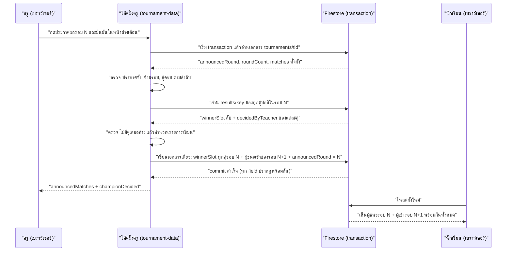
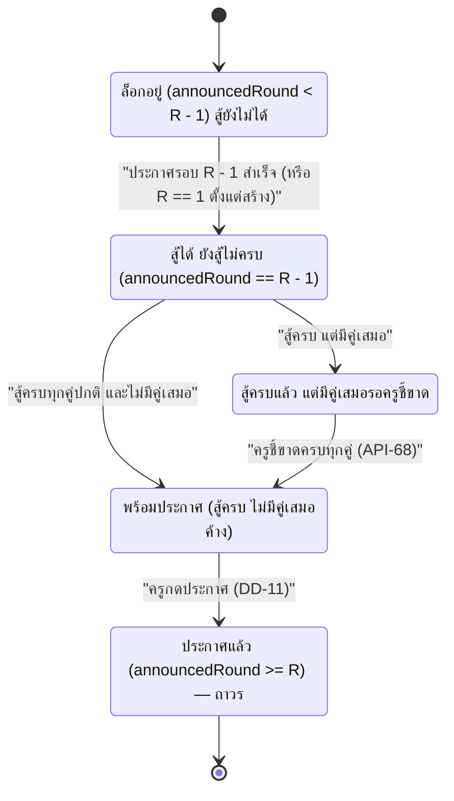

# DD-11 — ประกาศผลรอบในทัวนาเมนต์

- **Feature:** FE-31 (ผูกไปก่อน — ดู G-DB-13/G-API-14) | **Journey:** UJ-03 | **Endpoint:** API-69 (`POST /api/v1/teacher/tournaments/{tournamentId}/rounds/{round}/announce`)
- **Acceptance Criteria ที่ต้องทำให้ผ่าน:** AC-FE-31-7 (เฉพาะครูกดได้), AC-FE-31-8, AC-FE-31-9, AC-FE-31-10, AC-FE-31-12, AC-FE-31-15, AC-FE-31-16, AC-FE-31-19 — ส่วนที่ flow นี้ทำให้เป็นจริงได้เพียงฝั่งข้อมูล (หน้าที่แสดงผลอยู่นอก flow): AC-FE-31-17 (แชมป์รายสัปดาห์บนกระดานเกียรติยศ), AC-FE-31-18 (การ์ดทัวนาเมนต์ล่าสุดหน้าหลัก) — และ AC ของ spec 08 ท้ายหัวข้อ ฌ.: ไม่มีทางยกเลิกประกาศ, คนได้บายแสดงช่องรอบ 2 ตั้งแต่สร้าง
- **ต้นทางกฎ:** [[../../../01-requirements/01-spec/20261103-08-tournament-bracket-demo|spec 08]] หัวข้อ จ., ฌ. ข้อ 1, 2, 3, 6, 9, 10, 11 · [[../database-schema|database-schema]] ENT-28/29/30 + หัวข้อ 3.1 (จ) แถว "ประกาศรอบ N" · [[../api-spec|api-spec]] API-69
- **หมายเหตุสถาปัตยกรรมจริง:** เรียก Firestore ตรงจากเบราว์เซอร์ครู ไม่มี server กลาง (G-DB-19) — ลำดับ 409 ด้านล่างบังคับที่โค้ดฝั่งครูใน transaction · **หน้าต่างยืนยัน "ประกาศแล้วยกเลิกไม่ได้" เป็นหน้าที่ฝั่ง client** (API-69 ไม่รับ field ยืนยัน และไม่มี 2-step ฝั่งข้อมูล)

## 1. Sequence Diagram



## 2. เงื่อนไขก่อนเริ่ม (Precondition)

- มี session ที่ valid และ role เป็นครู (ระบบไม่ประกาศเองตามเวลา — ไม่มี scheduler/trigger ใดเรียก flow นี้ได้ ต้องมาจากการกดของครูเท่านั้น: AC-FE-31-19)
- `round` ใน path เป็นจำนวนเต็มในช่วง `1 <= round <= roundCount`
- ทัวนาเมนต์มี field `announcedRound` (ทัวนาเมนต์เก่าที่ไม่มี field นี้ถือว่าประกาศครบแล้ว — จะตก ROUND_ALREADY_ANNOUNCED เสมอ)
- ไม่มี request body

## 3. ขั้นตอนการทำงาน (Pseudo Code)

```
1. ตรวจสิทธิ์ก่อนแตะข้อมูล:
   - ไม่มี session -> คืน ERR-01
   - role ไม่ใช่ teacher -> คืน ERR-02

2. ตรวจรูปแบบ round: ต้องเป็นจำนวนเต็ม ไม่ใช่ -> คืน ERR-07 (VALIDATION_ERROR "เลขรอบไม่ถูกต้อง")

3. เริ่ม transaction เดียว (อ่านทั้งหมดก่อน แล้วเขียนครั้งเดียว):
   a. อ่านเอกสาร tournaments/{tournamentId}
      ถ้าไม่มี (รวมถูกลบแล้ว) -> คืน ERR-18 (TOURNAMENT_NOT_FOUND)
   b. ถ้า round < 1 หรือ round > roundCount -> คืน ERR-07 (VALIDATION_ERROR "เลขรอบไม่ถูกต้อง")
   c. ตรวจ 409 ตามลำดับนี้เท่านั้น (ตาม api-spec API-69):
      1) ถ้าเอกสารไม่มี announcedRound (ทัวนาเมนต์เก่า) หรือ round <= announcedRound -> คืน ERR-20 (ROUND_ALREADY_ANNOUNCED)
      2) ถ้า round > announcedRound + 1                    -> ROUND_SKIPPED
      3) normal = คู่ทุกคู่ในรอบ round ที่ bye == false
         ถ้ามีคู่ใน normal ที่ fought == false              -> ROUND_NOT_FULLY_FOUGHT
      4) อ่าน results/{matchKey} ของทุกคู่ใน normal (ตามรายการ matchKey ที่ได้จากเอกสารทัวนาเมนต์ — อ่านในทรานแซกชันนี้)
         - ถ้ามีคู่ที่ fought == true แต่หา results ไม่เจอ -> INTERNAL_DATA_ERROR (ข้อมูลภายในผิดปกติ ไม่ใช่ความผิดผู้ใช้ — rollback)
         - ถ้ามีคู่ใดที่ results.winnerSlot == null (เสมอจริง ครูยังไม่ชี้ขาด) -> TIE_NOT_DECIDED
      (ผ่านครบทั้ง 4 ข้อ = ประกาศได้ — ดูเงื่อนไขรวมที่ BR-26)

   d. คำนวณรายการเขียน (ยังไม่เขียน):
      สำหรับทุกคู่ k ใน normal (ผู้ชนะ w = results[k].winnerSlot, slot ผู้ชนะ = matches[k][w]):
        - set matches.{k}.winnerSlot = w
        - set matches.{k}.decidedByTeacher = results[k].decidedByTeacher
        - ถ้า round < roundCount:
            nextKey = "r" + (round + 1) + "m" + ceil(matchIndex(k) / 2)
            side    = (matchIndex(k) เป็นเลขคี่) ? "slotA" : "slotB"
            set matches.{nextKey}.{side} = สำเนา slot ผู้ชนะ  (studentUid, studentName, speciesKey, stage, stats snapshot เดิม)
      คู่บายของรอบนี้ (bye == true): ไม่เขียนซ้ำ — winnerSlot="slotA" และช่องรอบถัดไปถูกเติมไว้แล้วตั้งแต่ตอนสร้าง (spec 08 ฌ.11)
      set announcedRound = round
      (ตัวคัดลอก ENT-30 -> ENT-29: ต้นฉบับใน results/ ไม่ถูกลบหรือแก้ ใช้เป็นหลักฐานตรวจย้อน)

   e. เขียนทั้งหมดใน "การอัปเดตเอกสาร tournaments/{tournamentId} ครั้งเดียว":
      winnerSlot + decidedByTeacher ของทุกคู่ปกติรอบ N, ผู้ชนะเข้าช่องรอบ N+1, และ announcedRound = N
      ต้องสำเร็จพร้อมกันทั้งหมด — พลาดข้อใดให้ rollback ทั้งหมด ห้ามมีสถานะที่นักเรียนเห็นผู้ชนะก่อนตัวนับ หรือตัวนับขยับโดยผู้ชนะยังไม่ปรากฏ
   f. commit transaction

4. คืนค่า {
     tournamentId, announcedRound: round, roundCount,
     championDecided: (round == roundCount),
     announcedMatches: [ทุกคู่ของรอบ รวมคู่บาย: { key, winnerSlot, decidedByTeacher }]  -- คู่บาย decidedByTeacher = null
   }
   เมื่อ round == roundCount: ผู้ชนะของ finalKey คือแชมป์ และเริ่มปรากฏบนผัง/รายการ/กระดานเกียรติยศ/การ์ดหน้าหลักได้ตั้งแต่ commit นี้
   ไม่มีขั้นตอนใดตั้ง announcedRound ลดลงหรือย้อนกลับ (ไม่มี endpoint ยกเลิก — ถ้ากดพลาด ทางเดียวคือลบทัวนาเมนต์ทั้งอัน: API-71)
```

## 4. กฎธุรกิจและการตรวจสอบ (Business Rules & Validation)

| ID | กฎ | ค่าขอบเขต (ระบุ `>=` / `>` / `==` ให้ชัด) | ถ้าละเมิด |
|---|---|---|---|
| BR-26 | ประกาศรอบ N ได้เมื่อ `announcedRound == N - 1` **และ** ทุกคู่ปกติ (`bye == false`) ของรอบ N มี `fought == true` **และ** ไม่มีคู่เสมอที่ยังไม่ตัดสิน (ทุกคู่มี `results.winnerSlot != null`) — คู่บายนับว่าผ่านโดยอัตโนมัติ | ตัวอย่างขอบ (AC-FE-31-8/31-9): รอบ N มี 2 คู่ สู้ 1 คู่ -> ปฏิเสธ (ROUND_NOT_FULLY_FOUGHT), สู้ครบ 2 คู่พอดี -> ผ่าน · `round == announcedRound + 1` พอดีเท่านั้น (ไม่ใช่ `>=`) | ROUND_ALREADY_ANNOUNCED / ROUND_SKIPPED / ROUND_NOT_FULLY_FOUGHT / TIE_NOT_DECIDED |
| BR-27 | `announcedRound` เพิ่มได้ครั้งละ 1 เท่านั้น ไม่มีทางลดหรือกระโดด ไม่มีทางยกเลิก/ซ่อนผลกลับ ไม่มีกลไกเพิ่มอัตโนมัติ/ตามเวลา | `announcedRound_ใหม่ == announcedRound_เดิม + 1` และ `announcedRound <= roundCount` (`0 <= announcedRound <= roundCount`) | ถือเป็นบั๊กร้ายแรงถ้า field ลดลงหรือเพิ่มโดยไม่ผ่าน flow นี้ (AC-FE-31-19) |
| BR-28 | เปิดเผยผลคือการคัดลอกผู้ชนะจาก `results/` (ลับ) ไปเอกสารสาธารณะ — เปิดเผยทุกคู่ปกติของรอบเดียวกันพร้อมกัน ไม่ใช่ทีละคู่ | หลัง commit: ทุกคู่ปกติของรอบ N มี `winnerSlot != null` พร้อมกัน | ถ้าบางคู่มี บางคู่ไม่มี = บั๊กร้ายแรง (ผิด spec 08 ฌ.2) |
| BR-30 | คู่บายมีผลตั้งแต่สร้าง (`winnerSlot = slotA` + ช่องรอบ 2 เติมแล้ว) จึงไม่ถูกแตะ/ไม่ถูกนับเป็น "ต้องสู้" ตอนประกาศ | `bye == true` -> ข้ามในการตรวจ `fought` และข้ามการเขียนซ้ำ | - |
| BR-31 | ทัวนาเมนต์ที่ไม่มี `announcedRound` นับว่าประกาศครบทุกรอบแล้ว ประกาศซ้ำไม่ได้ | ไม่มี field -> ROUND_ALREADY_ANNOUNCED เสมอ | ROUND_ALREADY_ANNOUNCED (ดู G-API-15) |
| BR-32 | แชมป์ = ผู้ชนะของ `finalKey` ปรากฏเมื่อ `announcedRound == roundCount` เท่านั้น (ประกาศรอบรองลงมาครบแล้วก็ยังไม่ปรากฏ) | `round == roundCount` -> `championDecided = true` (AC-FE-31-15/16) | - |
| (เฉพาะ flow) | ตำแหน่งเลื่อนผู้ชนะ: `r{R}m{M}` ไปที่ `r{R+1}m{ceil(M/2)}` ฝั่ง `slotA` ถ้า M คี่ / `slotB` ถ้า M คู่ (ตรรกะเดิมของโค้ดและ ENT-29) | M เริ่มนับที่ 1 | - |
| (เฉพาะ flow) | ประกาศรอบ N ไม่ทำให้ต่อสู้รอบ N+2 ได้ (ต้องประกาศรอบ N+1 ก่อน) | ใช้ BR-25 ของ DD-10 | ดู DD-10 |
| (เฉพาะ flow) | ไม่แตะคะแนน "คะแนนสูงสุด" จากแบบทดสอบ (spec 08 ฌ.8) | - | - |

## 5. กรณีผิดพลาดและการรับมือ (Edge Case & Error Handling)

| ID | สถานการณ์ | ระบบต้องทำ | Status + ข้อความ |
|---|---|---|---|
| ERR-01 | ไม่มี session / หมดอายุ | ปฏิเสธก่อนอ่านข้อมูล | 401 UNAUTHENTICATED — "กรุณาเข้าสู่ระบบใหม่อีกครั้ง" |
| ERR-02 | ไม่มีสิทธิ์: นักเรียนเรียก | ปฏิเสธก่อนแตะข้อมูล (rules ปฏิเสธการเขียนของนักเรียนซ้ำอีกชั้น) | 403 FORBIDDEN_ROLE — "ไม่มีสิทธิ์ทำรายการนี้" |
| ERR-07 | ข้อมูลผิด: `round` ไม่ใช่จำนวนเต็ม หรือ `round < 1` หรือ `round > roundCount` | ไม่เขียนอะไร | 400 VALIDATION_ERROR — "เลขรอบไม่ถูกต้อง" |
| ERR-18 | หาไม่เจอ: ไม่มีทัวนาเมนต์ (รวมถูกลบแล้ว) | ไม่เขียนอะไร | 404 TOURNAMENT_NOT_FOUND — "ไม่พบทัวนาเมนต์นี้" |
| ERR-20 | กดซ้ำ/ยิงซ้ำ: `round <= announcedRound` (รวมทัวนาเมนต์เก่า) | ไม่เลื่อนผู้ชนะซ้ำ ไม่แก้ field ใดๆ | 409 ROUND_ALREADY_ANNOUNCED — "รอบนี้ประกาศผลไปแล้ว" |
| ROUND_SKIPPED | ข้อมูลผิด: ประกาศข้ามรอบ (`round > announcedRound + 1`) | ไม่เขียนอะไร | 409 — "ต้องประกาศผลรอบก่อนหน้าก่อน" |
| ROUND_NOT_FULLY_FOUGHT | ยังมีคู่ปกติของรอบที่ `fought == false` | ไม่เขียนอะไร สถานะรอบยังเป็น "ยังไม่ประกาศ" | 409 — "ยังมีคู่ในรอบนี้ที่ยังไม่ได้ต่อสู้ ต่อสู้ให้ครบก่อนประกาศผล" |
| TIE_NOT_DECIDED | มีคู่เสมอที่ครูยังไม่ชี้ขาด (**พฤติกรรมชั่วคราว** — tie-break อัตโนมัติยังไม่ล็อก ไม่มี AC ทดสอบตรงๆ ดู G-API-16 ข) | ไม่เขียนอะไร ให้ครูชี้ขาดผ่าน API-68 ก่อนแล้วลองใหม่ | 409 — "ยังมีคู่เสมอที่ต้องเลือกผู้ชนะก่อนประกาศผล" |
| INTERNAL_DATA_ERROR | `fought == true` แต่ไม่มี `results/{matchKey}` (ผิด invariant ENT-29 ↔ ENT-30 — ข้อผิดพลาดภายใน มาตรการป้องกันที่เอกสารนี้เพิ่มเอง ไม่อยู่ใน api-spec) | rollback ทันที ไม่ประกาศบางส่วน บันทึก log ภายใน | 500 — ใช้ข้อความเดียวกับ ERR-17 ("เกิดข้อผิดพลาดภายใน กรุณาลองใหม่ภายหลัง") |
| แย่งกันแก้ (สองแท็บครูกดประกาศรอบเดียวกันพร้อมกัน) | ทั้งสอง transaction อ่านเห็น `announcedRound = N - 1` | การเขียนทั้งหมดอยู่ในเอกสาร `tournaments/{tid}` เดียว -> Firestore ให้ฝั่งที่ commit ก่อนชนะ ฝั่งที่สองถูก retry อัตโนมัติ อ่านเห็น `announcedRound = N` แล้วตกข้อ c.1 -> ไม่เลื่อนผู้ชนะซ้ำ ไม่ทับผลเดิม | 409 ROUND_ALREADY_ANNOUNCED |
| แย่งกันแก้ (แท็บหนึ่งประกาศรอบ N ขณะอีกแท็บกำลังกดต่อสู้คู่สุดท้ายของรอบ N) | แท็บประกาศอ่านเห็น `fought = false` ของคู่นั้นก่อน | แท็บประกาศที่อ่านเห็น `fought = false` จะตก ROUND_NOT_FULLY_FOUGHT ทันที · ถ้าการต่อสู้ commit ก่อนที่แท็บประกาศจะ commit แท็บประกาศถูก retry แล้วเห็นคู่ครบ (อ่าน results เพิ่ม) ผ่านได้ถ้าไม่เสมอ — จึงไม่มีทางประกาศรอบที่ยังสู้ไม่ครบโดยบังเอิญ | ตามผลของ transaction ที่ commit ก่อน |
| แย่งกันแก้ (แท็บหนึ่งประกาศ ขณะอีกแท็บกำลังชี้ขาดคู่เสมอของรอบนั้น — API-68) | ชี้ขาดเขียน `results/` ซึ่งไม่ใช่เอกสารเดียวกับที่เขียนตอนประกาศ | การอ่าน `results/{matchKey}` อยู่ใน transaction ของ flow นี้ จึงเห็นค่าที่ commit แล้วเท่านั้น: ก่อนชี้ขาด -> TIE_NOT_DECIDED, หลังชี้ขาด -> ผ่าน · ห้ามประกาศด้วยค่า `winnerSlot` ที่อ่านมาก่อน transaction เริ่ม | ตามผลของ transaction |
| commit ล้มกลางทาง / เครือข่ายหลุดหลังกดประกาศ | transaction เป็น all-or-nothing | ผลที่ไม่รู้แน่ ให้ client โหลดเอกสารใหม่ดู `announcedRound`: ถ้า `== N` ถือว่าสำเร็จ ห้ามกดซ้ำ (ถ้ากดซ้ำจะได้ ROUND_ALREADY_ANNOUNCED ซึ่งไม่เสียหาย) | ไม่มีรหัสใน api-spec — ดู G-DD-12 |
| ระบบภายนอกล่ม (Firestore เชื่อมต่อไม่ได้) | ไม่ commit ไม่มีข้อมูลบางส่วน | แจ้งครูให้ลองใหม่ ผังคงสถานะเดิม | ไม่มีรหัสใน api-spec — ดู G-DD-12 |
| ครูกดประกาศพลาด (ต้องการยกเลิก) | ไม่มีทางยกเลิก (spec 08 ฌ.10) — ห้ามสร้างวิธีลดตัวนับ/ซ่อนผลกลับ | ทางออกเดียวคือลบทัวนาเมนต์ (API-71) แล้วสร้างใหม่ | - |

## 6. การเปลี่ยนสถานะ (State Transition)

สถานะของ "รอบ R" (derived จาก `announcedRound` และ `fought` ของคู่ในรอบ — ไม่เก็บเป็น field)



| จาก | ไป | เงื่อนไข | เกิดที่ |
|---|---|---|---|
| `announcedRound = N - 1` | `announcedRound = N` | ผ่านครบตาม BR-26 | DD-11 เท่านั้น |
| `announcedRound = N` | `announcedRound = N - 1` หรืออื่นที่น้อยกว่า | **ห้ามเกิดขึ้นได้ไม่ว่ากรณีใด** (BR-27) | - |
| คู่ปกติ `winnerSlot = null` | `winnerSlot` มีค่า | พร้อมกันทั้งรอบ ณ commit ของการประกาศ | DD-11 |
| ช่อง `slotA/slotB` ของรอบ N+1 (ที่มาจากคู่ปกติ) `null` | สำเนาผู้ชนะ | พร้อมกับ `announcedRound = N` | DD-11 |
| รอบสุดท้าย `announcedRound < roundCount` | `announcedRound == roundCount` | แชมป์เริ่มปรากฏ | DD-11 (`round == roundCount`) |
