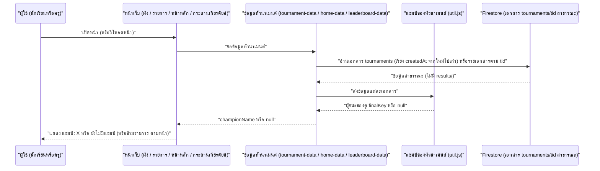

# DD-13 — แสดงแชมป์ทัวนาเมนต์ (ผัง / รายการ / การ์ดหน้าหลัก / แชมป์รายสัปดาห์)

- **Feature:** FE-92 (แสดงแชมป์หลังประกาศรอบชิงเท่านั้น), FE-94 (การ์ดหน้าหลัก) — AC ผูก FE-31 เดิมไว้ด้วย | **Journey:** UJ-03 | **Endpoint:** API-65 (รายการ, ฟิลด์ `championName`), API-66 (ผัง, ฟิลด์ `champion`)
- **Acceptance Criteria ที่ต้องทำให้ผ่าน:** AC-FE-31-15, AC-FE-31-16, AC-FE-31-17, AC-FE-31-18
- **ต้นทางกฎ:** [[../../../01-requirements/01-spec/20261103-08-tournament-bracket-demo|spec 08]] หัวข้อ ฌ. ข้อ 6, 9, 10 · [[../api-spec|api-spec]] API-65, API-66 · BR-32 / BR-31 / BR-28 ใน [[../detailed-design|hub]]
- **หมายเหตุสถาปัตยกรรมจริง:** ไม่มี server — ทั้ง 4 หน้าอ่านเอกสาร `tournaments/{tid}` (เอกสารสาธารณะ) ตรงจาก Firestore ในเบราว์เซอร์ แล้วหาแชมป์ด้วยฟังก์ชันกลางตัวเดียว `แชมป์ของทัวนาเมนต์(ข้อมูล)` ใน `js/util.js` — flow นี้ **อ่านอย่างเดียว ไม่เขียนข้อมูลใด** และไม่มีการอ่าน `results/` เลย
- **ไม่ออก BR ใหม่:** กฎ "แชมป์ปรากฏเมื่อ `announcedRound == roundCount`" คือ **BR-32** เดิม (ไม่ซ้ำ/ไม่เปลี่ยนเลข) — ไฟล์นี้ระบุเฉพาะ "กลไกที่ทำให้ BR-32 เป็นจริงในโค้ด" และพฤติกรรมของแต่ละหน้า

## 1. Sequence Diagram



## 2. เงื่อนไขก่อนเริ่ม (Precondition)

- มี session ที่ valid (นักเรียนหรือครู — ทั้งสองบทบาทได้ผลเดียวกัน ไม่มีการเปิดเผยเพิ่มให้ครู)
- ไม่มีการเขียนข้อมูล ไม่มี request body — flow นี้ไม่ต้องมีสถานะ/ข้อมูลล่วงหน้านอกจากเอกสารทัวนาเมนต์ที่ DD-10/DD-11 สร้างไว้
- **ไม่มี realtime listener:** หน้าที่เปิดค้างอยู่ไม่อัปเดตเอง ผู้ใช้เห็นแชมป์ใหม่หลัง**โหลดหน้าใหม่** (ที่มา: โค้ดใช้ `getDocs` ครั้งเดียว ไม่ใช้ `onSnapshot`)

## 3. ขั้นตอนการทำงาน (Pseudo Code)

```
A. ฟังก์ชันกลาง แชมป์ของทัวนาเมนต์(ข้อมูล)  (js/util.js — ทุกหน้าเรียกตัวเดียวกัน ห้ามมีสูตรแยก)
   1. หาคู่ชิง:
      - ถ้า ข้อมูล มี matches และ finalKey      -> คู่ = ข้อมูล.matches[finalKey]
      - มิฉะนั้น ถ้า ข้อมูล มี field final       -> คู่ = ข้อมูล.final   (ผังรุ่นเก่า 4 คน: semifinal1/semifinal2/final)
      - มิฉะนั้น                                -> คู่ = ไม่มี
   2. ถ้า คู่ ไม่มี                              -> คืน null
   3. ถ้า คู่.winnerSlot ไม่ใช่ "slotA" และไม่ใช่ "slotB" -> คืน null   (ค่า null/ว่าง/อื่น = ยังไม่มีแชมป์)
   4. ถ้า คู่[คู่.winnerSlot] ว่าง (ช่องที่ชี้ไม่มีผู้เข้าแข่ง) -> คืน null
   5. คืน { slot: คู่[คู่.winnerSlot], decidedByTeacher: (คู่.decidedByTeacher == true) }

   * ฟังก์ชันนี้ไม่ตรวจ announcedRound ตรงๆ — BR-32 เป็นจริงเพราะโครงข้อมูล (ดู B)

B. ทำไม BR-32 ปลอดภัยโดยโครงสร้าง (ไม่ใช่ด่านตรวจใน UI)
   1. ทัวนาเมนต์ใหม่ (มี announcedRound): winnerSlot ของคู่ปกติ (รวมคู่ชิง) ถูกเขียนลงเอกสารสาธารณะโดย
      transaction ประกาศผลรอบ (DD-11) เท่านั้น — DD-10 (ต่อสู้) และ API-68 (ครูชี้ขาด) เขียนแค่ results/ (BR-28)
      => ก่อนประกาศรอบชิง คู่ finalKey.winnerSlot = null สำหรับ "ทุกคน รวมครู" => ข้อ A.3 คืน null
      => เมื่อประกาศรอบชิง (announcedRound = roundCount) DD-11 เขียน winnerSlot ของ finalKey => แชมป์ปรากฏ
      (คู่ชิงไม่มีทางเป็นคู่บาย — ผู้เข้าแข่งอย่างน้อย 2 คน รอบสุดท้ายมี 1 คู่จริง)
   2. ทัวนาเมนต์เก่า (ไม่มี announcedRound): เคยเขียน winnerSlot ตอนสู้ => นับว่าประกาศครบแล้ว (BR-31)
      => ถ้าคู่ชิงสู้แล้วมี winnerSlot แชมป์ปรากฏทันที / ถ้าคู่ชิงยังไม่สู้ winnerSlot ว่าง => null (ผังอ่านอย่างเดียว ERR-23)

C. จุดเรียกใช้ 4 จุด (ทุกจุดอ่านเฉพาะเอกสารสาธารณะ tournaments/{tid} ห้ามอ่าน results/)
   C1. ผัง (js/tournament.js วาดผัง):
       แชมป์ = แชมป์ของทัวนาเมนต์(เอกสารที่โหลด)
       ถ้ามี -> แสดง "👑 แชมป์: {slot.studentName}"   ถ้าไม่มี -> ไม่แสดงบรรทัดนี้เลย (ไม่มีข้อความ "ยังไม่มีแชมป์" บนผัง)
   C2. รายการ "ทัวนาเมนต์ที่ผ่านมา" (js/tournament-data.js โหลดรายการทัวนาเมนต์ + js/tournament.js):
       อ่านทุกเอกสารของ tournaments เรียง createdAt จากใหม่ไปเก่า (ในนาทีเดียวกันเรียงด้วย createdAtMs)
       ต่อเอกสาร: championName = แชมป์ ? แชมป์.slot.studentName : null
       แสดงต่อรายการ: championName ไม่ null -> "แชมป์: {ชื่อ}"  มิฉะนั้น -> "ยังไม่มีแชมป์"
   C3. การ์ด "ทัวนาเมนต์ล่าสุด" หน้าหลัก (js/home-data.js โหลดทัวนาเมนต์ล่าสุด + js/home.js):
       อ่านทุกเอกสารเรียง createdAt จากใหม่ไปเก่า -> เลือก "เอกสารแรก" (ใหม่สุด) เพียงอันเดียว
       championName = แชมป์ ? แชมป์.slot.studentName : null
       ไม่มีทัวนาเมนต์เลย -> การ์ดแสดง "ยังไม่มีทัวนาเมนต์ในระบบ"
       มี และ championName ไม่ null -> "แชมป์: {ชื่อ}"  มิฉะนั้น -> "ยังไม่มีแชมป์"
       (เลือกใหม่สุดโดย createdAt เท่านั้น — ไม่ข้ามไปหาอันเก่าที่มีแชมป์)
   C4. แชมป์รายสัปดาห์ บนกระดานเกียรติยศ (js/leaderboard-data.js โหลดทำเนียบแชมป์ + js/tournament.js):
       อ่านทุกเอกสาร เรียง createdAt จากใหม่ไปเก่า
       ต่อเอกสาร:
         ผลแชมป์ = แชมป์ของทัวนาเมนต์(ข้อมูล)
         ถ้า ผลแชมป์ == null -> ข้าม (ไม่แสดง)
         จันทร์ = วันจันทร์ของสัปดาห์ที่ createdAt ตกอยู่ (อ่าน "YYYY-MM-DD ..." เวลาท้องถิ่น จันทร์ = วันแรก)
         ถ้าอ่าน createdAt ไม่ออก -> ข้าม
         จัดกลุ่มตาม "วันจันทร์" -> weekStart; เพิ่มรายการ { tournamentId, championName (ว่าง -> "ไม่ระบุชื่อ"),
           speciesKey, stage, decidedByTeacher } เข้ากลุ่มนั้น (ทัวนาเมนต์หลายอันในสัปดาห์เดียวกัน = แสดงทุกอัน)
       ผลลัพธ์: สัปดาห์เรียงจากใหม่ไปเก่า ถ้าไม่มีกลุ่มเลย -> "ยังไม่มีทัวนาเมนต์ที่ได้แชมป์"
       ส่วน "คะแนนสูงสุด" บนกระดานมาจากแบบทดสอบ ไม่เกี่ยวกับ flow นี้ (spec 08 ฌ. ข้อ 8)

D. การลบทัวนาเมนต์ (API-71) ลบเอกสาร tournaments/{tid} (+ log + results) => ครั้งถัดไปที่โหลดหน้า
   เอกสารนั้นไม่ปรากฏทั้ง C1-C4 (ผังเปิดไม่เจอ = ERR-18, รายการ/การ์ด/ทำเนียบไม่มีแถวนั้น)
   การ์ดหน้าหลักจะย้ายไปแสดงทัวนาเมนต์ใหม่สุดอันถัดไปเอง

E. การโหลดล้มเหลว (ดูข้อ 5): ไม่เดาค่า ไม่แสดงแชมป์ปลอม ไม่แสดง "ยังไม่มีแชมป์" แทนข้อผิดพลาด
```

## 4. กฎธุรกิจและการตรวจสอบ (Business Rules & Validation)

| ID | กฎ | ค่าขอบเขต (ระบุ `>=` / `>` / `==` ให้ชัด) | ถ้าละเมิด |
|---|---|---|---|
| BR-32 | แชมป์ = ผู้ชนะของ `finalKey` ปรากฏบนผัง/รายการ/กระดานเกียรติยศ/การ์ดหน้าหลักเมื่อ `announcedRound == roundCount` เท่านั้น (ประกาศครบก่อนรอบชิงแล้วก็ยังไม่ปรากฏ) — ฝั่งข้อมูล: `winnerSlot` ของ `finalKey` ถูกเขียนโดย DD-11 ตอนประกาศรอบสุดท้ายเท่านั้น | `announcedRound == roundCount` (ไม่ใช่ `>=`/`>`; `announcedRound` ไม่เกิน `roundCount` อยู่แล้วตาม BR-27) — ขอบ: `announcedRound = roundCount - 1` ต่อสู้รอบชิงแล้ว -> ไม่มีแชมป์ทุกจุด (AC-FE-31-15) | ถ้าเห็นแชมป์ก่อนประกาศรอบชิง = บั๊กร้ายแรง (ผลลับรั่ว ผิด BR-28) |
| BR-31 | ทัวนาเมนต์ไม่มี `announcedRound` = ประกาศครบแล้ว: ใช้ `winnerSlot` ที่เขียนไว้ตอนสู้ได้ทันที (ผังรุ่น 4 คนอ่านจาก `final` ด้วย) | ไม่มี field `announcedRound` ⇒ `effAnnounced = roundCount` | ถ้าคู่ชิงยังไม่มี `winnerSlot` -> ไม่มีแชมป์ (ไม่มีทางประกาศเพิ่ม ERR-23) |
| BR-28 | แหล่งข้อมูลแชมป์ต้องเป็นเอกสารสาธารณะเท่านั้น ห้ามอ่านผลลับ `results/{key}` มาคำนวณแชมป์ (ครูอ่านได้ แต่ผังของครูก็ต้องไม่เฉลยก่อนประกาศ — AC-FE-43-2) | อ่านเฉพาะ `tournaments/{tid}.matches[finalKey].winnerSlot` | เฉลยก่อนประกาศ = ผิดกฎปิดผล |
| (ในไฟล์นี้) | `winnerSlot` ต้องเป็น `"slotA"` หรือ `"slotB"` **และ** ช่องที่ชี้ต้องมีผู้เข้าแข่ง จึงนับเป็นแชมป์ | ค่าอื่น/ช่องว่าง -> null | ไม่แสดงแชมป์ (ไม่ throw) |
| (ในไฟล์นี้) | การ์ดหน้าหลักแสดง "ทัวนาเมนต์ที่ createdAt ใหม่สุด" เพียงอันเดียว (ที่มา: โค้ด `home-data.js`, AC-FE-31-18) | เรียง `createdAt` จากมากไปน้อย แล้วเอาอันแรก | ใหม่สุดยังไม่มีแชมป์ -> "ยังไม่มีแชมป์" (ไม่ข้ามไปแสดงอันเก่า) |
| (ในไฟล์นี้) | แชมป์รายสัปดาห์จัดกลุ่มด้วย "วันจันทร์ของสัปดาห์ที่ `createdAt` ตกอยู่" (วันสร้าง ไม่ใช่วันประกาศ) และข้ามทัวนาเมนต์ที่ไม่มีแชมป์ ที่มา: โค้ด `leaderboard-data.js`, spec 08 ฌ. ข้อ 6 | จันทร์ = วันแรกของสัปดาห์ | `createdAt` อ่านไม่ออก -> ข้ามรายการ |

## 5. กรณีผิดพลาดและการรับมือ (Edge Case & Error Handling)

| ID | สถานการณ์ | ระบบต้องทำ | Status + ข้อความ |
|---|---|---|---|
| ERR-01 | ไม่มี session / หมดอายุ | ไม่อ่านข้อมูล (หน้าจะถูกส่งไปล็อกอินโดย auth-guard) | 401 UNAUTHENTICATED — "กรุณาเข้าสู่ระบบใหม่อีกครั้ง" |
| ข้อมูลนำเข้า | ไม่มี input จากผู้ใช้ นอกจาก `tournamentId` ใน URL ของผัง (ว่าง/ไม่มี -> ผังไม่โหลด ตามพฤติกรรมของหน้า DD-12) | flow นี้ไม่ validate เพิ่ม | — |
| ไม่มีสิทธิ์ | นักเรียนและครูเห็นแชมป์ค่าเดียวกันทุกจุด (ไม่มี field พิเศษของครู) — ไม่มีกรณี 403 | ไม่แยกตามบทบาท | — |
| ERR-18 | ผังของทัวนาเมนต์ที่ถูกลบ (ลิงก์ค้างจากรายการ/การ์ด/ทำเนียบที่เปิดค้างไว้) | ผังแสดงข้อผิดพลาดตาม DD-12 ไม่แสดงแชมป์ — รายการอื่นไม่กระทบ | 404 TOURNAMENT_NOT_FOUND — "ไม่พบทัวนาเมนต์นี้" |
| ไม่มีทัวนาเมนต์เลย | คอลเลกชันว่าง | การ์ดหน้าหลัก: "ยังไม่มีทัวนาเมนต์ในระบบ" · รายการ: "ยังไม่มีทัวนาเมนต์ในระบบ" · ทำเนียบ: "ยังไม่มีทัวนาเมนต์ที่ได้แชมป์" | — (ไม่ใช่ข้อผิดพลาด) |
| คู่ชิงเสมอ ครูชี้ขาดแล้วแต่ยังไม่ประกาศ (BR-33) | API-68 เขียนผู้ชนะที่ `results/` เท่านั้น ไม่เขียน `winnerSlot` สาธารณะ | `winnerSlot` ของ `finalKey` ยังเป็น null -> **ยังไม่มีแชมป์** ทั้ง 4 จุด จนกว่าครูกดประกาศรอบชิง (DD-11) | — |
| คู่ชิงสู้แล้ว ยังไม่ประกาศ (AC-FE-31-15) | `fought = true` แต่ `winnerSlot = null` | ไม่มี 👑 บนผัง, รายการ/การ์ด "ยังไม่มีแชมป์", ทำเนียบไม่แสดงทัวนาเมนต์นี้ | — |
| ทัวนาเมนต์เก่า มี `matches` (ไม่มี `announcedRound`) | นับว่าประกาศครบ (BR-31) ใช้ `winnerSlot` ที่เขียนไว้ตอนสู้ | คู่ชิงมีผู้ชนะ -> แสดงแชมป์ปกติ / ไม่มี -> "ยังไม่มีแชมป์" (สู้ต่อไม่ได้ ERR-23) | — |
| ทัวนาเมนต์รุ่น 4 คนตายตัว (ไม่มี `matches` มี `final`) | ฟังก์ชันกลางอ่านจาก `final.winnerSlot` | รายการ/การ์ด/ทำเนียบ **แสดงแชมป์ได้** แต่เปิดผังไม่ได้ (ERR-21) — ผู้ใช้กดลิงก์จากแชมป์เก่าแล้วเจอ ERR-21 | 422 TOURNAMENT_LEGACY_FORMAT — "ทัวนาเมนต์นี้สร้างด้วยระบบรุ่นเก่า เปิดผังในระบบใหม่ไม่ได้" |
| ทัวนาเมนต์ 2 อันในสัปดาห์เดียวกัน (วันจันทร์เดียวกัน) | จัดกลุ่มตาม weekStart เดียวกัน | แสดงแชมป์ทุกอันใต้ป้ายสัปดาห์เดียว เรียงตามลำดับ `createdAt` ใหม่สุดก่อน (ตามลำดับที่ query คืนมา) | — |
| `createdAt` อ่านไม่ออก/ไม่มี | ทำเนียบข้ามทัวนาเมนต์นั้น (ไม่ throw) · รายการแสดง "ไม่ทราบเวลา" · การ์ดแสดง "จัดเมื่อ —" | แชมป์ในรายการ/การ์ดยังแสดงได้ ต่างจากทำเนียบที่ไม่แสดง | — |
| `winnerSlot` ผิดรูป / ช่องชี้ว่าง | ฟังก์ชันกลางคืน null | ถือว่ายังไม่มีแชมป์ ไม่ crash | — |
| กดซ้ำ/ยิงซ้ำ (idempotency) | flow นี้อ่านอย่างเดียว รีเฟรช/โหลดซ้ำกี่ครั้งได้ผลเดิมจาก state ปัจจุบัน | — | — |
| แย่งกันแก้ (race) | ครูกดประกาศรอบชิงขณะนักเรียนโหลดหน้า: transaction ของ DD-11 เป็น all-or-nothing — ผู้อ่านเห็นเอกสาร "ก่อน" (ไม่มีแชมป์) หรือ "หลัง" (มีแชมป์ + `announcedRound = roundCount` พร้อมกัน) ไม่มีสถานะครึ่งๆ กลางๆ | หน้าที่โหลดก่อนไม่อัปเดตเอง (ไม่มี realtime) ต้องโหลดใหม่ | — |
| ระบบภายนอกล่ม: โหลดผัง ล้มเหลว | ผัง: กล่องแสดง "⚠️ โหลดทัวนาเมนต์ไม่สำเร็จ: {ข้อความ}" ไม่มีแชมป์ | ไม่มีรหัสใน api-spec — ดู G-DD-12 | (ไม่มีรหัส) |
| ระบบภายนอกล่ม: โหลดรายการ ล้มเหลว | หัวข้อ "ทัวนาเมนต์ที่ผ่านมา" + "⚠️ โหลดรายการไม่สำเร็จ: {ข้อความ}" (ไม่แสดง "ยังไม่มีแชมป์" แทน) | ไม่มีรหัสใน api-spec — ดู G-DD-12 | (ไม่มีรหัส) |
| ระบบภายนอกล่ม: โหลดการ์ดหน้าหลัก ล้มเหลว | เฉพาะการ์ดทัวนาเมนต์แสดง "โหลดไม่สำเร็จ: {ข้อความ}" การ์ดอื่นของหน้าหลักทำงานต่อ (โหลดแยกกล่อง) | ไม่มีรหัสใน api-spec — ดู G-DD-12 | (ไม่มีรหัส) |
| ระบบภายนอกล่ม: โหลดทำเนียบแชมป์ ล้มเหลว | ส่วน "แชมป์รายสัปดาห์" แสดง "⚠️ {ข้อความ}" ใต้หัวข้อเดิม ส่วนอื่นของกระดานไม่กระทบ (ไม่แสดง "ยังไม่มีทัวนาเมนต์ที่ได้แชมป์" แทน) | ไม่มีรหัสใน api-spec — ดู G-DD-12 | (ไม่มีรหัส) |
| ทัวนาเมนต์ถูกลบ (API-71) ระหว่างหน้าเปิดค้าง | หน้าเดิมยังโชว์แชมป์เก่าจนกว่าจะโหลดใหม่ (ไม่มี realtime) · โหลดใหม่ -> หายจากทั้ง 4 จุด; การ์ดหน้าหลักเปลี่ยนไปแสดงอันใหม่สุดถัดไป | — | — |

## 6. การเปลี่ยนสถานะ (State Transition)

- ไม่มีการเปลี่ยนสถานะของข้อมูลใน flow นี้ (อ่านอย่างเดียว) — "แชมป์" เป็นค่าที่ derive จากเอกสารสาธารณะ ไม่เก็บเป็น field
- สถานะที่ผู้ใช้เห็นเปลี่ยนตามผลของ DD-10/DD-11 เท่านั้น:

| สถานะข้อมูลของ `finalKey` | `winnerSlot` สาธารณะ | แชมป์ที่ 4 จุดแสดง | เกิดที่ |
|---|---|---|---|
| ยังไม่สู้ | null | ไม่มี | DD-10 ยังไม่เกิด |
| สู้แล้ว / เสมอรอชี้ขาด / ชี้ขาดแล้ว ยังไม่ประกาศ | null | ไม่มี (AC-FE-31-15) | DD-10, API-68 (เขียน `results/` เท่านั้น) |
| ประกาศรอบชิงแล้ว (`announcedRound == roundCount`) | `slotA`/`slotB` | แชมป์ปรากฏ ณ การโหลดหน้าครั้งถัดไป (AC-FE-31-16/17/18) | DD-11 |
| ทัวนาเมนต์เก่า สู้แล้ว | มีค่า (เขียนตอนสู้) | แชมป์ปรากฏ (BR-31) | ก่อนมีกติกา |
| ทัวนาเมนต์ถูกลบ | (เอกสารไม่มี) | หายทุกจุด | API-71 |

## 7. ความปลอดภัย (ระดับจุด)

- แชมป์มาจาก **เอกสารสาธารณะ `tournaments/{tid}` เท่านั้น** — ไม่มีการอ่าน `tournaments/{tid}/results/*` (ซึ่งนักเรียนอ่านไม่ได้ตาม rules) ทั้งในฝั่งนักเรียนและครู ดังนั้นทั้ง 4 จุดจึงไม่ทำให้ผลลับรั่ว และผลลัพธ์ของนักเรียน = ครู
- ผลลับไม่ถูกกันด้วยการซ่อนใน UI: `winnerSlot` ของ `finalKey` ไม่อยู่ในเอกสารสาธารณะจนกว่า DD-11 จะเขียน (BR-28) — นักเรียนที่ยิงอ่านเอกสารตรงก็เห็นแค่ null
- การแสดงชื่อ: ใช้ `studentName` ที่เก็บในช่อง `slot` ตอนสร้างทัวนาเมนต์ (ไม่ส่งสเตตัส/แต้มของนักเรียนในจุดแสดงแชมป์) — ทำเนียบเพิ่ม `speciesKey`/`stage` ซึ่งมีในช่อง `slot` เดียวกันอยู่แล้ว
- ทุก string ที่แสดงต้องผ่าน `esc()` (หน้าเว็บทั้ง 4 จุดทำอยู่แล้ว)
