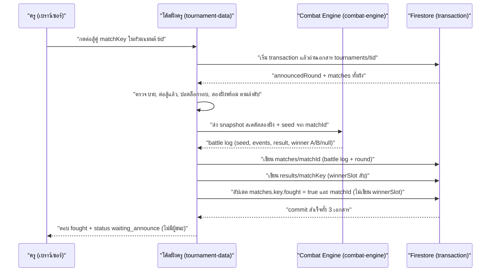
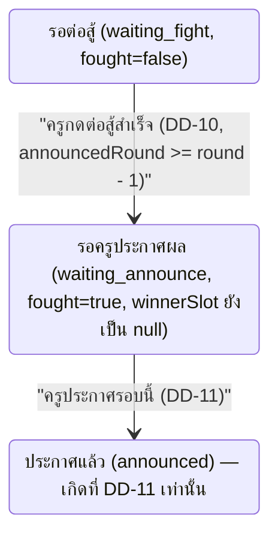

# DD-10 — ต่อสู้คู่ในทัวนาเมนต์ ("ประลองแล้วเงียบ")

- **Feature:** FE-31 (ผูกไปก่อน — spec 08 ยังไม่มี FE ของตัวเอง ดู G-DB-13/G-API-14) | **Journey:** UJ-03 | **Endpoint:** API-67 (`POST /api/v1/teacher/tournaments/{tournamentId}/matches/{matchKey}/fight`)
- **Acceptance Criteria ที่ต้องทำให้ผ่าน:** AC-FE-31-3, AC-FE-31-4, AC-FE-31-13, AC-FE-31-14, AC-FE-31-19 (ฝั่งข้อมูล: ไม่มีอะไรประกาศเอง), AC-FE-43-2 (ฝั่งข้อมูล: ไม่เขียน `winnerSlot` ลงเอกสารสาธารณะ) — เกี่ยวข้องทางอ้อม: AC-FE-31-8/31-9 (เงื่อนไข `fought` ที่ DD-11 ใช้)
- **ต้นทางกฎ:** [[../../../01-requirements/01-spec/20261103-08-tournament-bracket-demo|spec 08]] หัวข้อ ค., จ., ฌ. ข้อ 3, 4, 7 · [[../database-schema|database-schema]] ENT-28~31 + หัวข้อ 3.1 (จ) แถว "ต่อสู้คู่" · [[../api-spec|api-spec]] API-67
- **หมายเหตุสถาปัตยกรรมจริง:** ระบบทัวนาเมนต์เรียก Firestore ตรงจากเบราว์เซอร์ของครู ไม่มี server กลาง (G-DB-19/G-API-19) — status/รหัสข้อผิดพลาดด้านล่างเป็น "สัญญาเชิงตรรกะ" ที่โค้ดฝั่งครู (`js/tournament-data.js`) ต้องบังคับเอง ส่วน rules บังคับได้แน่นอนเฉพาะ "นักเรียนเขียนไม่ได้ / นักเรียนอ่านผลลับไม่ได้" (DD-12)

## 1. Sequence Diagram



## 2. เงื่อนไขก่อนเริ่ม (Precondition)

- มี session ที่ valid และ role เป็นครู (`teacher`)
- มีเอกสาร `tournaments/{tournamentId}` และมีคีย์ `matchKey` ใน map `matches`
- คู่นั้นยังไม่ถูกต่อสู้ (`fought = false`), ไม่ใช่คู่บาย, ทั้ง `slotA` และ `slotB` ไม่เป็น null
- เอกสารทัวนาเมนต์เป็นรุ่นใหม่ (มี `announcedRound` และ map `matches`) — ทัวนาเมนต์เก่าถูกปฏิเสธด้วย ERR-23 (อ่านอย่างเดียว)
- ไม่มี request body (ครูไม่ส่งผู้ชนะ/seed ใดๆ — engine เป็นผู้คำนวณ ไม่มีการสุ่มตัดสิน ตาม spec 08 หัวข้อ ค./จ.)

## 3. ขั้นตอนการทำงาน (Pseudo Code)

```
1. รับ tournamentId, matchKey จาก path ตรวจสิทธิ์:
   - ไม่มี session -> คืน ERR-01
   - role ไม่ใช่ teacher -> คืน ERR-02 (ก่อนอ่านข้อมูลใดๆ)
   - (ชั้น rules เป็นด่านที่สอง: นักเรียนเขียนเอกสารทัวนาเมนต์/results/matches ไม่ได้อยู่แล้ว)

2. เริ่ม transaction เดียว (อ่านก่อนเขียนเสมอ):
   a. อ่านเอกสาร tournaments/{tournamentId}
      ถ้าไม่มี (รวมถูกลบไปแล้ว) -> คืน ERR-18 (TOURNAMENT_NOT_FOUND)
   a2. ถ้าเอกสารไม่มี map matches (ผังรุ่น 4 คนตายตัว) -> คืน ERR-21 (TOURNAMENT_LEGACY_FORMAT)
       (โค้ดจริง `ตรวจเอกสาร` ตรวจข้อนี้ทันทีหลังข้อ a ก่อนข้อ b)
   b. ถ้าเอกสารไม่มี field announcedRound (ทัวนาเมนต์ก่อนกติกานี้ แต่มี matches) -> คืน ERR-23 (TOURNAMENT_LEGACY)
      ทันที ก่อนตรวจเงื่อนไข 409 อื่นทุกข้อ ไม่เขียนอะไร — ทัวนาเมนต์เก่า = ดูผลได้อย่างเดียว (ผู้ใช้ตัดสิน 2026-11-19,
      spec 08 ฌ. ข้อ 9.1; API-66 ตั้ง canFight = false) ไม่ว่าจะมีคู่ที่ยังไม่สู้เหลืออยู่หรือไม่
      ~~[GAP G-DD-09 / G-API-17] พฤติกรรมยังไม่ล็อก (สู้ต่อแบบเก่า / อ่านอย่างเดียว / แปลง) — เอกสารนี้ไม่กำหนด ห้ามเดา~~
      [ปิด 2026-11-19] ผู้ใช้ตัดสิน: อ่านอย่างเดียว -> ERR-23
   c. m = matches[matchKey]
      ถ้าไม่มี -> คืน ERR-19 (MATCH_NOT_FOUND)
   d. ตรวจ 409 ตามลำดับนี้เท่านั้น (ตาม api-spec API-67):
      1) m.bye == true                                  -> MATCH_IS_BYE
      2) m.fought == true                               -> MATCH_ALREADY_FOUGHT
      3) NOT (announcedRound >= m.round - 1)            -> ROUND_NOT_UNLOCKED
      4) m.slotA == null OR m.slotB == null             -> MATCH_NOT_READY
      (ผ่านทั้ง 4 ข้อจึงไปต่อ)

3. คำนวณผลด้วย engine จริง (pure — ไม่เขียนอะไรลงฐานข้อมูล):
   matchId = tournamentId + "-" + matchKey
   seed    = แฮชจาก matchId (deterministic: seed เดิมได้ผลเดิม)
   input   = snapshot สเตตัสของ slotA/slotB ที่บันทึก ณ ตอนสร้างทัวนาเมนต์ (ไม่ดึงสเตตัสปัจจุบันของสัตว์เลี้ยง)
   log     = engine(input, seed) -> { engineVersion, seed, computedAt, sideA, sideB, result, events }
   winnerSlot = log.result.winner: "A" -> "slotA" / "B" -> "slotB" / null -> null (เสมอจริง รอครูชี้ขาด)

4. ในทรานแซกชันเดียวกัน เขียนพร้อมกัน 3 รายการ — ถ้าข้อใดพลาด rollback ทั้งหมด (ไม่มี log ลอย ไม่มี fought ลอย):
   a. set tournaments/{tid}/matches/{matchId} = { round: m.round, ...log }
      (ต้องมี field round — ใช้เป็นเงื่อนไข rules ของนักเรียน ดู DD-12; ไม่มี round = นักเรียนอ่านไม่ได้ในทัวนาเมนต์ที่มี announcedRound)
   b. set tournaments/{tid}/results/{matchKey} = { matchId, winnerSlot (อาจเป็น null), decidedByTeacher: false, foughtAt: now }
   c. update tournaments/{tid} : matches.{matchKey}.fought = true, matches.{matchKey}.matchId = matchId
   ห้ามเขียน matches.{matchKey}.winnerSlot, ห้ามเขียนผู้ชนะลงช่อง slotA/slotB ของรอบถัดไป, ห้ามแตะ announcedRound
   (การเลื่อนผู้ชนะและเปิดเผยผลเป็นหน้าที่ของ DD-11 เท่านั้น)

5. commit transaction

6. คืนค่า { matchKey, matchId, fought: true, status: "waiting_announce", needsTeacherDecision, roundReadyToAnnounce }
   - needsTeacherDecision = (log.result.winner == null)
   - roundReadyToAnnounce = คำนวณหลัง commit เป็นค่าบอกใบ้ให้ UI ขึ้นปุ่มประกาศ (ไม่ใช่ด่านบังคับ — ด่านจริงอยู่ที่ DD-11):
       ทุกคู่ปกติของรอบนี้ fought == true และไม่มีคู่เสมอค้าง
   - response ห้ามมีผู้ชนะ (ครูอาจฉายจอค้างอยู่ — AC-FE-43-2)
```

## 4. กฎธุรกิจและการตรวจสอบ (Business Rules & Validation)

| ID | กฎ | ค่าขอบเขต (ระบุ `>=` / `>` / `==` ให้ชัด) | ถ้าละเมิด |
|---|---|---|---|
| BR-25 | ต่อสู้คู่รอบ `R` ได้เมื่อ `announcedRound >= R - 1` (รอบ 1 ต่อสู้ได้เสมอเพราะ `announcedRound >= 0`; รอบ N+1 ต้อง `announcedRound >= N`) ไม่ล็อกตามเวลา/วัน | `announcedRound >= R - 1` — ตัวอย่างขอบ: 2 รอบ, `announcedRound = 0` สู้รอบ 2 ไม่ได้ (`0 >= 1` เท็จ), `announcedRound = 1` สู้ได้ทันที (`1 >= 1` จริง) | ROUND_NOT_UNLOCKED (AC-FE-31-13) |
| BR-28 | ผลของคู่ปกติเป็นความลับจนกว่าจะประกาศรอบนั้น: การต่อสู้เขียนผู้ชนะลง `results/{matchKey}` (ครูอ่านเท่านั้น) และ battle log เท่านั้น ห้ามเขียน `winnerSlot` ลงเอกสารสาธารณะ | `matches.{key}.winnerSlot` ต้องยังเป็น null หลังต่อสู้ (คู่ปกติ) | ผิดกฎปิดผล spec 08 ฌ.7 / AC-FE-31-4 — ถือเป็นบั๊กร้ายแรง |
| (ในไฟล์นี้) | คู่ต่อสู้ได้ครั้งเดียว: `fought` เปลี่ยน false -> true ได้ครั้งเดียว ไม่ย้อนกลับ ต่อสู้ซ้ำคู่เดิมไม่ได้ | `fought == false` ก่อนเขียน | MATCH_ALREADY_FOUGHT |
| (ในไฟล์นี้) | คู่บายไม่ต้องสู้ ไม่มี battle log/ผลลับ | `bye == false` | MATCH_IS_BYE |
| (ในไฟล์นี้) | ต้องมีผู้เข้าแข่งครบสองฝั่งก่อนสู้ (รอบ >= 2 ที่ช่องรอผู้ชนะรอบก่อน = null) | `slotA != null AND slotB != null` | MATCH_NOT_READY |
| (ในไฟล์นี้) | ผล engine deterministic: `seed` = แฮชจาก `matchId` (= `tournamentId + "-" + matchKey`) ค่าสเตตัสใช้ snapshot ณ ตอนสร้าง | seed เดิม -> ผลเดิม (spec 08 ซ./ง.๓ ข้อ 9) | - |
| BR-33 | เสมอจริง (engine คืน `winner = null`) ไม่สุ่ม ไม่ตัดสินอัตโนมัติ — เก็บ `winnerSlot = null` ที่ผลลับ รอครูชี้ขาด (API-68) | `needsTeacherDecision = true` | - |

## 5. กรณีผิดพลาดและการรับมือ (Edge Case & Error Handling)

| ID | สถานการณ์ | ระบบต้องทำ | Status + ข้อความ |
|---|---|---|---|
| ERR-01 | ไม่มี session / หมดอายุ | ปฏิเสธก่อนอ่านข้อมูล | 401 UNAUTHENTICATED — "กรุณาเข้าสู่ระบบใหม่อีกครั้ง" |
| ERR-02 | ไม่มีสิทธิ์: session เป็นนักเรียน | ปฏิเสธก่อนแตะข้อมูล (rules ปฏิเสธการเขียนของนักเรียนซ้ำอีกชั้น) | 403 FORBIDDEN_ROLE — "ไม่มีสิทธิ์ทำรายการนี้" |
| ERR-18 | หาไม่เจอ: ไม่มีทัวนาเมนต์ (รวมถูกลบแล้ว) | ไม่เขียนอะไร | 404 TOURNAMENT_NOT_FOUND — "ไม่พบทัวนาเมนต์หรือคู่นี้" |
| ERR-19 | หาไม่เจอ: ไม่มี `matchKey` ในผัง | ไม่เขียนอะไร | 404 MATCH_NOT_FOUND — "ไม่พบทัวนาเมนต์หรือคู่นี้" |
| MATCH_IS_BYE | ข้อมูลผิด: กดต่อสู้คู่บาย | ไม่เขียนอะไร (ตรวจเป็นข้อแรกของ 409) | 409 — "คู่นี้ได้บาย ไม่ต้องต่อสู้" |
| MATCH_ALREADY_FOUGHT | กดซ้ำ/ยิงซ้ำ: คู่ต่อสู้ไปแล้ว (ดับเบิลคลิก, retry หลังเครือข่ายหลุด) | ไม่คำนวณใหม่ ไม่เขียน log/ผลลับซ้ำ (log เขียนครั้งเดียวไม่แก้ภายหลัง) UI ควรโหลดผังใหม่แล้วแสดงสถานะ "รอครูประกาศผล" | 409 — "คู่นี้ต่อสู้ไปแล้ว" |
| ROUND_NOT_UNLOCKED | ต่อสู้รอบ N+1 ก่อนประกาศรอบ N (`announcedRound < R - 1`) | ไม่เขียนอะไร (AC-FE-31-13) | 409 — "ต้องประกาศผลรอบก่อนหน้าก่อน จึงจะต่อสู้รอบนี้ได้" |
| MATCH_NOT_READY | ฝั่งใดฝั่งหนึ่งยังว่าง (null) | ไม่เขียนอะไร | 409 — "คู่นี้ยังไม่พร้อม ต้องรอผลของรอบก่อนหน้าให้ครบทั้งสองฝั่ง" |
| แย่งกันแก้ (สองแท็บครูกดต่อสู้คู่เดียวกันพร้อมกัน) | ทั้งสอง transaction อ่านเห็น `fought = false` | Firestore transaction ตรวจชนกันที่เอกสาร `tournaments/{tid}`: ฝั่งที่ commit ก่อนชนะ ฝั่งที่สองถูก retry อัตโนมัติ แล้วอ่านเห็น `fought = true` -> ตกข้อ MATCH_ALREADY_FOUGHT (ผลลัพธ์เหมือนกันเพราะ engine deterministic แต่ห้ามเขียนซ้ำ) | 409 MATCH_ALREADY_FOUGHT |
| แย่งกันแก้ (ต่อสู้รอบ N+1 พร้อมกับครูอีกแท็บกดประกาศรอบ N) | อ่าน `announcedRound` คนละค่าในจังหวะเดียวกัน | ทั้งสอง transaction แก้เอกสาร `tournaments/{tid}` เดียวกัน จึงถูกเรียงลำดับโดย transaction: ถ้าประกาศ commit ก่อน การต่อสู้ที่ retry จะอ่านเห็น `announcedRound` ใหม่และผ่านข้อ 3) ถ้าการต่อสู้ commit ก่อน การประกาศ (DD-11) ที่ retry จะเห็น `fought` ล่าสุดของรอบแล้วคำนวณเงื่อนไขใหม่ ไม่มีสถานะกึ่งกลาง | ตามผลของ transaction ที่ commit ก่อน (ถ้าต่อสู้ไม่ผ่านข้อ 3 -> 409 ROUND_NOT_UNLOCKED) |
| commit ล้มกลางทาง / เครือข่ายหลุดก่อนรู้ผล | transaction เป็น all-or-nothing: ไม่มีกรณี log เขียนแล้วแต่ `fought` ไม่ถูกตั้ง | ผลที่ไม่รู้แน่ (timeout หลัง commit จริง) ให้ client โหลดเอกสารใหม่: ถ้า `fought = true` ถือว่าสำเร็จ ห้ามกดซ้ำเพื่อ "แก้" | ไม่มีรหัสใน api-spec — ดู G-DD-12 |
| engine พลาด (exception ระหว่างคำนวณ) | ยังไม่มีการเขียนใดๆ (คำนวณก่อนเขียน) | ยกเลิก transaction ทั้งหมด `fought` ยังเป็น false กดใหม่ได้ | ไม่มีรหัสใน api-spec — ดู G-DD-12 |
| ระบบภายนอกล่ม (Firestore เชื่อมต่อไม่ได้) | transaction ไม่ commit — ไม่มีข้อมูลเขียนบางส่วน | แจ้งครูให้ลองใหม่ ไม่เปลี่ยนสถานะผังที่แสดง | ไม่มีรหัสใน api-spec — ดู G-DD-12 |
| ERR-23 | ข้อมูลผิด: ทัวนาเมนต์เก่า (ไม่มี `announcedRound`) ที่ยังมีคู่ไม่ได้สู้ — ~~ยังไม่ล็อก / Gap G-DD-09~~ **[ปิด 2026-11-19]** | ผู้ใช้ตัดสิน: อ่านอย่างเดียว — ปฏิเสธทันทีหลังโหลดเอกสาร (ข้อ 2.b) ก่อนเงื่อนไข 409 อื่น ไม่เขียนอะไร ผังไม่แสดงปุ่มต่อสู้ ถ้าจะแข่งต่อให้ครูสร้างทัวนาเมนต์ใหม่ | 409 TOURNAMENT_LEGACY — "ทัวนาเมนต์นี้สร้างก่อนมีระบบประกาศผล — ดูผลได้อย่างเดียว" |
| ERR-21 | ผังรุ่น 4 คนตายตัว (ไม่มี `matches`) | ปฏิเสธก่อนข้อ ERR-23 (โค้ดตรวจโครงเอกสารก่อน) ไม่เขียนอะไร | 422 TOURNAMENT_LEGACY_FORMAT — "ทัวนาเมนต์นี้สร้างด้วยระบบรุ่นเก่า เปิดผังในระบบใหม่ไม่ได้" |

## 6. การเปลี่ยนสถานะ (State Transition)

สถานะของคู่ (`status` เป็น derived ไม่เก็บเป็น field — ตาม database-schema หัวข้อ 4) flow นี้ทำให้เกิดเฉพาะการเปลี่ยน `waiting_fight` -> `waiting_announce`



| จาก | ไป | เงื่อนไข | เกิดที่ |
|---|---|---|---|
| `fought=false` | `fought=true` | `bye == false`, `slotA/slotB != null`, `announcedRound >= round - 1` | DD-10 |
| `fought=true` | `fought=false` | **ห้ามเกิดขึ้นได้ไม่ว่ากรณีใด** | - |
| คู่ปกติ `winnerSlot=null` | `winnerSlot` มีค่า | ไม่เกิดที่ DD-10 | DD-11 เท่านั้น |
| คู่บาย (`bye=true`) | - | ไม่มีการเปลี่ยนสถานะ (ผู้ชนะ `slotA` ตั้งแต่สร้าง) | ตอนสร้าง (API-64) |
