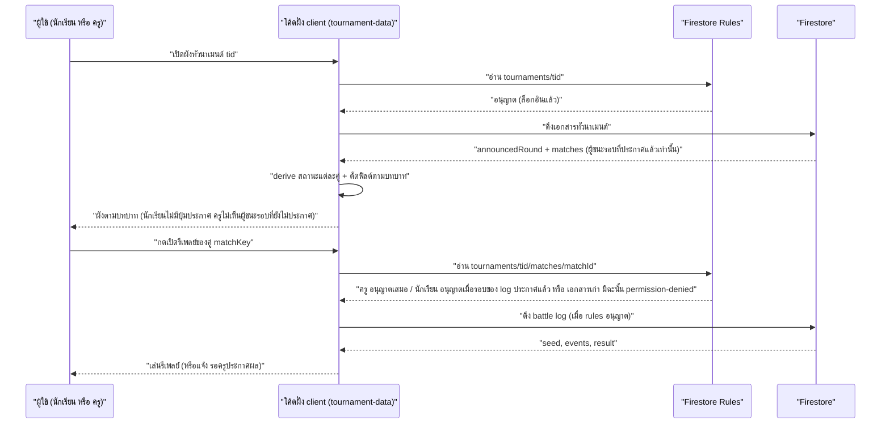

# DD-12 — ดูผังและรีเพลย์ทัวนาเมนต์ตามบทบาท

- **Feature:** FE-31, FE-43 (ผูกไปก่อน — ดู G-DB-13/G-API-14) | **Journey:** UJ-03 | **Endpoint:** API-66 (`GET /api/v1/tournaments/{tournamentId}`), API-70 (`GET /api/v1/tournaments/{tournamentId}/matches/{matchKey}/replay`) + Firestore rules ของ `tournaments/**` (database-schema 3.1 (ค)/(ง))
- **Acceptance Criteria ที่ต้องทำให้ผ่าน:** AC-FE-31-3, AC-FE-31-4, AC-FE-31-5, AC-FE-31-6, AC-FE-31-7, AC-FE-31-10, AC-FE-31-11, AC-FE-31-12, AC-FE-31-15 (ส่วนผังไม่มีแชมป์), AC-FE-31-19 (ผังไม่เปิดเผยตามเวลา), AC-FE-43-1, AC-FE-43-2
- **ต้นทางกฎ:** [[../../../01-requirements/01-spec/20261103-08-tournament-bracket-demo|spec 08]] หัวข้อ ง., ฌ. ข้อ 4, 5, 6, 7, 9, 11 · [[../database-schema|database-schema]] ENT-28~31 + หัวข้อ 3.1 · [[../api-spec|api-spec]] API-66, API-70
- **หมายเหตุสำคัญ:** แถบป้ายผู้ชนะที่หน้าจอรีเพลย์ซ่อนไว้จนเล่นจบ (F2 ใน `js/tournament-match.js`) เป็น **UX อย่างเดียว** ไม่ใช่การป้องกันความลับ — ด่านจริงคือ rules + โครงข้อมูลที่ไม่เคยเขียนผู้ชนะของรอบที่ยังไม่ประกาศลงเอกสารสาธารณะ (DD-10, DD-11)

## 1. Sequence Diagram



## 2. เงื่อนไขก่อนเริ่ม (Precondition)

- มี session ที่ valid (นักเรียนหรือครู) — นักเรียนทุกคนได้ข้อมูลชุดเดียวกัน ไม่ว่าจะลงแข่งหรือไม่
- มีเอกสาร `tournaments/{tournamentId}` ที่เป็นผังแบบ `matches` (ทัวนาเมนต์รุ่น 4 คนตายตัวแบบ semifinal/final ไม่มีผังนี้ — เปิดไม่ได้)
- รีเพลย์: มี `matchKey` ในผัง, คู่ไม่ใช่คู่บาย, คู่ต่อสู้แล้ว (`fought = true`) จึงมี battle log

## 3. ขั้นตอนการทำงาน (Pseudo Code)

```
=== A. อ่านผัง (API-66) ===
1. ไม่มี session -> คืน ERR-01
2. อ่านเอกสาร tournaments/{tournamentId}
   - ไม่มี (รวมถูกลบแล้ว) -> คืน ERR-18 (TOURNAMENT_NOT_FOUND)
   - ไม่มี map matches (รุ่น 4 คนตายตัว) -> คืน ERR-21 (TOURNAMENT_LEGACY_FORMAT)
3. legacy = เอกสารไม่มี field announcedRound
   effAnnounced = legacy ? roundCount : announcedRound        -- (BR-31: เอกสารเก่า = ประกาศครบทุกรอบ)
4. สำหรับแต่ละรอบ r และแต่ละคู่ m ใน r:
   announced(r) = (r <= effAnnounced)
   status(m):
     m.bye == true                              -> "bye"
     m.fought == false                          -> "waiting_fight"
     m.fought == true AND r > effAnnounced      -> "waiting_announce"
     m.fought == true AND r <= effAnnounced     -> "announced"
   winnerSlot ที่ส่งออก (ทั้งนักเรียนและครูเหมือนกัน):
     m.bye == true                              -> "slotA" (มีค่าตั้งแต่สร้าง)
     r <= effAnnounced                          -> ค่าที่เก็บไว้
     มิฉะนั้น                                    -> null เสมอ  (แม้เอกสารมีค่าอยู่ก็ห้ามส่ง — ป้องกันซ้อนชั้น)
   slotA/slotB: ส่ง { studentUid, studentName, speciesKey, stage } ตามที่เก็บ — **ตัด stats ออก** (G-API-18)
                ช่องรอบ >= 2 ที่ยังเป็น null ส่ง null (ช่องที่มาจากคู่บายมีชื่ออยู่แล้วตั้งแต่สร้าง — ส่งตามจริง)
   replayAvailable:
     นักเรียน: status == "announced" AND m.bye == false
     ครู     : m.fought == true AND m.bye == false     -- derive จากสิทธิ์ของ API-70 (ดู G-DD-11)
5. champion = (effAnnounced == roundCount) ? ผู้ชนะของ finalKey : null        -- BR-32
6. ฟิลด์เฉพาะบทบาท:
   - นักเรียน: **ไม่ใส่ field** needsTeacherDecision / canFight / announceableRound ใน response เลย (ไม่ใช่ false) -> ไม่มีปุ่มประกาศใน DOM
   - ครู: อ่าน results/{matchKey} ของคู่ที่ fought == true เพื่อคำนวณ
       needsTeacherDecision = (results.winnerSlot == null) ต่อคู่
       canFight             = (m.bye == false AND m.fought == false AND slotA != null AND slotB != null AND announcedRound >= r - 1) และ legacy == false
       announceableRound    = N = announcedRound + 1 ถ้า N <= roundCount และทุกคู่ปกติของรอบ N fought == true และไม่มีคู่เสมอค้าง
                              มิฉะนั้น null (legacy -> null: ไม่มีปุ่มประกาศสำหรับเอกสารเก่า)
     ผลลับ (winner ใน results/log) ห้ามนำไปใส่ response ของผัง — ครูเห็นผู้ชนะก่อนประกาศได้ทางเดียวคือเปิดรีเพลย์ (B)
7. คืนผัง (ไม่ใช้ข้อมูลเวลาในการตัดสินว่าจะเปิดเผยหรือไม่ — AC-FE-31-19)

=== B. อ่านรีเพลย์ (API-70) ===
1. ไม่มี session -> ERR-01
2. อ่านเอกสาร tournaments/{tournamentId}: ไม่มี -> ERR-18 · ไม่มี map matches -> ERR-21
3. ถ้าผู้เรียกเป็นนักเรียน (ตามลำดับนี้เท่านั้น):
   a. m = matches[matchKey]; ไม่มี -> ERR-19
   b. ถ้าไม่ใช่ legacy และ m.round > announcedRound -> คืน ERR-22 (ROUND_NOT_ANNOUNCED) ทันที
      **ก่อนตรวจว่าคู่ต่อสู้แล้วหรือยังเสมอ** (ไม่บอกรายละเอียดเพิ่มว่าคู่ยังไม่ถูกสู้)
   c. m.bye == true หรือ m.fought == false หรืออ่าน log (matches/{matchId}) ไม่เจอ -> ERR-19
   d. ผ่านทุกข้อ -> อ่าน battle log (rules ต้องอนุญาตด้วย — ดูหัวข้อ rules ด้านล่าง)
4. ถ้าผู้เรียกเป็นครู: ไม่ตรวจรอบ/ไม่ตรวจ announcedRound
   a. m ไม่มี / m.bye == true / m.fought == false / log ไม่เจอ -> ERR-19
   b. อ่าน battle log ได้เสมอ (AC-FE-43-1); การเปิดรีเพลย์ **ไม่แก้ข้อมูลใดๆ** สถานะรอบยังคง "ยังไม่ประกาศ"
5. คืน log { matchId, matchKey, round, engineVersion, seed, computedAt, sideA, sideB, result, events,
            teacherDecidedWinnerSlot }
   teacherDecidedWinnerSlot:
     นักเรียน: ถ้า matches.{key}.decidedByTeacher == true (เปิดเผยแล้วเพราะรอบประกาศแล้ว) -> matches.{key}.winnerSlot, มิฉะนั้น null
     ครู     : ถ้า results/{matchKey}.decidedByTeacher == true -> results.winnerSlot, มิฉะนั้น null

=== C. กฎของ Firestore rules (ด่านจริง — ต้องบังคับแม้ client ถูกเขียนใหม่/เปิด devtools) ===
- tournaments/{tid}                : read ได้เมื่อล็อกอิน · create/update/delete เฉพาะครู
- tournaments/{tid}/results/{key}  : read และ write เฉพาะครู -> นักเรียนอ่านตรง = permission-denied (AC-FE-31-6)
- tournaments/{tid}/matches/{id}   : write เฉพาะครู · read = isTeacher() OR (ล็อกอินแล้ว AND logReadable(tid))
    logReadable(tid) = (เอกสารแม่ไม่มี announcedRound) OR (log.round <= แม่.announcedRound)
    log ที่ไม่มี round ในทัวนาเมนต์ที่มี announcedRound -> ปฏิเสธ (ค่าเริ่มต้นปลอดภัย)
- (เสริม ไม่บังคับ) update ของครูต้องมี announcedRound ใหม่ in [เดิม, เดิม + 1] กันตัวนับลด/กระโดด
- ลำดับธุรกิจ (ต่อสู้ข้ามรอบ/ประกาศข้ามรอบ) rules บังคับได้จำกัด — บังคับที่โค้ดฝั่งครู (G-DB-19)
```

## 4. กฎธุรกิจและการตรวจสอบ (Business Rules & Validation)

| ID | กฎ | ค่าขอบเขต (ระบุ `>=` / `>` / `==` ให้ชัด) | ถ้าละเมิด |
|---|---|---|---|
| BR-28 | ผู้ชนะของคู่ปกติในรอบที่ยังไม่ประกาศต้องไม่ปรากฏใน response ของผังให้ผู้ใช้ทุกบทบาท (ครูเห็นได้ทางรีเพลย์เท่านั้น) และไม่ถูกเขียนลงเอกสารสาธารณะ | `round > announcedRound` -> `winnerSlot = null` (คู่บายยกเว้น) | ผิด AC-FE-31-4 / AC-FE-43-2 |
| BR-29 | สิทธิ์อ่าน battle log: ครูอ่านได้เสมอ (ไม่ขึ้นกับรอบ) · นักเรียนอ่านได้เมื่อ `round <= announcedRound` **หรือ** เอกสารไม่มี `announcedRound` | นักเรียน: ผ่านเมื่อ `log.round <= announcedRound` — ตัวอย่างขอบ: `announcedRound = 1` อ่าน log รอบ 1 ได้ (`1 <= 1`), รอบ 2 ไม่ได้ (`2 <= 1` เท็จ) | ERR-22 ที่ชั้นตรรกะ + permission-denied ที่ rules (AC-FE-31-5, 31-6, 31-11) |
| BR-31 | ทัวนาเมนต์ที่ไม่มี `announcedRound` นับว่าประกาศครบทุกรอบ — แสดงผลเหมือนเดิม นักเรียนอ่าน log ได้ ไม่มี `results/` ให้อ่าน ไม่ต้อง migrate | `effAnnounced = roundCount` | - |
| BR-30 | คู่บายแสดง `winnerSlot = slotA` และช่องรอบ 2 มีชื่อคนได้บายตั้งแต่สร้าง (ก่อนประกาศรอบแรก) — ไม่ถือเป็นการรั่วของผลการต่อสู้ ไม่มี replay | `bye == true` -> `status = "bye"`, `replayAvailable = false` | - |
| BR-32 | แชมป์ (`champion`) ปรากฏเมื่อ `announcedRound == roundCount` เท่านั้น (หรือเอกสารเก่า) ให้ผลเหมือนกันทั้งนักเรียนและครู | ประกาศรอบก่อนหน้าครบแต่ยังไม่ประกาศรอบชิง -> `champion = null` (AC-FE-31-15) | - |
| (เฉพาะ flow) | ไม่มีการเปิดเผยตามเวลา: ผลของผังขึ้นกับ `announcedRound` เท่านั้น ไม่ขึ้นกับนาฬิกา/วัน | ข้ามคืนก็ยัง "ยังไม่ประกาศ" (AC-FE-31-19) | - |
| (เฉพาะ flow) | "ซ่อน ไม่ใช่ disable": response ของนักเรียนต้องไม่มี `needsTeacherDecision`, `canFight`, `announceableRound`, ผลลับ, battle log ของรอบที่ยังไม่ประกาศ — นับปุ่มประกาศใน DOM ของนักเรียนต้องได้ 0 | จำนวนปุ่มประกาศของนักเรียน `== 0` (AC-FE-31-7) | ผิด BR-15-แนวเดียวกัน (ซ่อนที่ข้อมูล) |
| (เฉพาะ flow) | `stats` ของผู้เข้าแข่งไม่ส่งในผัง (ทั้งสองบทบาท) | - | ดู G-API-18 |

## 5. กรณีผิดพลาดและการรับมือ (Edge Case & Error Handling)

| ID | สถานการณ์ | ระบบต้องทำ | Status + ข้อความ |
|---|---|---|---|
| ERR-01 | ไม่มี session | ปฏิเสธ | 401 UNAUTHENTICATED — "กรุณาเข้าสู่ระบบใหม่อีกครั้ง" |
| ERR-02 | ไม่มีสิทธิ์: นักเรียนอ่าน `results/` หรือ battle log ของรอบที่ยังไม่ประกาศโดยตรงจากฐานข้อมูล (ไม่ผ่านหน้าจอ) | rules ปฏิเสธ (AC-FE-31-6) ทั้งนักเรียนที่ลงแข่งและไม่ลงแข่ง — ผัง/รีเพลย์เปิดให้ทั้งสองบทบาท จึงไม่มี FORBIDDEN_ROLE ที่ชั้น endpoint ของ flow นี้ (กรณีรอบยังไม่ประกาศใช้ ERR-22) | ระดับ rules: permission-denied (ตรงกับ ERR-02 ในความหมายของสิทธิ์) |
| ERR-22 | ไม่มีสิทธิ์: นักเรียนขอรีเพลย์ของรอบที่ยังไม่ประกาศ (`round > announcedRound`) — ตรวจก่อนสถานะ `fought` เสมอ | ไม่ส่ง log ไม่ส่งรายละเอียดเพิ่ม UI แสดงสถานะ "รอครูประกาศผล" แทน (AC-FE-31-5) | 403 ROUND_NOT_ANNOUNCED — "รอครูประกาศผลก่อน จึงจะดูรีเพลย์ได้" |
| ERR-18 | หาไม่เจอ: ไม่มีทัวนาเมนต์ (รวมถูกลบระหว่างเปิดดู — API-71) | ผังที่เปิดค้างต้องรีเฟรชแล้วแจ้งว่าไม่มี | 404 TOURNAMENT_NOT_FOUND — "ไม่พบทัวนาเมนต์นี้" |
| ERR-19 | หาไม่เจอ: ไม่มี `matchKey` / คู่ยังไม่ต่อสู้ / เป็นคู่บาย / ไม่มี log (ฝั่งนักเรียนตรวจหลัง ERR-22 เสมอ) | ไม่ส่งข้อมูล | 404 MATCH_NOT_FOUND — "ไม่พบรีเพลย์ของคู่นี้" |
| ERR-21 | ข้อมูลผิด: ผังรุ่น 4 คนตายตัว ไม่มี map `matches` | ไม่ render ผัง/ไม่เปิดรีเพลย์ (ไม่แสดงเป็นผังว่าง) | 422 TOURNAMENT_LEGACY_FORMAT — "ทัวนาเมนต์นี้สร้างด้วยระบบรุ่นเก่า เปิดผังในระบบใหม่ไม่ได้" |
| กดซ้ำ/ยิงซ้ำ (idempotency) | เปิดผัง/รีเพลย์ซ้ำกี่ครั้งก็ได้ | flow เป็นอ่านอย่างเดียว ไม่แก้ข้อมูลใดๆ ผลเหมือนเดิมทุกครั้ง (รวมครูเปิดรีเพลย์ก่อนประกาศซ้ำ — ไม่ทำให้รอบเปลี่ยนสถานะ AC-FE-43-1) | ไม่มี error |
| แย่งกันแก้ (นักเรียนเปิดผังพอดีกับครูกดประกาศรอบ N) | การประกาศเขียนผู้ชนะ + ผู้เข้ารอบ N+1 + `announcedRound` ในเอกสารเดียวพร้อมกัน (DD-11) | การอ่านเอกสารเดียวเห็น "ก่อน" หรือ "หลัง" ประกาศอย่างใดอย่างหนึ่งทั้งก้อน ไม่มีทางเห็นผู้ชนะโดย `announcedRound` ยังเป็นค่าเก่า หรือตัวนับขยับโดยยังไม่มีผู้ชนะ · ผังที่โหลดไว้ก่อนประกาศเป็นภาพเก่า ต้องรีเฟรชจึงเห็นผล | ไม่มี error |
| แย่งกันแก้ (นักเรียนกดรีเพลย์ของรอบ N ที่ประกาศไปแล้วขณะที่ผังของตนยังเป็นภาพเก่า) | ภาพเก่ายังไม่มีปุ่มรีเพลย์ จึงไม่เกิดกรณีนี้ผ่านหน้าจอ · ถ้ายิงตรง rules/ตรรกะอ่านค่า `announcedRound` ล่าสุดเสมอ | อนุญาตตามค่าล่าสุด | - |
| ระบบภายนอกล่ม (Firestore เชื่อมต่อไม่ได้) | ไม่มีข้อมูลให้แสดง | แจ้งผู้ใช้ให้ลองใหม่ ห้ามแสดงผังจากแคชที่อาจรั่วผลเก่าผิดสถานะเป็นผลใหม่ | ไม่มีรหัสใน api-spec — ดู G-DD-12 |
| เอกสารถูกแก้ตรงจนผิด invariant (เช่น มี `winnerSlot` ในรอบที่ยังไม่ประกาศ) | ส่งออกเป็น `null` ตามข้อ A.4 เสมอ ไม่เชื่อค่าที่เก็บ (ป้องกันซ้อนชั้น) | ไม่มี error |

## 6. การเปลี่ยนสถานะ (State Transition)

- ไม่มีการเปลี่ยนสถานะ — flow นี้อ่านอย่างเดียว (การเปิดรีเพลย์ของครูไม่เปลี่ยนสถานะรอบ AC-FE-43-1) · สถานะของคู่ (`waiting_fight` / `waiting_announce` / `announced` / `bye`) ถูก derive ใหม่ทุกครั้งที่อ่านจาก `bye`, `fought`, `round` เทียบ `announcedRound` · ตารางเปลี่ยนสถานะอยู่ที่ [[tournament-fight-match|DD-10]] และ [[tournament-announce-round|DD-11]]

สิทธิ์การมองเห็นตามสถานะ (สรุปสำหรับผู้เขียนโค้ด/ผู้ทดสอบ):

| สถานะคู่ | นักเรียนเห็นผู้ชนะ | นักเรียนเปิดรีเพลย์ | ครูเห็นผู้ชนะบนผัง | ครูเปิดรีเพลย์ |
|---|---|---|---|---|
| `waiting_fight` (ยังไม่สู้) | ไม่ | ไม่ (ไม่มี log -> ERR-22 หรือ ERR-19 ตามรอบ) | ไม่ | ไม่ (ไม่มี log -> ERR-19) |
| `waiting_announce` (สู้แล้ว รอประกาศ) | **ไม่** | **ไม่** (ERR-22 / permission-denied) | **ไม่** (AC-FE-43-2) | **ได้** (AC-FE-43-1) |
| `announced` | ได้ | ได้ | ได้ | ได้ |
| `bye` | ได้ (`slotA` ตั้งแต่สร้าง) | ไม่มี log (ERR-19) | ได้ | ไม่มี log (ERR-19) |
